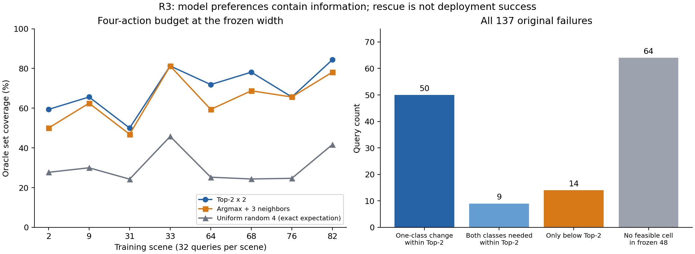

# EG 因果机制诊断 v2：第一阶段结果

**结论：支持“零质量几何监督适用域”成为唯一下一步因果试验；是否造成实际性能损害仍证据不足，方法开发维持 HOLD。** R1.1–R1.3、R2、R3 已完成。R1.4 微更新及 R1.5 短程训练未执行，不能把本报告当作有害更新或方法收益的证明。

本轮使用同一官方完整训练权重，覆盖8个训练场景、16帧。完成8,732个固定有效查询的原始标签溯源、16个真实训练路径批次求导、256查询的无GT坐标重编码与同预算网格分析。没有参数更新、新解析评价、C3新计算或C4/C5访问，没有修改旧结果、EG/G或Git。

## 1. 主线：零质量目标的语义问题得到确认

全部8,732个查询按原物体、点和方向精确回溯，未知为0。634个q_ref=0查询的48格过滤后全部为零；不是用近邻GT替代实际预测质量，也不是正质量量化为零。

|零质量来源，允许重叠|查询数 / 634|
|---|---:|
|原始48格没有正质量标签|80|
|场景碰撞排除了原本正质量格|311|
|宽度>100mm排除了原本正质量格|513|
|原始存在正质量，但所有过滤后无正质量格|554|

不能把80个非正原始标签进一步认定为“没有接触”；原始记录没有足够过程信息。宽度非零也不证明该格是可行抓法。

只改变48格的平局优先顺序，原物理几何和质量完全不动：循环置换使634/634的角度、深度目标及输出梯度改变，586个宽度目标改变；反序改变480个宽度目标。4,260个正质量唯一最大值控制全部不变。另有3,838个正质量并列最大值，单独报告，其目标也依赖平局规则。**这证明目标依赖实现约定，尚不证明原约定损害学习。**

原始参考宽度>100mm为298例，保存后的训练目标>100mm为293例。5次查询的100.269–100.961mm宽度被毫米整数截断为100mm；不是新增失配，也不是这些查询的正质量误筛。详细候选和原始网格见R1报告。

证据：[逐查询原始标签](label_semantics_trace.csv)、[平局目标与梯度](data/r1/tie_rule_gradients.csv)、[R1详细报告](r1/R1_summary.md)。源码：`dataset/generate_economic.py`过滤与max/gather、uint8保存链；`utils/label_generation.py`原ID映射；本轮`code/r1/label_semantics_trace.py`只读溯源。

## 2. 真正训练路径仍有这些目标，但分布与固定推理查询不同

|统计|原固定推理查询|本轮真实训练路径|
|---|---:|---:|
|有效查询|8,732|8,676|
|零质量目标|634（7.26%）|3,456（39.83%）|
|零质量目标中宽度为0|186（29.3%）|2,696（78.0%）|
|零质量目标中宽度>100mm|293（46.2%）|324（9.38%）|
|零质量预测已上界饱和|359（56.6%）|294（8.51%）|
|已饱和仍被宽度导数推向更大值|183|183|

真实训练路径开启官方增强、方向采样、net/view训练标志和PyTorch train，包括BN/dropout；使用B=1、FP32当前权重，只求导。零质量率按场景等权为39.79%，8场景bootstrap区间[34.57%,45.86%]；排除重复方向映射歧义后为3058/7675=39.84%。全部零质量角度／深度目标均为第0格。

零质量宽度梯度确实到达最终宽度层、宽度特征、attention及骨干；其骨干范数与正质量宽度梯度之比逐批中位数1.654，16/16批次大于1，余弦中位数−0.107。**梯度竞争不是有害更新证据。** 只有样本统计做了排除歧义复核，聚合梯度仍包含歧义查询。真实训练路径中，q0上限饱和率8.51%反而低于q+的15.92%；正质量样本也有431个饱和后继续增大的导数。另有793个零宽度q0落在下界，其导数把raw推回零，不能解读为继续恶化。固定推理查询的饱和富集不应外推为训练中的普遍现象。

不能把7.26%→39.83%解释为因果效应：两者的采样方向、查询和训练状态不同，也不是官方历史训练记录。真实训练路径中更突出的现象是零宽度目标，而非仅超宽饱和。BN临时状态已恢复、参数逐值未变；首帧同RNG重放的少量标签差异全部落在已知重复方向映射歧义内。

证据：[训练路径汇总](training_summary.md)、[场景表](training_scene_statistics.csv)、[逐批状态/梯度](data/training_path/)、[原宽度梯度表](width_diagnostics.csv)。源码：`models/loss_economicgrasp.py::compute_width_loss`、`models/economicgrasp.py::pred_decode`；本轮`code/training_path.py`保留原分母并保存RNG。

## 3. 坐标表示敏感，但没有稳定净收益

物理48动作集合完全一致、原宽度固定、邻居和上游特征不变；只把零角重编码为15°整数倍并同步回映射。历史预测与k=0重放均完全一致，物理集合误差<5×10⁻¹⁶。

|零角变化|可行 / 256|恢复 / 损害|净变化，场景95%区间|
|---|---:|---:|---|
|0°|119|0 / 0|基准|
|15°|120|20 / 19|+0.39pp [−6.25,6.64]|
|45°|130|29 / 18|+4.30pp [−1.95,10.55]|
|90°|114|21 / 26|−1.95pp [−7.03,3.52]|

约69%–73%的物理AD选择改变，说明坐标敏感性存在；原raw Top-1为12/16，新条件分别11/16、12/16、11/16，没有稳定改善。真实训练标签／推理基底还包含接近方向离散误差（中位4.51°），并非纯零角差；不能由此证明原基底有害。未事后挑选phi，未评价新宽度或完整后处理。R2机制的性能影响证据不足，方法HOLD。

证据：[R2报告](r2/r2_summary.html)、[逐查询](basis_reencoding_results.csv)、[不变量凭据](data/r2/)。源码：训练／推理基底选择与本轮`code/r2/probe_basis.py`局部xyz重编码。

## 4. 四格预算中模型偏好有效，多数恢复仍是单类别调整

256查询原可行119，Top-2×2覆盖178，随机4格精确期望78.01，保留原格＋随机3格139.99，预登记局部4格164，完整48格192。全部为Oracle覆盖上限，不能当作部署成功率。

Top-2×2比随机4格高39.06pp [33.38,44.83]，比保留原格＋随机3格高14.85pp [10.39,19.96]；比预登记邻居4格高5.47pp [2.73,8.59]。但16个raw Top-1中，Top-2×2和邻居4格均15/16。

59个可恢复失败中，50个只需改角度或深度之一，9个必须两者都改。严格“首选角度与深度分别可用、组合却失败”只有14/137，跨6场景。直接统一改用次选角度，恢复31／损害29；次选深度25／53；同时次选39／52。不能把全部59个恢复解释为联合头缺陷，普通分类不确定性仍是主要竞争解释。

64个全格失败只表示固定点／方向／旧宽度下48格无解。有效匹配其中30个，q0为13/30，对照有可行格组1/101；该关联没有排除几何及宽度混杂，不是宽度监督的因果证据。

证据：[R3报告](r3/R3_conclusion.md)、[逐查询联合结构](AD_joint_structure.csv)、[同预算冻结规则](r3/R3_manifest.json)。

## 5. 决策和下一步的唯一试验

|问题|机制判断|方法开发|
|---|---|---|
|零质量目标依赖任意平局且实际进入训练|支持|尚未证明有害；HOLD|
|坐标表示敏感|支持敏感性；有害根因证据不足|HOLD|
|Top-2偏好是否含信息|支持；联合不相容仅部分存在|HOLD|

**建议GO仅指进入R1.4因果微更新试验，不是方法立题GO。** 不增加新网络或评分器，不同时推进R2/R3训练。官方权重内确实保留Adam状态（152项，学习率2.44717×10⁻⁵），下一步应从同一原状态恢复，而不是用SGD或新Adam冒充官方更新。

具体待授权试验已写入[pulse_preregistration.json](pulse_preregistration.json)：8个预登记来源批次，两折场景留出；每分支1/5步，原始、移除q0宽度梯度、只保留其最终宽度层梯度、等量随机移除，以及三项对应的实际Adam步长匹配控制。最多280个独立分支内Adam步、131,072次逐姿态直接解析评价；不访问C3/C4/C5，不执行1000步短训、不提交Git。固定原分母，恢复参数/BN/优化器/RNG；新姿态重新评价，固定池与完整筛选、恢复与损害分别报告。不能超越数量／步长控制则不支持有害监督机制，不扩大预算追结果。

你提供的方案R1.4明确写道：“此阶段包括临时参数更新，需要额外执行授权。”因此本轮在完成第一阶段后停在该授权边界。[gradient_pulse_effects.csv](gradient_pulse_effects.csv)仅保留表头、没有虚构试验行；[执行凭据](controlled_update_receipts.json)明确记为未执行。

## 6. 证据边界

统计以场景为单位，只有8个场景；候选、旋转条件和48格不作为独立场景。训练集可能被基座见过，后续留出只能称适应留出。解析可行性不等于真实机器人成功率。本轮证明了实现语义与局部依赖，尚未测量受控参数更新后的实际抓取损害。所有旧标签、权重及历史结果保持原样。

输入：[执行前冻结协议](protocol_v2_frozen.json)、[用户原方案](plan_v2.md)。完整数据、代码、哈希清单与逐批凭据同目录保留。
