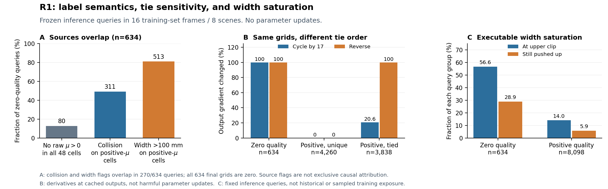

# R1：零质量姿态监督的语义与梯度适用域

**机制判断：支持“全零方向的代表 ADW 受平局约定支配，且该监督在真实训练路径中仍生效”；对“因此造成可行抓法学习受损”仍证据不足。方法开发：HOLD。** 下一步只考虑已设计的 R1.4 成对微更新，须额外参数更新授权；本轮没有训练或更新。

## 1. 标签精确溯源：零质量不是单一失败原因

8个训练场景、每场景帧0/128，共8,732个固定推理有效查询全部精确溯源，unknown=0。匹配关系保持冻结，按物体ID、原始点坐标的精确身份、方向与存储slot回溯，没有用最近离散GT替代预测姿态评价。

634个 q_ref=0 查询的完整48格**全部确为零**，不是微小正质量量化为零。554个方向原来有 μ>0 标签；其中468个在场景碰撞过滤后仍有 μ>0 格，随后全部被100mm宽度约束排除。其余86个方向的正μ格均有碰撞标记，80个方向原来就没有正μ标签。这是按既定过滤顺序的描述，不是互斥因果归因，μ>0也不等于满足主评价 μ≤0.4。

允许重叠的来源标记为：无原始正μ **80/634**、碰撞排除过正μ格 **311/634**、正μ格宽度超限 **513/634**，碰撞与超宽同时出现 **270/634**。原始μ≤0不足以继续区分无接触、摩擦不足等未记录原因。

全零后 `max(depth) → max(angle) → gather(width)` 固定选第0角度／第0深度，并携带该格的宽度。448个查询该格记录了非零宽度；**有几何宽度记录不等于该宽度代表一个可行抓法**。

## 2. 存储顺序干预与正质量控制

原序、左移17格、反序映射回原物理网格，分别在全零网格选格0、17、47，即AD索引(0,0)、(4,1)、(11,3)。点、方向、48格质量和物理动作集合均不改变；仅平局优先顺序变化。

| 群体 | n | 循环：AD/宽度/输出梯度改变 | 反序：AD/宽度/输出梯度改变 |
|---|---:|---|---|
| 全零质量 | 634 | 634 / 586 / 634 | 634 / 480 / 634 |
| 正质量、唯一最大值 | 4,260 | 0 / 0 / 0 | 0 / 0 / 0 |
| 正质量、最大值平局 | 3,838 | 791 / 720 / 791 | 3,838 / 2,590 / 3,838 |

AD一栏表示角度或深度任一改变。全零组循环干预与原始加权输出梯度的余弦中位数为−0.623；反序为+0.757。正质量唯一最大值控制全部不变；正质量平局单列，因为它们是在正质量目标支持的多个并列姿态之间选择，不能混作零质量语义缺陷。上述是固定输出上的梯度，不是参数更新，也不是损害证明。

## 3. 宽度：记录目标、原始输出与最终执行宽度不能混淆

原损失为 `SmoothL1(raw_width, 10*w_ref)`，单样本原始输出导数为 `clip(raw_width−10*w_ref, −1, 1)`，按原分母乘 `10/N_valid`。执行宽度为 `clip(1.2*raw_width/10, 0, 0.1)`。

| 固定推理有效查询 | q_ref=0，n=634 | q_ref>0，n=8,098 |
|---|---:|---:|
| 预测已到100mm上界 | 359（56.6%） | 1,134（14.0%） |
| 已到上界，梯度仍推动raw增大 | 183（28.9%） | 474（5.85%） |
| 平均绝对raw梯度 | 0.406 | 0.0783 |

零质量冻结宽度目标为：0mm 186个、>100mm 293个、其余155个；其中只有86个进入SmoothL1线性区。大损失不等于无限大梯度。场景等权上界饱和率差为+29.34个百分点，8场景bootstrap区间[16.06,41.44]；7/8场景方向相同，scene76略相反。scene31占零质量样本332/634，因此不能把634个候选当独立统计单位。

**298与293的差异已逐候选核验。** 原始被选宽度超过100mm有298个；其中以下5个查询的原始宽度位于100–101mm，保存时 `float32(width*1000) → uint8 → /1000` 截断为100mm，故冻结目标超限为293。5次查询来自3个不同物体—点—方向，均原始第0格μ=−1且无碰撞；不是5个额外的边界可行格被错删。

| 帧 / candidate ID | 物体 / 原始点 / 方向 | 原始宽度(mm) | 保存宽度(mm) |
|---|---|---:|---:|
| train_0002_0000 / 685 | 66 / 472 / 19 | 100.580245 | 100 |
| train_0002_0128 / 42 | 66 / 453 / 19 | 100.269139 | 100 |
| train_0002_0128 / 121 | 66 / 472 / 19 | 100.580245 | 100 |
| train_0002_0128 / 518 | 66 / 472 / 19 | 100.580245 | 100 |
| train_0064_0128 / 208 | 58 / 17 / 186 | 100.961469 | 100 |

这5例已从逐帧原始48格重新读取并复算量化；100mm的float32表示为0.10000000149m，分类时用同精度阈值，未把该浮点表示误当超限。

## 4. 真实训练路径：疑似监督存在，但构成与固定推理查询不同

当前权重下，16个预登记增强batch使用官方训练方向采样，`net.is_training/view.is_training/PyTorch train=True`，FP32，batch size=1，只求导。8,676个有效查询中零质量3,456（39.83%）；排除重复方向映射歧义后仍为3,058/7,675（39.84%）。全部零质量目标的角度／深度为(0,0)，8场景均出现。参数保持不变、BN缓冲恢复，无优化器。

但训练零质量目标中**2,696/3,456（78.0%）为零宽度**，超过100mm只有324；预测上界饱和294（8.5%），下界饱和793（22.9%）。因此固定推理查询的56.6%上界饱和**不能外推为训练时的主导暴露**，也不能把不同方向采样造成的39.8%对7.26%当成成对因果效应。

| 参数位置 | 零质量width梯度范数中位数 | 正质量width梯度范数中位数 | 两者余弦中位数 | 负余弦batch数 |
|---|---:|---:|---:|---:|
| 宽度末层 | 0.641 | 0.946 | -0.707 | 14/16 |
| 宽度特征 | 0.240 | 0.234 | -0.589 | 15/16 |
| 头部 attention | 0.208 | 0.209 | -0.461 | 15/16 |
| 骨干 | 0.367 | 0.183 | -0.107 | 13/16 |

这些梯度确实抵达共享表示，并常与正质量width方向相反；范数采用原有效样本分母和width权重10。但与其他损失的共享表示梯度余弦靠近零，且已汇总梯度包含方向映射歧义样本。负余弦不等于留出场景物理表现受损，更不是实际Adam更新。宽度末层没有其他损失的结构路径，数值消减残差不解释为额外梯度路径。

首次重放仅1个有效mask、3个ADWQ标签不同，均位于预记录的重复方向映射歧义集合；查询与采样方向一致。train/eval的下游模式对照也会改变输出，不能混为整网模式因果试验。上述是当前权重的16个batch核验，不能追溯官方每轮历史训练。

## 5. 可复核的候选实例

以下为三种过滤过程各按文件／候选顺序选择的首例，仅解释机制，不估计效果：

- **原始方向没有正质量标签：train_0002_0000，candidate 2**；物体 70、原始点 978、方向 144。48格中原始 μ>0 共 0 格，其中碰撞标记 0 格，碰撞后 μ>0 剩 0 格，再因宽度超限排除 0 格。三种遍历顺序的宽度目标为 **52 / 99 / 41 mm**，对应原始宽度输出梯度为 **-0.0767 / -0.5467 / +0.0333**。
- **场景碰撞清除了全部正摩擦标签：train_0002_0000，candidate 47**；物体 20、原始点 7、方向 232。48格中原始 μ>0 共 13 格，其中碰撞标记 13 格，碰撞后 μ>0 剩 0 格，再因宽度超限排除 0 格。三种遍历顺序的宽度目标为 **47 / 0 / 56 mm**，对应原始宽度输出梯度为 **+0.0341 / +0.5041 / -0.0559**。
- **宽度约束清除了碰撞后剩余标签：train_0002_0000，candidate 73**；物体 66、原始点 512、方向 19。48格中原始 μ>0 共 9 格，其中碰撞标记 0 格，碰撞后 μ>0 剩 9 格，再因宽度超限排除 9 格。三种遍历顺序的宽度目标为 **101 / 91 / 106 mm**，对应原始宽度输出梯度为 **+0.0243 / +0.1243 / -0.0257**。

三例的原始μ、宽度、碰撞、过滤后48格以及对应输出梯度完整保存于 [案例与量化核验](r1_examples_and_quantization.json)，直接对应 `data/r1/frames/train_0002_0000_raw_grids.npz` 中candidate 2/47/73。

## 6. 决策与证据边界

- **支持**：全零方向的代表ADW含任意平局约定；有符号的width梯度会进入共享表示；这些目标并非仅固定推理标签探针的人造现象。
- **尚不支持**：零质量监督已被证明造成EG实际失败，或删除这些监督一定更好；饱和与梯度冲突不足以完成该推断。
- **方法HOLD；R1.4值得作为唯一下一步**：原损失、仅去零质量width梯度、保留末层但阻断共享表示、等数量随机去width，并补实际步长控制。每臂从同一参数/BN/优化器/RNG出发，固定分母，仅用未参与更新样本的重新解析结果判断；需额外授权，当前未执行。

证据文件：[逐候选语义](../data/r1/label_semantics_trace.csv)、[存储顺序与梯度](../data/r1/tie_rule_gradients.csv)、[原始48格](../data/r1/frames/)、[宽度统计](../width_diagnostics_summary.json)、[真实训练路径](../training_summary.json)。代码路径为官方 `dataset/generate_economic.py` 的过滤与max/gather、`utils/label_generation.py` 的点/方向有效匹配、`models/loss_economicgrasp.py` 的有效掩码ADWQ损失；sidecar只读，未改原始标签或EG/G。
