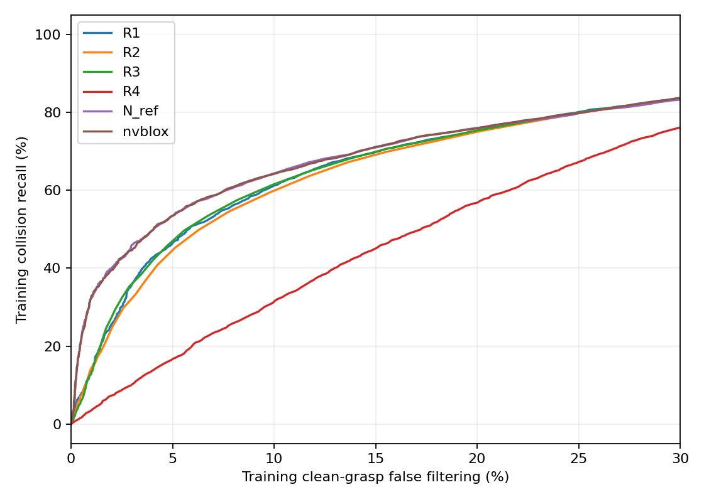
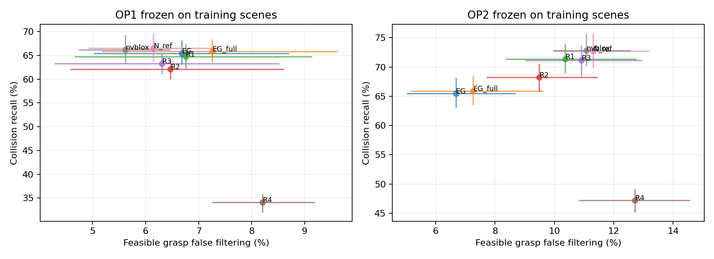

# N0：连续投影 N_ref 主检测器受控实验报告

日期：2026-10-24。**最终结论：STOP，停止把本轮场景SDF碰撞替换路线作为主方法继续推进。**

已完成48帧训练标定、48帧C3正式比较、48帧P2复核、致密GT碰撞审计、I1联合选角和完整后处理。N_ref能以接近的误过滤水平带来少量检测改善，但达不到原定相对EG +5个百分点、相对简单规则在两工作点均+2个百分点的门槛，也未把I1新增碰撞降到≤88。nvblox对照结论相近。

## 1. 协议变更、数据与冻结核验

用户在上一轮HOLD后明确将NumPy连续投影版升为主检测器，并要求完成N0。本轮建立独立目录；上一轮97.32%的连续—体素一致性及HOLD记录保持不变，不将其改写为通过。nvblox只作独立标定的对照。

| 面板 | 场景 / 帧 | 原候选 | 角度姿态 | 标签范围 |
|---|---:|---:|---:|---|
| 训练标定 | 12 / 48 | 2,028 | 24,336 | 直接姿态碰撞和空夹；未计算力闭合 |
| C3开发 | 12 / 48 | 1,229 | 14,748 | 已有直接姿态碰撞、空夹、力闭合标签 |
| P2复核 | 12 / 48 | 2,247 | 26,964 | 直接姿态碰撞和空夹；未计算力闭合 |

训练场景按原报告种子20261024抽取：67、4、50、56、14、65、62、30、45、1、96、71，帧0/64/128/192。C3沿用100、106、115、124、132、139、150、157、160、169、176、186及帧0/64/128/192；P2在同场景使用32/96/160/224。

训练与P2使用各帧原始最终候选池的全部候选；C3复用既定的1,229个干净、有力闭合解候选。三者候选构成并不完全同分布。P2仅检验碰撞检测方向，不能声称验证了摩擦改善或可行抓法误过滤。

官方完整EG仍为Kinect epoch-10，权重SHA256：`a47b717ad41870e9b34e85b1487de2a3f0f134ddc1a71a98a1b55bca7fc5804a`。新推理仅生成训练/P2冻结候选，未训练、未更新参数。

冻结配置SHA256：`16abd0cd1102ab75800633674424210dd5003dc7b0f0f46833b0af571176df72`。96份标定输入的SHA逐项核对通过；冻结时间早于首个C3正式结果。C3只使用这一套冻结配置，没有根据结果改变κ、阈值或规则。原O/B组完整后处理逐帧重放一致，74/44/3和164例集合也完全对应。

## 2. 检测器与标定

N_ref直接在夹爪采样点投影到深度图；nvblox在2.5mm体素中积分同一单帧深度。两者均使用10mm负向截断、2.5mm占据带上界和相同官方静态夹爪实体采样。风险为占据比例＋κ×未知比例，κ候选为0/0.1/0.25/0.5。输入仅为深度和内参；GT只用于标签、标定与离线I1/PCR，不作为新检测器输入。

简单规则全部使用完整有效深度点云：R1为EG占据比例调阈值，R2为EG分部件最大点数，R3为官方静态夹爪盒内点数，R4为官方夹爪表面采样到观测点的最近距离。另保留EG原检测器、完整深度但不改阈值的EG_full，避免把输入范围或几何变化误写成SDF收益。

标定EG误过滤率为10.55%，OP2预算为该值＋5个百分点。离散阈值无法精确匹配时，取不超过预算的最佳召回，不作随机混合。N_ref和nvblox均选择 **κ=0**；OP1/OP2的最佳简单规则均为 **R1**。这只说明给定κ网格与误过滤预算下没有选中未知惩罚，不能证明未知空间永远无价值。

| 工作点 | N_ref阈值 | nvblox阈值 | R1阈值 | N_ref标定召回 / 误过滤 |
|---|---:|---:|---:|---:|
| OP1 | 0.01462156 | 0.01496011 | 0.01039917 | 65.26% / 10.54% |
| OP2 | 0.00958807 | 0.00969828 | 0.00813358 | 71.65% / 15.54% |

## 3. C3正式碰撞检测结果

以下均为场景等权平均；置信区间按seen/similar/novel分层，对场景重采样10,000次。碰撞召回分母为非空碰撞姿态；可行误过滤分母为无碰撞、非空且0<μ≤0.4的姿态。没有把14,748个相关候选姿态当成独立样本。

| 方法 | OP1碰撞召回 | OP1可行误过滤 | OP2碰撞召回 | OP2可行误过滤 |
|---|---:|---:|---:|---:|
| EG | 65.45% | 6.68% | 65.45% | 6.68% |
| EG_full | 65.88% | 7.26% | 65.88% | 7.26% |
| R1 | 64.70% | 6.75% | 71.34% | 10.36% |
| R2 | 62.09% | 6.47% | 68.23% | 9.49% |
| R3 | 63.32% | 6.31% | 71.12% | 10.91% |
| R4 | 34.07% | 8.21% | 47.20% | 12.71% |
| N_ref | 66.55% | 6.15% | 72.72% | 11.30% |
| nvblox | 66.15% | 5.62% | 72.79% | 11.07% |
| 配对比较（百分点，95%场景区间） | OP1 | OP2 |
|---|---:|---:|
| N_ref − EG：碰撞召回 | +1.11 [-0.51, +2.69] | +7.27 [+5.81, +8.80] |
| N_ref − R1：碰撞召回 | +1.85 [+0.09, +3.78] | +1.38 [+0.16, +2.63] |
| N_ref − nvblox：碰撞召回 | +0.40 [+0.08, +0.71] | -0.07 [-0.36, +0.21] |

OP1下N_ref相对EG的可行误过滤变化为 **-0.53 [-1.94, +0.93]** 个百分点：点估计没有增加，但区间包含小幅增加，不能宣称已证明严格不增加代价。OP2的可行误过滤增加 **+4.62 [+3.63, +5.55]** 个百分点，较大召回改善伴随明确代价。

核心判断：OP1相对EG的召回改善不足5个百分点且区间跨零；相对最佳简单规则的改善在OP1、OP2均不足2个百分点。不能把OP2相对固定EG的较高召回称为等代价优势。

## 4. 121个残余碰撞、164个误过滤与致密GT审计

| 原残余碰撞类型 | 数量 | N_ref OP1检出 | N_ref OP2检出 |
|---|---:|---:|---:|
| 观测存在但原占据比例不足 | 74 | 19 | 33 |
| 原碰撞体缺少采样观测支持 | 44 | 0 | 0 |
| 原夹爪几何口径不一致 | 3 | 3 | 3 |

N_ref修复了部分阈值与几何口径问题；对原44个缺少观测支持的碰撞没有检出收益。此分类不等于严格遮挡真值。

原164个被EG误过滤的可行姿态，N_ref在OP1放回84个、仍过滤80个；OP2放回44个、仍过滤120个。这是旧错误集合的转换，不能代替全体可行姿态的净误过滤统计。

OP1全体2,470个可行角度姿态中，N_ref总共误过滤142个，其中62个为EG原来未误过滤的新错误；该计数与前述场景等权百分比口径不同。

OP2全体2,470个可行角度姿态中，N_ref总共误过滤262个，其中142个为EG原来未误过滤的新错误；该计数与前述场景等权百分比口径不同。

致密审计使用原始完整物体模型点云和2.5mm桌面体采样，沿用官方工作区口径；定义碰撞点进入静态夹爪实体至少1.25mm为稳健支持。它是更密的几何证据，不是真实机器人碰撞真值，也没有重新定义正式标签。

| N_ref相对EG（8mm官方标签上的碰撞） | 新检出 | 新检出中致密确认 | 新检出中稳健支持 | 原检出但新漏检 | 新漏检中稳健支持 |
|---|---:|---:|---:|---:|---:|
| OP1 | 455 | 455 | 434 | 365 | 354 |
| OP2 | 736 | 736 | 699 | 167 | 161 |

OP1新增检出的455个碰撞中，434个有稳健支持（95.4%），收益不是主要来自8mm边界离散误差；但它同时漏掉365个EG原能识别的碰撞，其中354个也有稳健支持。因此不能只展示新修复的碰撞。

## 5. 与I1联合选角及完整后处理

下表前三项以固定1,229个原干净候选为单位；“原可行受损”指641个原可行候选中变为不可行的数量。“碰撞”是选角后新增的非空碰撞；不是Top-50中的碰撞数。Top-1则来自完整1,024原始候选池重放碰撞过滤→NMS→每物体Top-10→Top-50。

| 工作点 / 组别 | 可行数 | 弱→可行 | 原可行受损 | 新增碰撞 | 无力闭合解 | 完整Top-1可行 / 碰撞 |
|---|---:|---:|---:|---:|---:|---:|
| OP1 / O | 641 | 0 | 0 | 0 | 0 | 20/48 · 8/48 |
| OP1 / B | 784 | 192 | 49 | 127 | 2 | 26/48 · 11/48 |
| OP1 / N | 787 | 200 | 54 | 130 | 5 | 28/48 · 10/48 |
| OP1 / N+ | 792 | 199 | 48 | 123 | 5 | 28/48 · 10/48 |
| OP1 / N_rule | 784 | 195 | 52 | 127 | 2 | 27/48 · 11/48 |
| OP1 / E | 864 | 228 | 5 | 0 | 3 | 32/48 · 0/48 |
| OP1 / O_N | 641 | 0 | 0 | 0 | 0 | 22/48 · 7/48 |
| OP2 / N | 780 | 194 | 55 | 116 | 5 | 27/48 · 10/48 |
| OP2 / N+ | 786 | 194 | 49 | 107 | 5 | 27/48 · 10/48 |
| OP2 / N_rule | 779 | 188 | 50 | 119 | 3 | 27/48 · 10/48 |
| OP2 / O_N | 641 | 0 | 0 | 0 | 0 | 21/48 · 7/48 |

O=原EG；B=I1＋EG；N=I1＋N_ref；N+=I1＋Rc/Rs＋N_ref；N_rule=I1＋冻结最佳简单规则；E=I1＋GT碰撞过滤；O_N=不改原角度，仅替换碰撞检测器。各组在上述干净候选子集均未新增空夹。

OP1的N保留了摩擦恢复：200个弱抓法恢复，但新增碰撞130个，未优于B的127个，更未达到≤88目标。N+为123个；OP2收紧过滤后N/N+降至116/107个，仍不达标，并损失部分可行数。

按场景等权，OP1的N相对B可行率变化为+0.46个百分点，95%区间[−0.20,+1.11]；N+为+0.89[+0.22,+1.60]。后者有小幅离线收益，但规模和碰撞门槛不足以支持本路线。

摩擦档位的均值变化只在新旧姿态都干净且有力闭合解的配对子集上报告；碰撞与无解不能因μ编码为−1而被当成改善：

| OP1组别 | 有效μ配对数 | 平均μ变化 |
|---|---:|---:|
| B | 1100 | -0.1144 |
| N | 1094 | -0.1170 |
| N+ | 1101 | -0.1163 |
| N_rule | 1100 | -0.1138 |
| E | 1226 | -0.1181 |

额外直接解析评价了新晋Top-10中的 **188** 个既有原始候选，未使用最近离散GT替代。所有组Top-1均已知。Top-50较低排名仍有未计算力闭合的干净候选，例如OP1 O/N/N+/O_N的未知条目总数分别为0/319/317/84，因此不声称完整Top-50的精确力闭合可行总数。逐帧未知标记已保留。

B、N、N+、N_rule、E使用GT辅助I1或PCR，是离线选角实验；不能写成已训练模型的姿态生成收益。O_N仅替换观测型检测器，OP1 Top-1从20增到22、碰撞8降到7，但只有48帧且上游EG仍使用GT分割辅助工作区裁剪，不能称为已证明完全无GT的部署收益。E的完整后处理此次使用GT碰撞检测，所以其Top-1不能与旧轮“E选角后再用EG过滤”的数值直接混用。

## 6. P2复核

| 工作点 / 方法 | 碰撞召回 | 干净、非空误过滤 |
|---|---:|---:|
| OP1 / EG | 56.24% | 7.74% |
| OP1 / R1 | 55.71% | 7.96% |
| OP1 / N_ref | 57.43% | 6.52% |
| OP1 / nvblox | 57.28% | 6.47% |
| OP2 / R1 | 62.98% | 11.61% |
| OP2 / N_ref | 64.48% | 10.74% |
| OP2 / nvblox | 64.75% | 11.03% |

OP1 N_ref相对EG的召回变化为 **+1.19 [-0.14, +2.52]** 个百分点，干净误过滤变化为 **-1.21 [-2.26, -0.18]**。与C3一样呈现小幅检测改善方向，召回区间仍跨零。相对R1的优势同样未达2个百分点；不能把P2解释为达到了主门槛。

## 7. 效率、局限与最终判断

C3每帧处理角度变体加完整原始池，N_ref采样＋查询耗时中位数0.762秒、P95 0.962秒，检测器本身不用GPU；nvblox采样＋积分＋查询中位数0.999秒、P95 1.278秒，A100进程显存记录范围1130–1628 MiB。计时不含EG前向、GT评价或完整后处理；服务器存在并发负载，不作为严格速度优劣基准。N_ref计时复算48帧与正式分数逐项相同，仅测量耗时，没有再次选参。

P2的nvblox任务在另一服务器因缺少libnppc.so.12未能启动，后改到已验证A100环境完成，算法配置未改。所有训练、C3、P2的nvblox正式结果均来自相同环境。

**STOP理由：** OP1召回优势未达+5个百分点且区间跨零；相对简单规则两工作点均未达+2个百分点；I1新增碰撞仍远高于≤88。其余通过项包括保持恢复数量、原可行损害门槛、O_N Top-1未退化、P2方向一致，以及新增检出主要有致密GT支持，但不能抵消未通过的核心门槛。

**最终回答：连续投影场景几何提供了小幅有效信息，能保留I1的摩擦改善，却不能在原定误过滤代价下显著优于EG及简单规则，也未解决I1的碰撞副作用。nvblox没有改变这一判断。** 已观察到的改进属于已有碰撞表示和后处理技术移植；本轮没有支持独立论文主方法的证据，不继续更换同类碰撞库寻找提升，也不据此启动训练。

仅12个开发场景，C3/P2共享物体与场景且候选构成不同；所有成功定义仍为解析力闭合，不是真实机器人成功率。未访问C4/C5，未修改EG、EG-B、G、权重或历史结果。

## 8. 交付

`frozen_config.json`及SHA、`integrity_audit.json`、`statistics.json`；逐姿态`per_pose/`；逐候选`selected_candidates.csv`；逐场景检测统计与配对区间；74/44/3及164例转换；`dense/`审计；`joint/`完整后处理及新补标签；两张权衡图、逐帧效率与复现代码。大型原始缓存和环境留在服务器，轻量结果及代码上传新Git分支。
