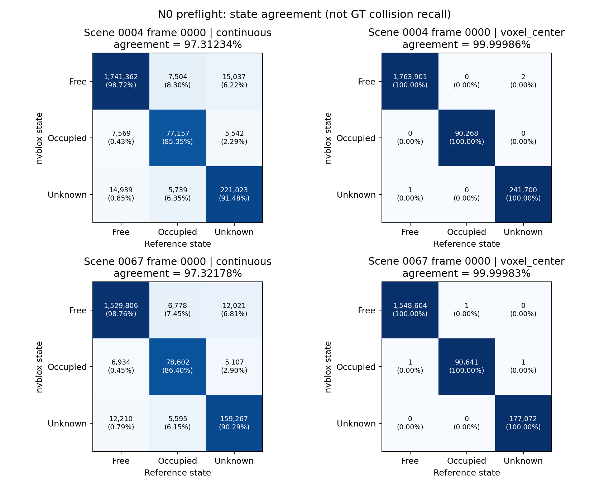

# N0：nvblox 单帧 TSDF 前置核验报告

日期：2026-10-24。结论：**HOLD，按原 99% 门槛停止本轮。**

本轮实际完成环境、源码来源、合成平面和两个训练帧的实现核验。连续投影参考的一致率没有达到原目标。用户在看到两种口径的结果后明确选择“保持原门槛，HOLD并提交本轮证据”。没有把体素中心对齐结果替换成原门槛的通过结果。

## 1. 关键结果

| 训练场景 / 帧 | 查询点数 | 与连续投影参考一致率 | 不一致点数 | 与相同体素中心参考一致率 | 残余不一致点 |
|---|---:|---:|---:|---:|---:|
| 0004 / 0000 | 2,095,872 | 97.31234% | 56,330 | 99.99986% | 3 |
| 0067 / 0000 | 1,816,320 | 97.32178% | 48,645 | 99.99983% | 3 |

两帧均未达到直接投影一致率 ≥99% 的原目标。每帧固定选择原始候选 ID 0、16、…、1008，共 64 个候选，展开全部 12 个角度；合计 128 个候选、1,536 个姿态、3,912,192 个夹爪体采样点。没有依据 GT 碰撞或质量筛选样本。

总体约 2.68% 的分类差异不能简单视作无关噪声：在连续参考判作“占据”的点中，nvblox 同样判为占据的比例分别仅为 **85.35% / 86.40%**。这只是两种表示的状态一致性，**不是 GT 碰撞召回率**，不能换算为抓法漏检率。

## 2. 实现与来源核验

- nvblox 来源为官方 v0.0.10 发布资产，体素 2.5 mm、截断 10 mm、占据带上界 ε=2.5 mm，raycast_subsampling_factor=1。每帧创建新地图，积分一次；相机坐标系作为世界坐标系。最大积分深度固定为 7 m，不参与调参。
- 检测输入只有完整有效深度图与内参，meta 文件仅读取 intrinsic_matrix、factor_depth。没有把 GT 分割、物体网格、物体姿态或碰撞标签输入 TSDF。
- 按官方静态夹爪左右手指和掌部三个盒体，在各方向使用不超过 2.5 mm 间距的内部采样点。位置、接近轴、深度、宽度和分数固定，仅展开 12 个角度。
- 三态定义：权重大于零且 TSDF>ε 为自由；权重大于零且 TSDF≤ε 为占据；权重为零为未知。未知不被当成自由；本阶段未选择 κ 或碰撞风险阈值。
- NumPy 参考独立实现相机投影、按像素取深度和截断，使用官方源码的 floor 像素索引约定。分别计算原始查询点与 `floor(p/voxel_size)+0.5` 对应的体素中心，两个结果均保留。
- 合成平面检查通过：表面前、表面带、表面后截断带内、截断带后四点的状态依次为自由、占据、占据、未知。

官方代码对投影距离采用“测得深度 − 体素深度”，负向超过截断距离则不积分；查询返回所属体素的值。因此连续点与体素中心的比较不是相同计算位置。对齐后两帧都超过 99.9998%，**强烈支持本次主要分类差异来自体素离散，而非普遍的坐标或符号实现错误**。但这不消除原始点位下的差异，也不证明其对抓取决策没有影响。仍存在每帧 3 个体素对齐状态差异；同为已观测点的最大 TSDF 数值差分别为 2.5 mm 和 11.0 mm，未把“分类几乎相同”表述为“数值逐点相同”，本轮未继续扩大异常定位。

源码依据：[v0.0.10 投影 TSDF 实现](https://github.com/nvidia-isaac/nvblox/blob/v0.0.10/nvblox/include/nvblox/integrators/internal/cuda/impl/projective_tsdf_integrator_impl.cuh)、[相机深度插值](https://github.com/nvidia-isaac/nvblox/blob/v0.0.10/nvblox/include/nvblox/sensors/internal/impl/camera_impl.h)、[体素查询实现](https://github.com/nvidia-isaac/nvblox/blob/v0.0.10/nvblox_torch/cpp/src/sdf_query.cu)。

### 版本记录

| 资产 | 标识 |
|---|---|
| 官方完整 EG Kinect epoch-10 权重 SHA256 | a47b717ad41870e9b34e85b1487de2a3f0f134ddc1a71a98a1b55bca7fc5804a |
| nvblox v0.0.10 标签提交 | c457c3fc01003bec6eba3ec1c61e6bf84bc3f51f |
| 官方发布 wheel 自报提交 | e4a2b00f45ecf989682d72a33a2c29defe39fd2d |
| wheel 自报版本 | 0.0.10.dev1+cu12ubuntu22 |
| TSDF 环境 | Python 3.10.22、PyTorch 2.9.1+cu126、Open3D 0.18.0 |
| 本次 TSDF GPU | NVIDIA A100-SXM4-40GB |

发布 wheel 的提交与标签不同，不能声称二者完整仓库逐字节相同。实际比较 `nvblox/include`、`nvblox/src`、`nvblox_torch` 三个目录，差异文件数为零；其余差异清单及关键源码 SHA 见 `source_manifest.json`。下载使用官方发布资产 URL，没有使用不明第三方构建。

新 venv 位于独立诊断目录，安装只写入新环境；它允许只读继承已有基础包。EG 冻结推理仍使用原环境和权重，TF32 设置沿用历史。新环境解决了发布 wheel 与原 PyTorch 的 ABI 差异，以及 Open3D 系统库兼容问题；没有替换 EG 环境中的包。两帧候选各有输入文件、权重、缓存 SHA 记录。

注意：候选生成仍沿用 EG 原有的 GT 分割辅助工作区裁剪。**TSDF 检测器未使用额外 GT，不等于整个 EG 流水线已经无需 GT。**

## 3. 固定面板与实际执行边界

原调研报告的抽样规则已找到并落实：种子 20261024，从训练场景 0–99 排除 2/9/31/33/64/68/76/82 后无放回抽取 12 个场景。顺序为 **67、4、50、56、14、65、62、30、45、1、96、71**；计划帧为 0/64/128/192。

实际只执行其中 67/0000、4/0000 两帧。环境准备和 EG 两帧推理在不同服务器并行，TSDF 核验在空闲 A100 上执行。没有训练或参数更新。

**以下均未执行：** 48 帧标定、OP1/OP2 参数选择与冻结、C3 正式比较、74/44/3 残余碰撞转换、164 个误过滤姿态分析、致密 GT 审计、P2 复核、I1 联合选角和完整后处理。因此也没有生成这些步骤的伪占位指标或置信区间。未访问 C4/C5，未修改历史数据。

## 4. 时间、统计与证据限制

两帧单帧 TSDF 积分分别约 **0.391 / 0.386 秒**，查询累计约 **0.113 / 0.104 秒**；这是实现检查的局部耗时，不包含点采样、EG 推理、完整检测及后处理，不能当成端到端速度。保存的 PyTorch 显存统计不覆盖 nvblox 自有 CUDA 分配，因此不报告其为完整显存峰值。

本轮是两个固定帧上的确定性实现检查，数百万查询点高度相关。没有用查询点数制造统计显著性，也没有以两个场景给出碰撞收益的场景 bootstrap 区间。结果不足以外推所有训练场景或 C3。

## 5. 科研结论

**本轮只能给出实现验收层面的 HOLD，不能给出碰撞方法层面的 GO-N 或 STOP。**

目前尚不能回答 nvblox 是否在不增加误过滤的情况下优于 EG 或简单规则，也不能回答它能否保留 I1 的摩擦改善。我们得到的实证是：固定 2.5 mm 体素时，连续查询点与体素表示之间的三态差异超过原定容差；统一体素中心后实现基本一致。用户已决定保留原门槛，故本轮到此结束。

如果未来重启，需要先重新明确“离散表示允许的误差”与实现验收口径，重新登记后再决定是否标定；本轮不降低门槛、不修改参数、不另换库寻找收益。TSDF 碰撞检测本身属于已有技术移植；本次没有产生独立方法创新或真实抓取收益的证据。

## 6. 交付索引

- `decision.json`：HOLD 决定、已完成和未执行阶段。
- `protocol.json`：固定面板和数值设置。
- `preflight/*.json`：逐姿态一致率、三态计数、混淆矩阵和残余差异案例。
- `per_pose_preflight.csv`：1,536 行逐姿态结果；`frame_statistics.csv`：两帧统计。
- `preflight_confusion.png`：两种比较口径的混淆图。
- `runtime.json`、`source_manifest.json`、`export_manifest.json`、`cache/*.json`：来源与 SHA。
- `infer_frozen.py`、`proj_sdf_ref.py`、`check_nvblox.py`、`analyze_preflight.py`：冻结推理、参考实现、核验和汇总代码。

大型权重、输入点云缓存、环境、源码检出和安装包留在独立服务器目录，不进入 Git。轻量证据和代码提交新分支；Git 归档清单给出实际上传范围。
