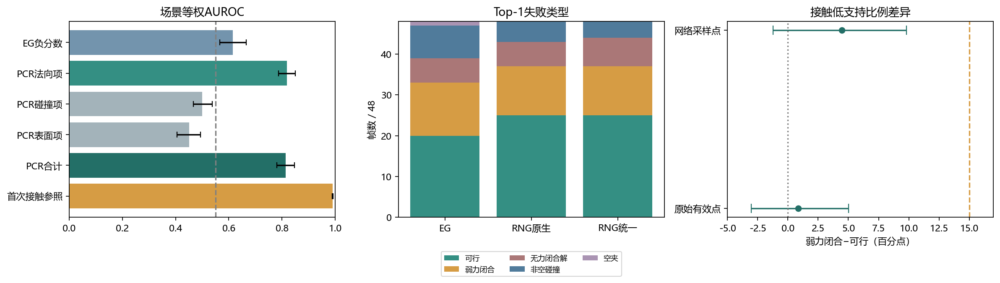

# EG力闭合可靠性：R0预验证报告

2026-10-24 · 固定C3 12场景×4帧 · 零训练、无参数更新

**联合判断：HOLD——PCR包含明确有效的物理信息，目标错误跨检测器存在；但不建议把原PCR原样加入EG直接启动训练。主要障碍是EG原始角度／深度硬解码的梯度不连通，以及指尖代理与首次接触判据的明显差距。可观测性目前不是必须增加的研究因素。**

本轮没有停止PCR物理信息路线，也没有开发替代模块。信息有效性达到GO门槛；“原样即可训练”的实现前提尚不满足。

## 1. 实验重放与范围

- 主面板严格为100、106、115、124、132、139、150、157、160、169、176、186，每场景帧0/64/128/192；未读取C4/C5或全C3。
- 官方完整训练EG Kinect epoch-10，历史Top-1为20可行、13弱力闭合、6无力闭合解、8非空碰撞、1空夹；最终2,274候选标签完整。主要二分类仅包含641可行＋588弱力闭合，共1,229候选。
- 48份解析评价文件SHA完全一致；服务器缓存多出input_points/input_seg/input_colors，本地是精简导出，整包SHA不同。两端共有字段逐数组SHA全部一致，包括预测、候选ID、分数、角度／深度、宽度、权重SHA及碰撞掩码，详见replay_field_sha_audit.json。
- 所有候选继续使用原解析档位及0<μ≤0.4可行标准；碰撞、空夹、无力闭合解、未知分开记录。不把解析可行率称为机器人成功率。
- 全部指标先按场景计算；在seen/similar/novel各4场景内bootstrap 10,000次，区间为95%。仅描述此固定开发面板，不将候选数作为独立样本量。

最终覆盖核验：2,274个最终候选的RA/RC/RS/PCR全部计算完毕，保存在eg_all_final_PCR.csv；碰撞、空夹和无力闭合候选未混入1,229个主要二分类样本。主分析需要56物体SDF，补齐完整候选池共59物体。扩大同批计算后的float32分组差异最大5.7×10⁻⁷，主统计保持最初完整主样本结果。服务器48份原始完整缓存与历史生成receipt的SHA也全部一致，精简导出差异已解释。

## 2. R0-1：PCR物理代理

按官方代码提交45fdb5f533f97588666f95ece2d8a6c9bb7f980a复现。令左右指尖c±=t+R(d−0.002, ±w/2, 0)，u由左指尖指向右指尖，sL/sR为外正内负SDF，nL/nR为对应外法向：

- RA = 0.5(1−cos(−u,nL)) + 0.5(1−cos(u,nR))。
- RC = ReLU(0.005−sL) + ReLU(0.005−sR)。这是指尖5mm外侧余量约束，不等于官方完整夹爪碰撞分类。
- RS = ReLU(sL−0.020) + ReLU(sR−0.020)。
- 主风险直接采用RA+RC+RS，不拟合权重、不反转某一项方向。上述为逐候选风险，未乘原训练代码的有效标签掩码和归一化预测分数，以免把EG评分重新混入待检验代理。官方额外计算的宽度正则未加入其最终PCR损失，本次亦未加入。

几何使用既有nontextured.ply，仅生成涉及的56物体SDF，遵循官方采样脚本的30mm padding、最长轴约128格及surface_point_method=sample，固定物体级随机种子。SDF三线性采样保持官方align_corners=False及border padding，世界／物体坐标双向变换与宽度单位均为米。原预测宽度与1.2×raw_width/10及截断逐值核对。

几何核验：1,229对解析接触处最大绝对SDF的中位数为0.338mm，最坏1.118mm；无零法向，18候选至少一侧指尖越出SDF网格。主分析保留它们；剔除越界的敏感性AUROC为0.830，不能将此筛选当因果改进。

|风险（越高越可能弱力闭合）|AUROC [95%区间]|PR-AUC/AP [95%区间]|Spearman与μ|
|---|---|---|---|
|EG_risk|0.615 [0.567, 0.665]|0.654 [0.615, 0.695]|0.196 [0.109, 0.282]|
|RA|0.818 [0.787, 0.850]|0.766 [0.719, 0.804]|0.567 [0.512, 0.622]|
|RC|0.500 [0.467, 0.537]|0.535 [0.481, 0.591]|0.007 [-0.057, 0.081]|
|RS|0.452 [0.406, 0.493]|0.531 [0.474, 0.594]|-0.084 [-0.152, -0.022]|
|PCR|0.814 [0.781, 0.846]|0.763 [0.714, 0.802]|0.559 [0.503, 0.615]|
|first_contact_risk|0.990 [0.988, 0.992]|0.992 [0.989, 0.994]|0.936 [0.927, 0.944]|

PR-AUC采用average precision定义。主指标为场景等权，不是候选池化AUROC。

PCR相对EG负分数的场景配对AUROC差为0.199 [0.143, 0.255]。主要信息来自RA，RC约为随机水平，RS对本目标没有正向判别力；这不否认RC/RS可能用于其他失败类型。

同帧同物体中共有538对“EG高分弱抓法—低分可行抓法”。PCR配对正确率为0.820 [0.761, 0.876]，首次接触参照为0.979 [0.968, 0.990]；平局记半分。这些是EG已错排的条件样本，EG在其中为0是定义所致，不是无条件性能。

13个弱力闭合Top-1中，9个在最终池有同物体可行替代；这9个均至少存在一个PCR风险更低的可行替代。它是互补信息的存在性见证，不等于PCR实际重排必然救回9例，更不等于训练收益；剩余4例不具有该最终池同物体对照。

代表案例：scene100/frame64的失败ID606（μ=0.6）PCR=0.00794，同物体可行候选中最低PCR=0.00196；scene176/frame64的失败ID308，PCR=0.16379，同物体可行候选最低0.06311。逐案例见weak_top1_complement.csv；反向配对错误也完整保存在inversion_pairs.csv，未只挑成功案例。

首次接触参照使用解析评价器close_fingers恢复的真实双接触法向，AUROC显著高于PCR，场景配对差0.176 [0.144, 0.209]。它与力闭合标签使用同源GT接触，近似诊断oracle，不是公平的可部署竞争方法；其高分不能包装成新原理。该差距支持指尖局部法向未完全对应闭合后接触，而非证明PCR毫无价值。

### 梯度健全检查（未更新参数）

全部1229候选的宽度和连续转角局部梯度检查有限；原EG角度分类和深度分类梯度在所有检查组均不连通。首帧还逐项记录RA/RC/RS梯度。RA对连续转角有效，但对宽度基本只是数值舍入量；RC/RS可在激活时影响宽度。

原因是EG原始预测角度／深度通过硬argmax取类别。PCR可微的连续姿态公式不等于可穿过该离散选择。官方SDF法向计算还保持默认create_graph=False，本次未悄悄改成二阶反传或软解码。连续转角检查是局部诊断变量，不是新预测头。由此不能把最有判别力的RA直接当成现有EG角度训练的有效约束。

PCR也有明确反例：scene100/frame0同物体48，弱抓法ID628（μ=0.6）的PCR=0.02768，反而低于可行ID463（μ=0.4）的0.05412。538对错排中PCR纠正442对、仍错96对；这些配对涉及274个不同弱候选，不能把538对视作独立实验。

## 3. R0-2：RNGNet跨检测器核验

使用官方RegionNormalizedGrasp提交25a60d0a4232e9e6061193200837dc4f8a18a508及公开Kinect权重，模型严格加载全部学习参数并冻结推理。仅移除检查点中的total_ops/total_params性能计数器；原权重文件未改。适配代码只跳过无用GT监督读取、选择固定面板、调整输出路径和移除MAC计数，前向与姿态解码保留官方实现。独立依赖环境为PyTorch2.5.1/CUDA12.1、PyTorch3D0.7.7，与论文原环境并非逐版本相同；首帧重复预测逐值一致。

原生脚本未开启可见碰撞过滤；原生列保留这一设置，再接受官方解析NMS/每物体10/Top50评价。统一列使用与EG相同的完整工作空间点云、5mm voxel、5cm approach、0.01 collision阈值及3cm/30° NMS。48帧均精确重放EG历史CD掩码。RNGNet输出20,565原始候选，独立评价最终池并集，未移用EG标签；最终评价未知为0。

|指标|EG统一面板|RNGNet原生|RNGNet统一|
|---|---:|---:|---:|
|Top-1可行|20/48|25/48|25/48|
|弱力闭合|13|12|12|
|无力闭合解|6|6|7|
|非空碰撞|8|5|4|
|空夹|1|0|0|
|弱力闭合场景／物体覆盖|6/7|7/8|7/8|
|弱Top-1有同物体可行替代|9/13|10/12|9/12|
|干净FF@10：仅弱力闭合|31.04%|27.50%|27.08%|
|干净FF@10：弱＋无力闭合解|49.58%|44.38%|43.75%|

FF@10取最终池内按原分数排序的前10个无碰撞、非空候选；不足10时用实际数量，逐帧分母已保存。两模型候选生成数量和架构不同，此处不是同预算性能竞赛。RNG统一Top-1可行率95%区间35.4%–68.8%，弱FF@10区间19.0%–35.0%。本轮支持错误跨架构存在，不证明PCR方法跨模型泛化。

## 4. R0-4：接触可观测性

1,229候选全部成功恢复两侧首次接触，缺失0。比较原始depth>0的有效观测点和EG缓存的20,000采样点；后者来自工作空间点云，二者的点密度和空间筛选范围均有差别，不把距离差全归因于采样。最近邻包含其他物体或桌面，故只称观测支持，不称遮挡真值。

|点云|可行组>10mm|弱组>10mm|场景等权差及95%区间|弱组更高的场景|
|---|---|---|---|
|原始有效点|129/641（20.1%）|122/588（20.7%）|+0.86pp [−3.05,+5.03]|5/12|
|网络采样点|196/641（30.6%）|192/588（32.7%）|+4.47pp [−1.22,+9.79]|8/12|

在69个同时有可行和弱抓法的场景—物体组内再控制物体，场景等权差约+0.36pp/+3.76pp。按场景、物体和μ档位的完整统计与≤5/5–10/>10mm分组均已保存。没有达到预设15pp门槛，不支持为本目标额外增加可观测性／不确定性模块。

距离与风险的场景等权Spearman：原始点支持距离与μ为0.040 [−0.033,0.105]，与PCR为0.088 [0.051,0.126]；采样点对应为0.022 [−0.057,0.098]和0.067 [0.039,0.098]。后两者虽有小幅相关，但量级弱，不能据此声称观测不足解释了摩擦失败。

## 5. R0-3：GraRe仅资产核实

按用户后续授权，本轮不执行GraRe。官方仓库有eg_kinect配置（融合λ=0.8）及93,999,433字节公开权重，需对象上下文和MobileSAM准备。已保存代码版本、配置和权重索引；没有把论文指标或其他划分结果填作48帧实验。

## 6. 联合结论与最小下一步

**HOLD：暂不原样移植PCR并启动训练；保留其物理信息路线。**

支持信息有效：PCR AUROC约0.814，明显超过0.55初筛门槛，且在同物体EG错排中提供约82%的配对互补信息。支持问题跨架构存在：RNGNet也有跨7场景的12次弱Top-1。不支持观测不足是必要新模块：两种点云口径均未达到15pp差异门槛。

暂停的具体原因不是“PCR无效”：最有效的法向项无法通过EG现有硬解码训练角度／深度，首次接触参照又明显优于指尖代理。按计划中的暂停条件，应先明确物理代理与实际接触及可微路径的对应，不直接开发新模块或开始训练。

下一步最小需求是仅对拟采用的EG可微解码适配做零参数更新的梯度核验，明确是否改变原解码行为；若确需改变解码，未来受控训练至少包含原EG、相同解码但无PCR、相同解码＋PCR三组，固定数据、更新数、普通姿态监督和预算，并单独监测弱力闭合、碰撞、空夹和可行抓法损害。本轮未实现这一适配或执行这些训练。

**一句话回答：现有PCR提供了值得研究迁移到EG的有效物理信息，高摩擦依赖的误选也跨检测器存在，但原样移植尚受可微路径和接触代理差异限制；当前证据不支持把接触可观测性作为下一阶段的必要方法因素。**

## 复现与来源

- 本目录保存逐候选candidate_results.csv、rng_final_candidates.csv，场景指标risk_scene_metrics.csv、observability_scene.csv、rng_frame_results.csv，以及风险配对、梯度、源代码、执行配置和SHA清单。物体SDF与独立依赖保留在服务器~/work/grasp/eg_pcr_r0_20261024；未覆盖历史代码、缓存或权重，未提交Git。
- [PCR官方代码](https://github.com/mahaoxiang822/Generalizing-Grasp/tree/45fdb5f533f97588666f95ece2d8a6c9bb7f980a)；[CVPR论文](https://openaccess.thecvf.com/content/CVPR2024/html/Ma_Generalizing_6-DoF_Grasp_Detection_via_Domain_Prior_Knowledge_CVPR_2024_paper.html)。
- [RNGNet官方代码](https://github.com/THU-VCLab/RegionNormalizedGrasp/tree/25a60d0a4232e9e6061193200837dc4f8a18a508)。
- [GraRe官方代码](https://github.com/Minakanmi-Yuki/grare/tree/86a2361aba96e61d176d43f95e934da99d732cf0)；[权重索引](https://huggingface.co/jibaoyuan/grare-graspnet/tree/main/checkpoints/eg_kinect)。
