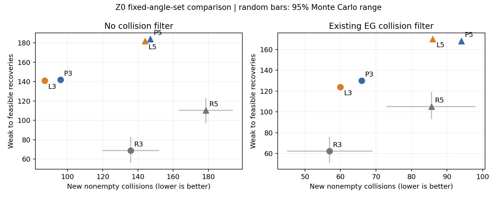
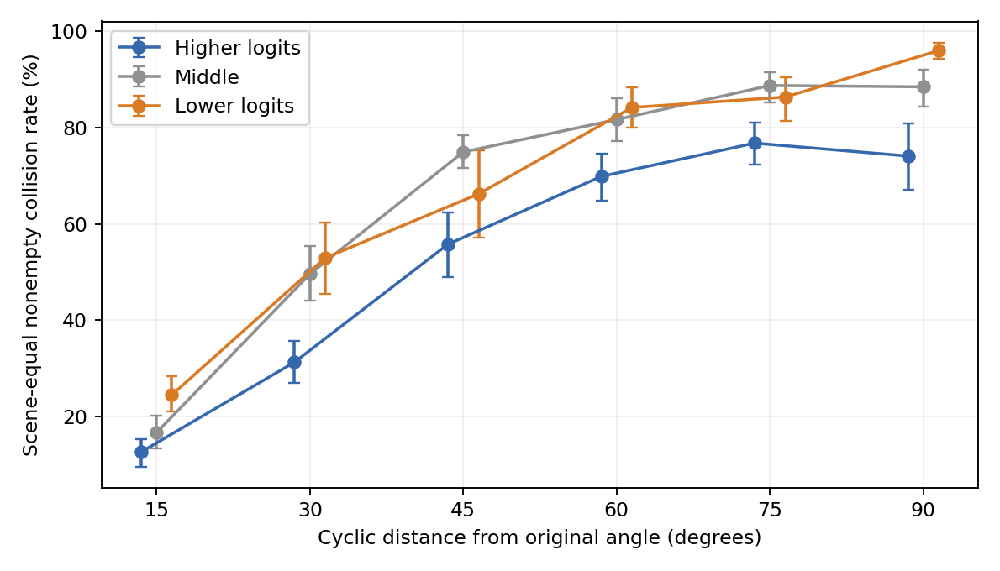

# Z0：检测器角度先验与局部修正零训练诊断

日期：2026-10-24。**主结论：未支持PRIOR；结果落在LOCALITY的±30%区间，P₃的碰撞点估计反而略差。**

只执行用户批准的Z0。复用本地已验证的服务器缓存，没有SSH访问、新推理、训练、风险标签预计算或新增力闭合评价；C4/C5未访问。

## 1. 主比较与判定

k=3、无过滤：P₃新增碰撞 **96**，L₃为 **87**，比值 **1.103**（P₃多10.3%）；弱→可行恢复 **142 / 141**，比值 **1.007**。场景等权碰撞率差P₃−L₃为 **+0.76 [-0.03, +1.56] 个百分点**。

PRIOR的三项要求中，仅“恢复≥局部法90%”通过；“碰撞≤局部法70%”和“碰撞差CI上界<0”均未通过。因此不能写成“logit先验比局部约束更能抑制碰撞”。

判定文字存在重叠：原表把±30%差异称为LOCALITY，同时把“P₃比L₃差”称为NO-PRIOR。执行前的`protocol.json`明确先按量化±30%区间归类，再单独披露较差点估计。本轮据此记为LOCALITY；若将NO-PRIOR解释为任何较差点估计，则也满足该文字条件。**不受命名影响的结论是：没有达到PRIOR，且没有证据证明P₃优于L₃。** CI跨零也不能证明两者严格等效。

## 2. 输入与必要核验

面板为12场景×4帧、1,229个原干净候选、14,748个已直接解析评价角度姿态；原可行641、原弱力闭合588。48份角度文件和48份EG_cd文件均与历史结果SHA一致，候选ID/原角度逐项对齐。

原角度与前12类角度输出argmax不一致数为 **0/1,229**，没有触发强制补入。第13类未参与。P/L每个原始集合严格含k个类并包含原角度；缺失I1依原规则排除，过滤版另排除EG_cd为碰撞的角度。向量化choose与原标量规则逐候选核对通过。

1,000次随机抽样使用PCG64、rng=20261024，每次保留原角度并均匀无放回抽其他类；k=3、k=5和两种过滤共享随机排列以便配对。场景bootstrap另以rng=20261024在seen/similar/novel内分层抽样10,000次。随机组先对每个候选的1,000次结果求期望，再做场景配对区间；另单列固定面板的随机抽样范围，二者不混用。

## 3. 全部固定组结果

可行：无碰撞、非空且0<μ≤0.4；弱力闭合：0.4<μ≤1.2。碰撞、空夹、无力闭合解分别计数。下表为1,229候选的总数，R为1,000次抽样均值；所有组空夹均为0。

| k | EG过滤 | 集合 | 可行数 | 弱→可行 | 原可行受损 | 新增碰撞 | 无力闭合解 |
|---|---|---|---:|---:|---:|---:|---:|
| 3 | 无 | P | 745 | 142 | 38 | 96 | 5 |
| 3 | 无 | L | 743 | 141 | 39 | 87 | 3 |
| 3 | 无 | R | 666.7 | 68.9 | 43.2 | 135.8 | 1.1 |
| 3 | 有 | P | 745 | 130 | 26 | 66 | 5 |
| 3 | 有 | L | 739 | 124 | 26 | 60 | 3 |
| 3 | 有 | R | 685.2 | 62.3 | 18.1 | 56.9 | 1.1 |
| 5 | 无 | P | 767 | 184 | 58 | 147 | 1 |
| 5 | 无 | L | 762 | 182 | 61 | 144 | 1 |
| 5 | 无 | R | 691.6 | 110.3 | 59.7 | 178.5 | 1.0 |
| 5 | 有 | P | 773 | 168 | 36 | 94 | 2 |
| 5 | 有 | L | 775 | 170 | 36 | 86 | 2 |
| 5 | 有 | R | 717.5 | 105.1 | 28.7 | 85.7 | 1.3 |

P=logit前k；L=循环局部±⌊k/2⌋；R=原角度加随机k−1类。加入EG过滤后P₃/L₃新增碰撞为66/60；k=5无过滤为147/144，过滤后94/86。次要比较也没有出现P的碰撞优势。随机组加过滤后的碰撞可能更少，但恢复明显不足，不能只按碰撞数量排优劣。

| 随机组 | 碰撞均值 [95%随机范围] | 恢复均值 [95%随机范围] |
|---|---:|---:|
| R3 / none | 135.8 [120.0, 152.0] | 68.9 [56.0, 83.0] |
| R3 / EG_cd | 56.9 [45.0, 69.0] | 62.3 [51.0, 76.0] |
| R5 / none | 178.5 [163.0, 194.0] | 110.3 [97.0, 123.0] |
| R5 / EG_cd | 85.7 [73.0, 98.0] | 105.1 [93.0, 119.0] |

上述范围只表达随机角度集合的波动，不是泛化到新场景的置信区间。完整场景配对区间见`paired_intervals.csv`。

| P−L，场景等权差（百分点） | 可行率 | 碰撞率 |
|---|---:|---:|
| k=3, none | +0.28 [-0.52, +1.20] | +0.76 [-0.03, +1.56] |
| k=3, EG_cd | +0.56 [-0.24, +1.40] | +0.49 [-0.24, +1.24] |
| k=5, none | +0.42 [-0.61, +1.46] | +0.31 [-0.43, +1.15] |
| k=5, EG_cd | -0.01 [-0.90, +0.89] | +0.54 [-0.39, +1.52] |

## 4. 机制统计：排序并非毫无信息，但没有带来主比较优势

去掉原角度后共有13,519个变体；其中1个空夹单独排除，机制AUROC使用13,518个，未知标签0。I1缺失的变体仍纳入碰撞知识统计，避免只看能恢复接触的姿态。

| 碰撞风险预测量 | 场景等权AUROC [95%区间] | 合并候选AUROC（描述性） |
|---|---:|---:|
| logit_rank | 0.7805 [0.7554, 0.8039] | 0.7690 |
| cyclic_distance | 0.7824 [0.7608, 0.8033] | 0.7706 |

logit排名−循环距离的AUROC差为 **-0.0019 [-0.0077, +0.0037]**，没有整体判别优势。这里logit排名越靠后、循环距离越大都定义为更高碰撞风险，未根据结果翻转方向。

| 相同循环距离 | 较高logit三分位碰撞率 | 中间 | 较低logit | 低−高差及95%区间（百分点） |
|---|---:|---:|---:|---:|
| 15° | 12.71% | 16.72% | 24.55% | +11.84 [+8.95, +14.82] |
| 30° | 31.33% | 49.59% | 52.94% | +21.61 [+15.36, +27.64] |
| 45° | 55.77% | 74.90% | 66.21% | +10.44 [-0.76, +21.23] |
| 60° | 69.83% | 81.62% | 84.12% | +14.29 [+8.98, +19.22] |
| 75° | 76.74% | 88.68% | 86.30% | +9.56 [+5.81, +13.67] |
| 90° | 74.06% | 88.42% | 95.93% | +21.87 [+15.30, +28.93] |

同距分层仍显示较高logit与较低碰撞率的关联，例如15°为12.71%对24.55%，30°为31.33%对52.94%。但各层不是都严格单调，45°的高低差区间跨零；三分位保留相同排名的并列值，实际组大小不相等，完整切点和样本数已保存。

这些分层仅控制角度距离，未消除跨候选、场景内物体或几何难度等混杂。可以保留“角度输出包含碰撞相关信号”的描述，不能由此推翻预注册主比较，也不能断言碰撞知识由某种训练机制因果产生。

## 5. 局部性、有效预算与H3登记

主比较中P₃/L₃有648/1,229个集合完全相同，最终选择相同974个。实际选角平均偏移为11.97° / 8.81°；排除I1缺失后平均可选角度数为2.945 / 2.959。名义候选预算相同不意味着有效集合及选角距离完全相同；这是解释限制，不是事后改变集合或指标。

**论文叙事：** 当前证据更适合“局部角度修正的摩擦—碰撞权衡”，不支持把“检测器先验优于局部性”作为已经成立的机制。也不能反过来声称EG的logit完全不含碰撞信息。

**H3后续预测登记：** 若未来另行授权T轮，不因Z0而预期EG先验会可靠抵消T2的碰撞增幅；保留原H3的待检验预测，即不协调摩擦与碰撞的T2比T1更容易增加碰撞。该预测尤其针对训练将角度推离原局部范围的情况，是否成立必须由预注册T1/T2对照判断，Z0不提供定量训练效果预测。

Z0不决定是否启动训练。本轮没有执行风险标签预计算、λ标定、T0/T1/T2训练或全C3 Level B。

## 6. 可信度、边界与归档

CPU核心计算约2.85秒；输入核验与统计均在本地完成。未创建SSH会话、没有GPU任务。L₃的87个碰撞复现原±15°结果。原始输入保持只读，代码、协议、逐候选选择、1,000次随机选择索引与抽样统计、场景级区间和图表保存于独立目录。

只使用12个既有C3开发场景、官方完整EG及既定干净候选，结论不等于全流水线Top-1/AP提升、跨模型普遍性或真实机器人成功率。选择使用GT辅助I1，是离线诊断，不能称为可部署推理策略。

交付：`statistics.json`、`selected_candidates.csv`、`selected_angles.npz`、`random_draw_counts.csv`、`scene_statistics.csv`、`paired_intervals.csv`、`AUROC_by_scene.csv`、`distance_rank_tertiles*.csv`、`input_manifest.json`、`protocol.json`及复现脚本。
