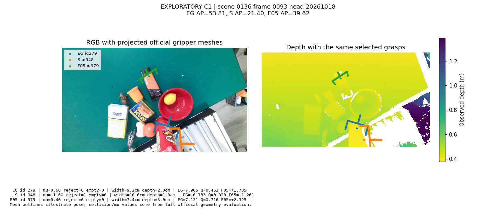
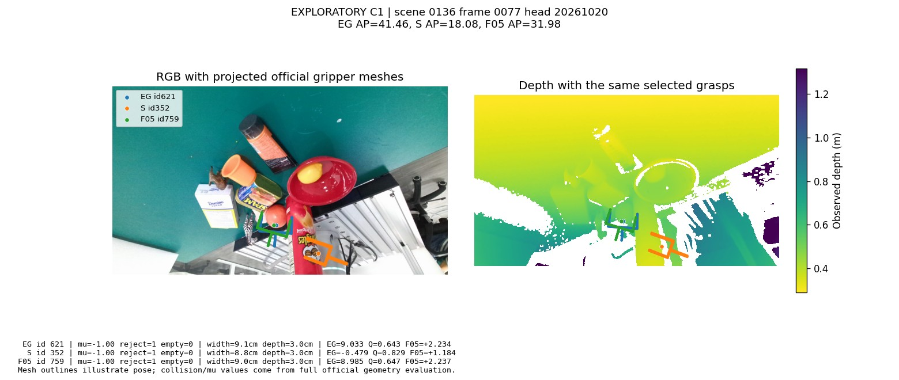
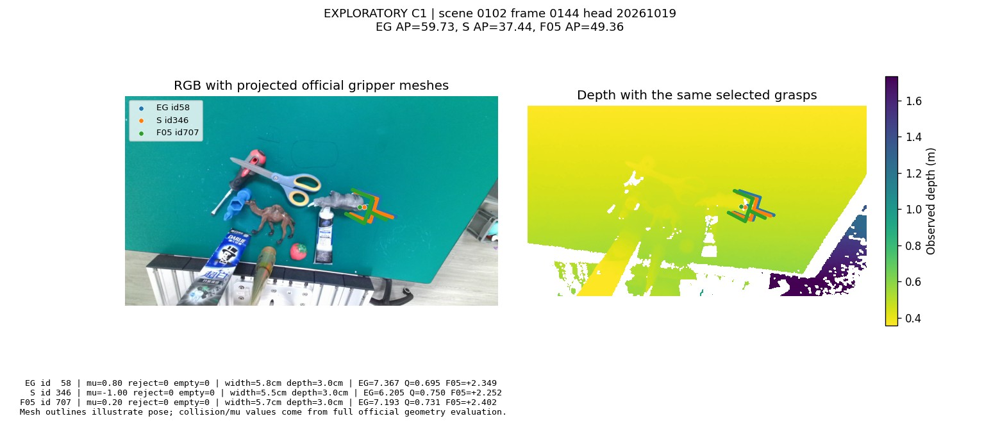

# EG-LQR-CD-DIAGNOSIS-V4 研究报告

分支：codex/eg-lqr-cd-diagnosis-v4-20261019；父结果：4bdf15a9b3a844929ccea5c14317c5f495a2768b。

执行状态：COMPLETE。0 次新训练；原 EG 与三个已有头、全部候选几何固定。

C1 已揭晓，本轮 C1 复盘及 F05 对照均为探索性，不是独立确认。
候选质量覆盖率表示有界缓存实际评价了多少候选，不是最近标签匹配成功率；这些已评价候选使用实际姿态的官方完整几何/碰撞/摩擦质量。

## CD 为什么缩小收益

完整 C1：S 相对 EG 在无 CD 时提升 +2.526 AP，带 CD 时 +1.433 AP，减少 1.094 AP。CD 本身让 EG 增加 2.106 AP，而让 S 增加 1.012 AP。此处是同一候选、同一场景的精确指标分解，不将其称为独立机制因果证据。

scene0136 的候选诊断覆盖原 1024 候选中的 13.6%（累计逐帧候选）。仅在已有官方质量的候选中，CD 拒绝合格抓法 499 次、保留合格抓法 5828 次；拒绝官方碰撞/空抓联合拒绝候选 5892 次、仍保留 12912 次。CD 合格拒绝率 7.89%，联合拒绝候选保留率 68.67%。分母均为已有质量的候选，不能外推到全部 1024 候选，也不是物理机器人真值。

## scene0136 排序表现

|头|失败→成功|成功→失败|被损伤 EG 合格 Top1 的 Q 排名中位数|其中不在 S 的前50|
|---|---:|---:|---:|---:|
|20261018|18|68|210.0|59|
|20261019|38|39|142.0|33|
|20261020|62|38|82.0|30|

以上检查的是实际官方 NMS/CD 路径输出。抓法几何没有变；错误来自选中不同候选。Q 排名是 CD 后尚存的原候选中的分数名次；候选还可能在 NMS/物体候选配额中消失。关联不能单独证明冻结特征无姿态信息、MSE 是根因，或某一几何参数导致退化。

宽度、深度、相机接近方向及可见像素面积分层见 diagnosis_geometry_strata.csv。分割可见面积不是完整物体可见比例，也不能直接当作遮挡率。代表性 Bad Case 是按已揭晓 AP 选择的探索性例子。

## 几何分层的描述性线索

scene0136、CD后官方前50：宽度>=8cm候选的官方联合拒绝率，EG为50.69%，S为59.51%；1cm浅抓取占比分别为28.05%和35.94%。这些是实际选中候选的条件分布，跨帧/头相关，不能据此声称宽度或深度是退化原因。

CD使用相同原始候选几何，因而所有评分方案的逐帧CD mask及全局拒绝率相同。不同AP收益来自过滤后排名及官方NMS/物体配额选择的交互；没有改变CD阈值。

## 固定 F05 探索

F05 始终是 0.5*z(EG)+0.5*z(Q)，全1024候选、float64、ddof0；没有系数、头或检查点搜索。

F05+CD 相对 EG 平均 +2.141 AP，描述性95%CI=[+1.473,+2.842]；三头差值 [2.0659907699667204, 2.085614615251936, 2.271404356083733]，正向场景 12/12。S 相对 EG +1.433 AP。

scene0136 中 F05 相对 S +7.342 AP；最差场景差值从 S 的 -7.202 变为 F05 的 +0.140 AP。

冻结放行条件：{'mean_positive': True, 'at_least_two_heads_positive': True, 'scene0136_better_than_S': True, 'worst_scene_better_than_S': True}；判决：PASS_FOR_C2。即便通过，也只能支持选定 F05 进入新数据确认，不能把 C1 当独立确认。

## 新确认使用边界

已知项目使用历史审计：PASS_NO_KNOWN_EXPOSURE_AND_RAW_FILES_PRESENT；预留场景：{'seen': [128, 105, 127, 112], 'similar': [147, 142, 143, 131], 'novel': [165, 166, 168, 184]}。审计不能保证未知外部历史没有暴露。只有探索闸门通过才写入 C2_method_lock 并打开新性能。

## 官方拒绝标记的语义

GraspNet collision标记=几何相交 OR 空抓；不能将联合标记直接称为纯几何碰撞。非空碰撞定义为collision AND NOT empty，空抓也可能同时相交，现有缓存不进一步拆分其相交状态。初版诊断CSV中known_true_collisions字段沿用旧名，数值实际是官方联合标记；AP始终使用官方定义，没有改动。

ModelFree CD检查观测点云密度及5cm接近路径，官方质量使用完整物体模型、静态抓手和空抓判定；二者不是同一判据。CD拒绝官方合格候选不自动证明CD错误，也不能把所有保留的官方联合拒绝候选叫作纯碰撞漏检。

exploration S相对EG：Top1官方联合拒绝-8.105个百分点，空抓+0.293，非空碰撞-8.398；描述性拆分，非新增确认终点。
exploration F05相对EG：Top1官方联合拒绝-6.120个百分点，空抓+0.119，非空碰撞-6.239；描述性拆分，非新增确认终点。
confirmation F05相对EG：Top1官方联合拒绝-3.092个百分点，空抓+0.000，非空碰撞-3.092；描述性拆分，非新增确认终点。

## C2 固定方法确认

结论：**AP_CONFIRMED_TARGET**。F05 相对 EG 平均 +2.602 AP，场景分层95%CI=[+1.893,+3.386]；三头差值 [2.7889824834541397, 2.393718629785742, 2.62262289246652]；正向场景 12/12。

Seen/Similar/Novel 差值：{'seen': 2.9177235925161065, 'similar': 3.1961737327942195, 'novel': 1.691426680396076}。

仅代表冻结的12场景×完整256帧，不是官方90场景全评测。三头先场景内平均，划分/场景等权，分层场景bootstrap10000次，种子20261019；不把帧、候选或头当独立样本。AP不等于机器人抓取成功率。

## 原始观测核验

C2 3072/3072帧联合RGB/深度/K指纹互异，与原C1精确重复数0。审计只覆盖C2内部和原C1原始指纹；其他历史按场景ID审计，不保证未知外部使用。完整256帧协议保留；无重复时去重敏感性与主结果相同。

## C1探索绝对AP与辅助指标

下表仅为每划分固定4场景的AP，不是每划分30场景全量AP；F05三头分别评价后平均。

|组别|Seen AP|Similar AP|Novel AP|等权平均AP|Top1合格率%|
|---|---:|---:|---:|---:|---:|
|R0|49.874|46.841|16.583|37.766|38.444|
|S|54.134|47.257|19.487|40.293|43.012|
|F05|54.037|49.756|18.361|40.718|43.240|
|R0+CD|52.462|49.240|17.915|39.872|39.844|
|S+CD|55.002|48.593|20.320|41.305|43.349|
|F05+CD|55.434|51.289|19.317|42.013|43.620|

|F05+CD相对EG+CD辅助指标|差值|描述性95%CI|
|---|---:|---|
|ap04|+1.899|[+1.242,+2.527]|
|ap08|+2.544|[+1.717,+3.399]|
|top1_valid|+3.776|[+0.488,+7.249]|
|top1_collision|-6.120|[-9.940,-2.387]|
|top1_empty|+0.119|[+0.033,+0.228]|

AP差值为AP百分点，其余为率的百分点；collision为含empty的官方联合标记。辅助区间为描述性，不作新增成功标准。

## C2确认绝对AP与辅助指标

下表仅为每划分固定4场景的AP，不是每划分30场景全量AP；F05三头分别评价后平均。

|组别|Seen AP|Similar AP|Novel AP|等权平均AP|Top1合格率%|
|---|---:|---:|---:|---:|---:|
|R0|62.844|49.763|20.191|44.266|47.526|
|F05|66.912|53.597|22.202|47.571|49.479|
|R0+CD|65.551|51.042|21.093|45.895|48.047|
|F05+CD|68.469|54.238|22.784|48.497|49.772|

|F05+CD相对EG+CD辅助指标|差值|描述性95%CI|
|---|---:|---|
|ap04|+2.159|[+1.230,+3.254]|
|ap08|+3.195|[+2.342,+4.071]|
|top1_valid|+1.725|[-3.114,+7.509]|
|top1_collision|-3.092|[-7.259,+1.367]|
|top1_empty|+0.000|[+0.000,+0.000]|

AP差值为AP百分点，其余为率的百分点；collision为含empty的官方联合标记。辅助区间为描述性，不作新增成功标准。

## 探索性示例

三个例子固定来自此前最差AP列表；官方抓手网格投影到RGB/深度，仅作位置/姿态示意，质量依据仍是实际姿态的完整官方评价。图注reject含empty。

例如0136/0093头20261018：S选中Q=0.820的非空碰撞候选，F05换到mu=0.4的合格候选；但该帧AP仍从EG53.81降到F0539.62。0102/0144中S候选无碰撞却质量=-1，F05换到mu=0.2后AP仍低于EG。0136/0077三个方法的Top1都未合格。它们显示修复Top1不等于恢复整张候选列表的AP，也不能声称F05修好了每个失败例子。

## 可信度、资源与停止

所有旧结果只读，新目录补算固定F05选中新候选的官方完整几何/摩擦质量。复用质量绑定输入、几何、骨干、评价源码身份。R0逐帧复验须与V3一致；两个固定帧额外对照完整原生官方路径。未评价质量仍是未知，不以失败填充。

诊断曾因提前把候选转float64造成CD边界重放不一致，已恢复原始dtype；原失败日志和旧诊断保留，最终608帧统一重放原始dtype。此修改没有改变V3结果、CD阈值或模型。

诊断最初上限8；首个F05性能前按资源补充将F05/C2上限改为13：12个CPU场景子任务+控制；新确认导出期间GPU1+CPU11+控制，导出后CPU12+控制。每子任务单线程、低优先级；无监控自动化，不终止其他任务。资源和实际条件状态以pipeline_status及各COMPLETE回执为准。

本卡结束后不自动更换融合系数、扩增训练或追加新场景。大输入、逐候选/逐帧文件、权重和完整日志留服务器；代码与轻量结果及哈希归档。

## 最终核验与实测成本

全部3072帧、24576条确认记录通过核验；所有被选候选均有实际姿态官方质量，未计算候选保留未知，未填失败。主指标与独立按场景/头重新求均值一致。

C2阶段墙钟约59.4分钟；GPU导出27.0分钟。含保留的旧诊断尝试和360秒未精确计时失败/辅助任务保守预留，结算10.846worker小时；预留不是实测值。单任务峰值RSS 5.36GiB，Torch峰值GPU分配268.2MiB（不等于整卡/驱动显存）。本卡目录4.833GiB。实际观测上限13进程，0新训练。

## 本轮研究决策

固定F05在本卡新C2达到预先冻结的AP确认目标，可保留为当前25%EG骨干上的轻量重评分基线。三个既有头分别评价后平均，不是集成；若下一阶段使用单模型，沿用事前固定的20261018头，不依据C2挑选最佳种子。

Top1合格率变化+1.725个百分点、95%CI[-3.114,+7.509]；官方联合拒绝率变化-3.092个百分点、95%CI[-7.259,+1.367]，其稳定改善尚未确认。本卡证明的是固定候选的AP重排序收益，未证明冻结特征缺少姿态信息或MSE是唯一根因，也未建立局部姿态改进。完整EG训练和90场景全量官方评价仍待另行安排。

本轮在此停止，不自动追加训练、改变融合系数或再选择新确认场景。
