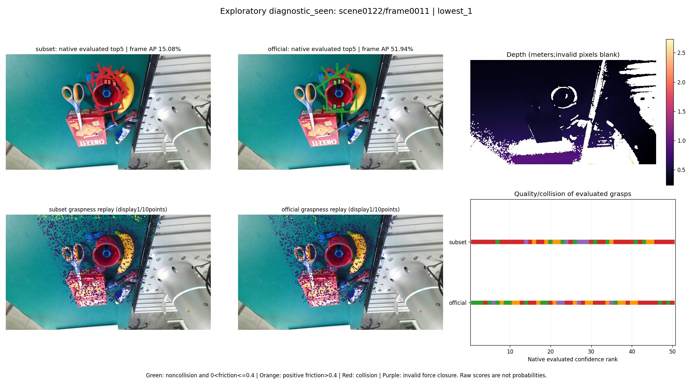
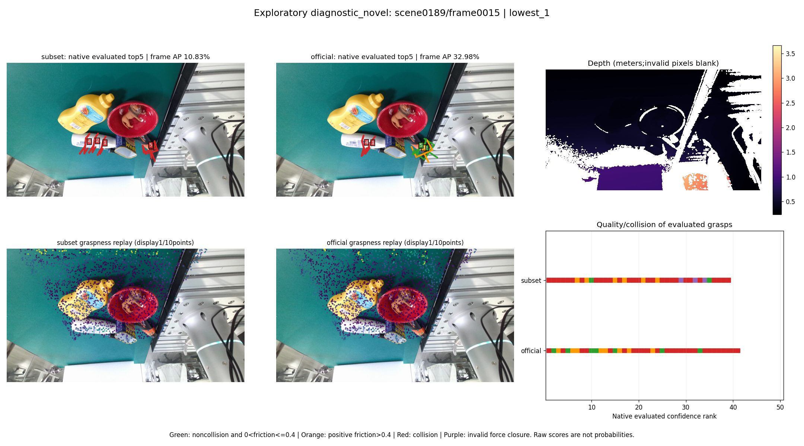
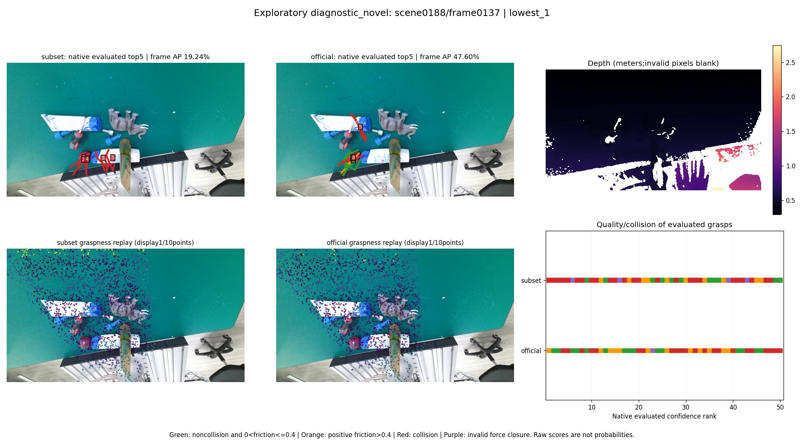

# EG-SUB25-V1：Bad Case 诊断

本轮完成冻结开发集和固定 Seen/Novel 场景评价，并按预定规则保留 12 个配对案例。结果支持优先研究候选排序、碰撞与点采样敏感性；尚未证实某个网络模块是根因，没有修改网络或追加训练。

## 分析口径

每个固定场景取子集模型逐帧 AP 最低的两帧和中位帧，AP 相同时按帧号排序，共 12 帧、24 次模型回放。这是事后选取的探索性材料。两模型输入点云及批次一致，24 次回放均与原预测在预设容差内匹配。正式 AP 仍来自原始预测和未修改的官方 API。

以下 Top-1“通过”指官方实际评价的第一候选无碰撞且所需摩擦系数满足 `0 < μ ≤ 0.4`，不代表机械臂成功率，也不替代连续 AP。未进入官方评价候选池的原始预测没有已知质量标签。

## 全部 1,024 个配对帧的观察

|固定划分|双方通过|仅官方通过|双方未通过|仅子集通过|
|---|---:|---:|---:|---:|
|Seen 119/122|272|113|59|68|
|Novel 188/189|166|146|132|68|

共 259 帧仅官方通过，191 帧双方均未通过；也有 136 帧仅子集通过。全量训练模型并非在每一帧都更好。训练量、收敛、分布和原官方训练历史尚未被分别控制。

|固定划分 / 模型|Top-1 碰撞帧数|Top-1 未通过、后面仍有通过候选|
|---|---:|---:|
|Seen / 子集|103/512|172/512|
|Seen / 官方|27/512|127/512|
|Novel / 子集|143/512|278/512|
|Novel / 官方|129/512|200/512|

两个模型在全部配对帧的官方评价候选池中都至少有一个满足 μ≤0.4 的无碰撞候选。子集有 **450/1,024 帧**、官方有 **327/1,024 帧**将未通过的候选排在它们之前。这直接说明最终候选列表存在排序改善空间，但候选生成、姿态、NMS 与评分共同影响该现象，不能据此证明评分头是唯一原因。

## 代表案例

### 0122 / 0011：碰撞与排序差异

子集 AP **15.08**，官方 **51.94**。子集 Top-10 中 9 个碰撞，首个通过候选排名第 7；官方 Top-10 中 1 个碰撞，首个通过候选排名第 1。两者 FPS 中心前景比例同为 98.44%，说明“点落在前景”不足以保证姿态及排序质量。

还找到一对**中心完全相同**的候选：子集第 29 个无碰撞但力闭合未通过，官方第 18 个在 μ=0.4 通过。两者旋转原始 SO(3) 距离为 45.88°、宽度差 5.58 mm、深度相同。这将该候选对的差异缩小到姿态/宽度等几何配置；没有分离方向和宽度，也不能归因于某个预测头。

### 0189 / 0015：双方第一候选均碰撞

子集 AP **10.83**，官方 **32.98**，两者 Top-1 均碰撞。首个 μ≤0.4 通过候选分别排第 10、第 2；官方实际评价候选数分别为 39、41，满足该阈值的候选仅 2、7 个。这是全量训练后仍存在的失败表现。可视图中高排名抓取集中在局部物体区域，但不能仅凭图像证明其他区域一定存在可行抓取。

### 0119 / 0027：子集第一候选碰撞，官方通过

子集 AP **51.26**、官方 **64.04**。子集 Top-1 碰撞而第 2 个候选通过；官方 Top-1 在 μ=0.2 通过。该案例同时包含候选排序差异和训练充分性等混杂因素。

### 0188：同一观测下的点采样相关波动

核查发现官方数据中 scene_0188 的 **109–255 共 147 帧** RGB、深度、分割、Meta 完全相同，相机位姿也相同；全场景仅 110 种观测。scene_0189 的 **170–255 共 86 帧**重复，全场景 171 种观测。两个场景的当前全部 1,285 个文件逐一重算大小/CRC 后，场景清单哈希均与独立官方 ZIP 索引一致，未发现本地提取损坏证据。

重复观测段中的点云采样各不相同。scene_0188 的同一观测，子集逐帧 AP 为 **19.24–58.06**，官方为 **31.94–64.20**；scene_0189 分别为 **26.85–50.08** 和 **34.62–52.35**。这些是已有结果中的观察，没有追加推理试验，也没有分离随机采样与数值计算的影响。

预定规则选出的 scene_0188 三帧 0137、0154、0232 均属于这个重复段，因此是**一个观测的三个采样实例**，不能解释为三种视角或遮挡变化。原有选帧、256 帧 AP、冻结场景均保持不变。全部 Novel 512 个名义帧只对应 281 种精确不同观测，不能视为 512 个独立视角。

## 抓取点、场景复杂度与证据边界

12 帧子集 FPS 中心前景比例约 94.8%–99.7%，部分案例未覆盖所有可见语义类别；官方也存在类别遗漏。语义前景或类别覆盖不是可抓性标签，既不能证明点选择正确，也不能证明遗漏了可行抓取区域。

scene_0122 的 10 个物体存在明显图像重叠，且较低 AP 案例有更高碰撞占比。这是案例观察，物体数量、可见面积和有效深度只作为复杂度代理，未证明遮挡导致失败。scene_0188 重复观测尤其禁止解释为视角复杂度变化。

近中心姿态探针对 12 个案例均找到质量不同的候选对。原始旋转距离未消除平行夹爪对称性；位置、接触、角度、宽度和深度的影响不能据此逐头分离。Graspness 图只是回放的未结合 Objectness 筛选的分数显示，显示抽样为 1/10、色域 0–1，不是最终候选掩码或概率。

原始解码评分不是概率，不能跨模型直接比较绝对值。官方 AP 使用原评分排序，未做校准或碰撞后过滤来提高指标。

## 后续研究判断

优先在固定点云输入、固定候选集的条件下核查排序与碰撞质量关系，并排除重复观测下的采样敏感性。训练量差异仍需保留为解释，不能把子集欠训练造成的问题包装成方法缺陷。本轮未自动扩大数据量、增加 seed、修改模块或重新训练。

逐帧/候选证据见 `per_frame_results.csv`、`bad_case_metrics.json`、`bad_case_summary.csv` 和 `bad_case_grasps.csv`。后者 `grasp_0..16` 按官方格式依次为 score、width、height、depth、9 个旋转矩阵元素、x/y/z、object_id。12 张 JPEG 位于 `figures/`；原始 RGB/深度、预测、质量/碰撞数组及中间张量留服务器。重复观测与 CRC 证据见 `DIAGNOSTIC_OBSERVATION_AUDIT.json`。
