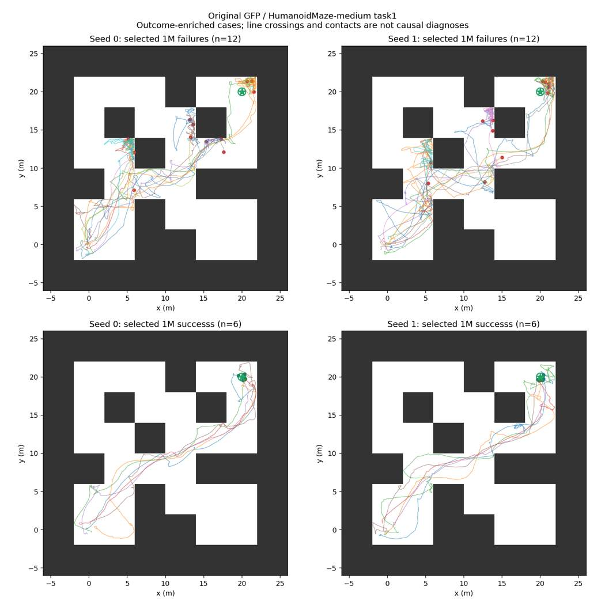
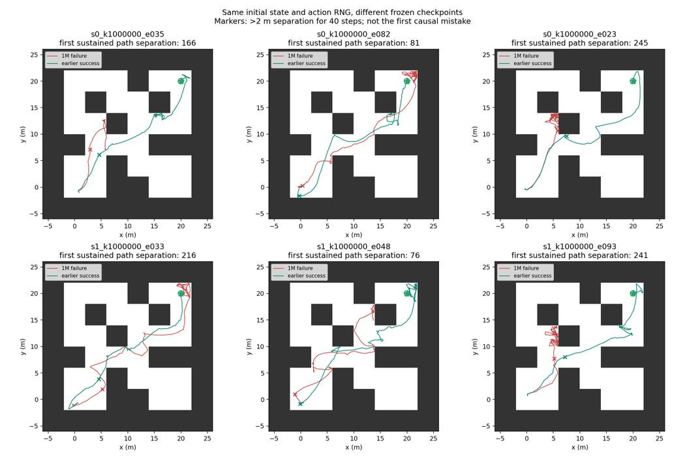

# GFP 冻结权重 bad-case 首轮诊断
日期：2026-10-15。任务：HumanoidMaze-medium singletask task1。仅原始 GFP，非 GFP+floq。

**已完成48条数值轨迹，75,818个环境步骤，参数更新0。** 首批8条验证通过后继续；36条1M原回合和6条早期回合的初始观测哈希、成功、Return、长度及终止标志全部与原 matched_verified 相同。6条随机性对照仅改变策略噪声种子，初始状态均保持相同。历史评价未保存逐步轨迹，因此不声称已逐步逐位比对旧轨迹。

## 1. 看到的失败模式
24条选定1M失败均在2000步超时。以下标签可重叠，只描述刻意富集的样本。

| 观察 | 数量 | 含义与边界 |
|---|---:|---|
| 持续位置停滞 | 12/24（两种子各6） | 200步窗口内位置跨度很小，并持续出现；不直接等于规划失败 |
| 接近目标但未完成 | 8/24（seed0三条、seed1五条） | 最近约0.56–1.09米；实际成功要求0.5米以内。这8条都进入目标所在网格 |
| 最后400步多数处于低头高度 | 8/24 | 低姿态代理，不是环境官方跌倒事件 |
| 最后400步频繁墙体接触 | 5/24 | 只统计控制步末接触，可能漏掉子步内接触，不能据此定因 |
| 多次网格即时返回 | 5/24 | 可能包含边界抖动，暂不命名为选错路线 |

12条成功对照中11条也出现过站立后的持续低头高度，失败中为24/24。因此，“出现低姿态”本身不能区分成败。必须继续看恢复、位置与后续进展，不能把最终倒地一律当成起因。

## 2. 过程分歧出现在哪里
“首次持续分离”定义为同一时间步的水平位置相差超过2米并维持40步；它可能反映速度差异，**不是已确认的第一处错误**。早期检查点对照的该标记位于第76–245步。

| 同场景对照 | 可复核证据 |
|---|---|
| seed0 / episode23，1M失败与900k成功 | 第245步开始持续分离：1M位置约(5.78,10.70)，900k约(7.48,9.63)。1M随后长期留在(6,12)附近；首次持续低姿态更晚，约第528步。仅看最后身体姿态会遗漏较早路径差异 |
| seed0 / episode7，1M失败 | 第980步距目标约0.557米，未进入0.5米成功圈；之后长时间低姿态和位置停滞。属于近目标执行问题候选，不能据此指定Actor或Critic为原因 |
| seed1 / episode38，1M失败 | 第194步起出现持续低姿态，较早出现位置停滞，最终仍距目标约18.9米。这与已进入目标区域的失败明显不同 |
| seed0 / episode82，1M失败与800k成功 | 1M最近约0.94米仍失败，800k在1100步成功；1M末段并非始终低姿态，不能将所有近目标失败归为倒地 |

在迷宫中，暂时远离目标可能是合理绕行。本轮保留地图/BFS网格进度和完整路径，不用单步欧氏距离增大直接判定路线错误。时间标记和坐标保存在 paired_comparisons.json、case_metrics.json；阈值详见 metric_definitions.json。

## 3. 随机性、训练种子与检查点变化
6条相同初始状态的动作随机性对照中，3条由失败变为成功：seed0为1/3，seed1为2/3。每场景只有一个替代噪声序列，不能估计该场景成功概率，也不足以比较两个训练种子的稳定性。其余3条仍失败，不证明必然失败。

6条早期检查点全成功是预选条件，不是新发现的退化率。为避免选择偏差，另从**原有完整100回合评价**核对成功身份变化，未新增环境交互：

| 训练种子 | 对照 | 早期成功→1M失败 | 早期失败→1M成功 |
|---|---|---:|---:|
| 0 | 800k→1M | 24 | 22 |
| 0 | 900k→1M | 16 | 15 |
| 1 | 800k→1M | 14 | 11 |
| 1 | 900k→1M | 16 | 16 |

各行初始观测哈希与策略随机数均一致。场景成败明显交换，而平均成绩变化较小；目前适合称“个体场景表现随检查点变化”，不能声称已证明能力遗忘。
总体1M成功率仍使用原评价：seed0=72%，seed1=82%，合计154/200=77%。不得用本次富集样本的失败比例估计总体比例。

## 4. 内部机制：当前能说什么
本轮没有追加候选动作分支回放、VaBC对照、数据覆盖搜索或Guidance权重诊断，因此尚不能判定Actor、VaBC、Critic或Guidance哪个环节导致失败。也没有验证组合有效、性能提升或提出新模块。

已静态核对实际源码：guidance_agg=min 时，使用 target_critic 对Actor与VaBC动作分别评分，再取两者较小值；结合Q归一化因子和eta温度形成softmax权重。不是仅以Actor作为参照。

建议下一张卡优先围绕近目标修正和重复停滞，验证以下可反驳假设：
1. Actor缺少有效修正动作：在同一完整状态多次采样Actor，并对照VaBC。若Actor经常能生成实际有效动作，便削弱“完全无法生成”的解释。动作不同本身不等于蒸馏失败。
2. Critic动作排序不正确：从同一完整模拟器状态执行候选动作，并使用相同后续策略和随机数继续。若有效动作已经稳定排在前面，则不应继续把责任直接归于Critic。短期回报只能说明短期效果。
3. 低姿态恢复或数据覆盖不足：按位置、姿态、速度对比相似成功片段及训练数据。若充分覆盖且常能恢复，数据不足解释会削弱。仅原始观测向量近邻不足以证明覆盖。

这些只是后续建议，**本轮未执行上述新诊断或任何训练**。

## 5. 产物与可信度
- 固定官方GFP提交：1abbd5f0e287caf9bda70e7bc655d0a499ac8401；使用前轮原环境与实际展开配置。5份所需checkpoint均核验文件和恢复状态身份；参数、Adam状态、Agent RNG测试前后不变。
- 完整逐步记录：obs、qpos/qvel、MuJoCo integration state、身体位置和朝向、目标/机器人xy、raw/clipped动作、每步策略key、reward/success/terminated/truncated、接触几何体与力。详见trajectory_index.json和environment.json；全量NPZ留服务器。
- 8条代表视频：5条失败、3条同场景成功控制。原斜视图存在墙体遮挡，经用户批准改为同8条的俯视重渲染；旧版保留草稿。重渲染读取保存状态，不运行env.step；身体位置恢复误差检查记录在video_index.json。视频只作典型展示，不用于估计类别比例。
- 捕获阶段耗时136.29秒（不含初始模型恢复），进程CPU约165.99秒（含初始化），最大RSS约1.50GiB。GPU0共享运行；未连续采集单进程显存峰值和完整GPU驻留时间，这两项不补造。视频阶段成本单列于render_result.json及原草稿回执。
- 原模型、评价结果、任务规则均未修改；无新增训练。其他账号仅查看汇总资源；本账号另有EconomicGrasp任务，未干预。
- 此次观察能缩小后续诊断范围，但尚不能建立模块级因果解释。两训练种子、刻意选样与有限随机性对照的限制仍在。

服务器根目录：/home/xushijie3/work/gfp_badcase_trajectory_v1_20261015
完整轨迹：trajectories/；最终视频：videos_topdown/；旧视频草稿：videos/。
分支：[codex/gfp-badcase-trajectory-v1-20261015](https://github.com/rollinpioneer/graph/tree/codex/gfp-badcase-trajectory-v1-20261015)。
