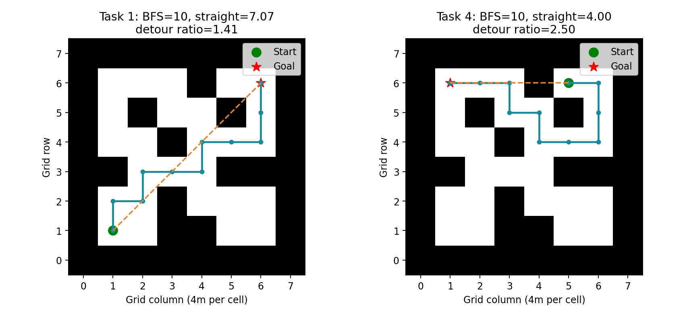
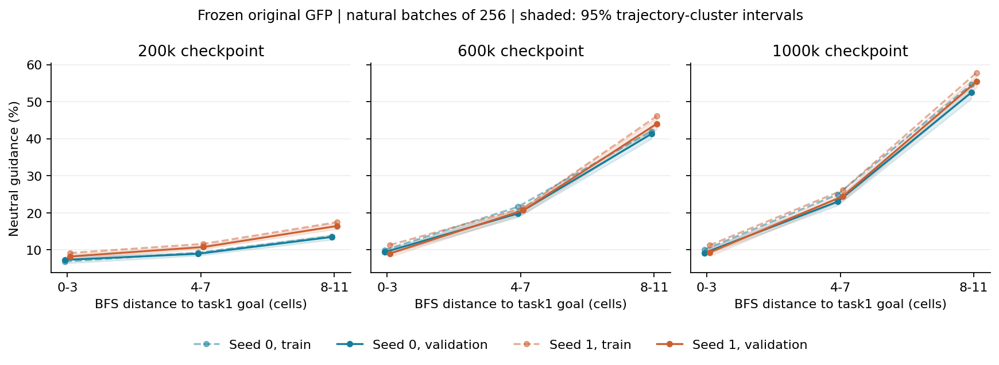
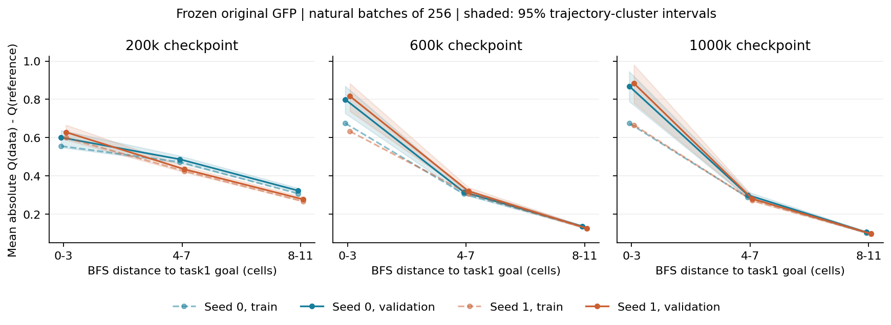
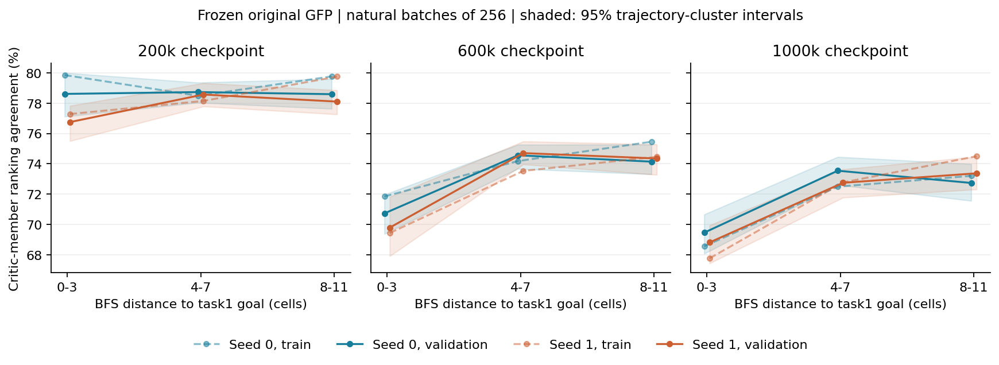
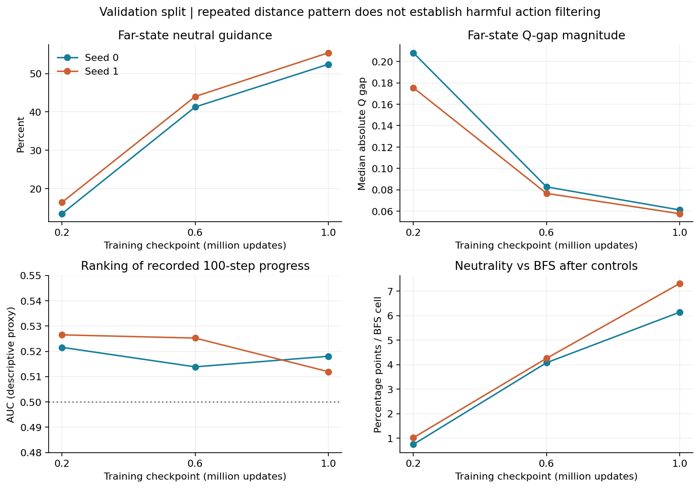

# GFP 任务缺口与 Guidance 距离诊断

2026-10-15 · GFP-GUIDANCE-DISTANCE-Z01-V1 · **完成 Z0、Z1，裁决 DIAGNOSE。**

两个训练种子的 task1 冻结模型均出现可重复的距离效应：后期远处 Q 差距缩小，Guidance 更接近 0.5。现有数据尚未证明这种变化损害了有用动作的筛选，也无法把它与 task4 的低成绩建立因果联系。H1 的第一环获得支持，第二、第三环仍未成立。**本轮没有启动 task4 Baseline，没有修改温度、模型或训练参数。**

## 公开任务缺口与几何

下表均为作者公开结果，单位为成功率百分比；均值和标准差来自 8 个训练种子。已从公开的八个数重算，CSV 使用总体标准差（ddof=0）。种子的具体 ID 未在 CSV 中给出，不能做跨算法逐种子配对。官方协议为 800k、900k、1M 三检查点均值，每点 100 回合。

| 数据与任务 | GFP | ReBRAC | FQL | VaBC | GFP-AWR |
|---|---:|---:|---:|---:|---:|
| navigate task1 | 83.46 ± 3.69 | 34.08 ± 16.43 | 未公布 | 28.79 ± 6.54 | 40.25 ± 10.09 |
| navigate task2 | 91.17 ± 6.27 | 75.83 ± 29.03 | 未公布 | 60.17 ± 9.37 | 78.62 ± 3.78 |
| navigate task3 | 86.29 ± 10.72 | 69.50 ± 25.75 | 未公布 | 28.92 ± 4.08 | 91.96 ± 2.49 |
| navigate task4 | 3.00 ± 6.62 | 19.50 ± 17.46 | 未公布 | 1.29 ± 1.99 | 7.38 ± 5.14 |
| navigate task5 | 95.83 ± 1.32 | 97.00 ± 0.88 | 未公布 | 60.12 ± 6.11 | 86.50 ± 5.31 |
| stitch task4 | 3.62 ± 9.47 | 33.08 ± 28.45 | 0.83 ± 0.85 | 14.88 ± 9.00 | 3.29 ± 6.55 |

全部逐任务缺口见 [official_task_gaps.csv](official_task_gaps.csv)，八个种子原始数值见 [official_task_values.json](official_task_values.json)。缺口是与现有可用竞争结果的描述性差值，未做因果或显著性声明。官方 CSV 缺少 FQL 的 HumanoidMaze-medium navigate 逐任务成绩，未以其他任务补齐。

[固定 GFP 官方结果来源](https://github.com/Simple-Robotics/guided-flow-policy/tree/1abbd5f0e287caf9bda70e7bc655d0a499ac8401/results/per_task)，[论文 v2](https://arxiv.org/html/2512.03973v2)。

OGBench 1.1.0 源码的四邻接 BFS：task1 和 task4 均为 10 格，格宽 4 米；直线距离分别为 7.071 格和 4 格，绕行比分别为 1.414 和 2.5。task4 的几何判断得到确认。但 task3 的绕行比更高（4.243，BFS 为 6 格），GFP 却达到 86.29%，所以绕行比不能单独解释弱项。网格距离也不表示 Humanoid 实际动力学最优路径。

navigate 的 discount=0.995，stitch 为 0.999，不能直接比较两者 Q 的尺度。最终配置与 CSV 匹配行已保存于 configs/public_task_configs.json；本轮推理只使用 navigate task1。奖励按固定 1.1.0 源码由当前位置是否进入目标 0.5 米区域给出 success−1，mask=1−success；原生任务最大 2000 步。为避免构造/reset 自动执行稳定姿态动作，本轮只解析源码和文件，未创建环境。

[OptiFlow v1 Table 9](https://arxiv.org/html/2609.15883v1) 报告 medium navigate task4 为 19.1% ±5.4 **标准误**；该文采用最终 1M 检查点 100 回合、8 种子，其同表 GFP 为 0.1% ±0.1。task4 尚未被充分解决，但这些数值与 GFP 作者“三检查点均值、种子标准差”的表不能合并。 [QGF v1](https://arxiv.org/html/2606.11087v1) 的公开实验集中于操作任务、动作分块和大规模数据，没有可用于此处的 HumanoidMaze-medium task4 对照。

## 冻结模型与测量

GFP 源码固定为 `1abbd5f0e287caf9bda70e7bc655d0a499ac8401`。原始 G0 seeds 0/1，200k、600k、1M 六份模型均恢复成功。运行环境沿用已验证环境：OGBench 1.1.0，JAX/jaxlib 0.6.2，Flax 0.10.7，MuJoCo 3.3.5，NumPy 1.26.4；float32、x64=false，矩阵精度设置保持原运行值。

训练集为 2,000,000 个有效转移、1,000 条轨迹，验证集为 200,000 个转移、100 条轨迹；完整观测轨迹哈希没有跨集合完全重复项。这是文件级独立性检查，不意味着两个集合的状态分布互不重叠。

每模型 100 个训练批次加 100 个验证批次，每批 256：主测量共 307,200 次。首 20 批是计入总额的检查批次。另以两个预先固定 RNG，在每集合首 10 批重复，增加 61,440 次，总计 368,640。数据有放回均匀抽取，同一批索引复用于六份模型；状态评估次数不是独立样本量。两个集合分别报告；下表以独立验证集合为主。

测量直接使用官方 compute_guidance。Actor 与 VaBC 共享同一高斯输入；先分别对 target Critic 的 ensemble 取均值，再取 Actor/VaBC 两分支的较小值。归一化由在线 Critic 对 Actor 动作的 ensemble 均值计算，再在整个自然批次取绝对值均值，未按距离重新归一化：

`g = sigmoid((Qdata_target − min(Qactor_target,Qvabc_target)) / (eta × mean_batch(abs(mean_ensemble(Qactor_online)))))`

eta=0.001，guidance_agg=min，q_agg=mean。官方 logsumexp 实现与上式最大绝对差小于 0.000067，符合冻结容差 0.001。距离定义为 task1 目标的 BFS；近处≤3 格，远处≥8 格。样本最大距离为 10 格，12+ 档为空，不外推到更长迷宫。

区间使用 200 次轨迹聚类重采样，不把相邻状态当独立观测；训练种子分别报告。控制项为欧氏距离及平方、头部高度、躯干竖直方向、质心速度和轨迹固定效应。这些粗粒度控制不能消除全部状态混杂。

## 距离效应及其边界

| 模型 seed | 检查点 | 近处中性权重 | 远处中性权重 | 远−近，百分点 [95% 区间] |
|---|---:|---:|---:|---:|
| 0 | 200k | 7.25% | 13.44% | 6.19 [5.15, 7.22] |
| 0 | 600k | 9.35% | 41.29% | 31.95 [30.34, 33.37] |
| 0 | 1000k | 9.13% | 52.43% | 43.29 [41.57, 44.74] |
| 1 | 200k | 8.17% | 16.41% | 8.24 [7.23, 9.25] |
| 1 | 600k | 8.98% | 44.02% | 35.04 [33.02, 37.16] |
| 1 | 1000k | 9.27% | 55.43% | 46.16 [44.11, 47.93] |

1M 时，seed0/1 近处的绝对 Q 差距中位数为 0.455/0.440，远处为 0.061/0.058；批次分母 eta×mean|Qactor| 约为 0.159–0.171。原始差距收缩与固定温度、批次尺度共同导致中性权重增加，不能把它仅描述成“远处 Q 值小”。控制变量后，中性比例对 BFS 每格的关联仍为 +6.14、+7.31 个百分点，95% 区间分别为 [5.21,7.03]、[6.37,8.16]；这仍是条件相关性。

训练集合也出现相同方向。额外 RNG 重复中，1M 远处中性比例为 seed0 48.25%/48.25%、seed1 53.13%/54.50%，近处约 6.22%–9.04%，距离现象保持。与此同时，逐状态权重相对原 RNG 的平均绝对变化约 0.17–0.18，约 27%–29% 的样本跨过 0.5；因此不能把单次参考动作的权重当作稳定的状态属性。

Critic 的“排序一致”定义为两个成员对数据动作相对于同一个已选参考分支的差值符号一致。1M 近处一致率为 seed0 69.46%、seed1 68.81%，远处为 72.74%、73.37%。**没有观察到远处成员分歧更高**；两个成员一致也不能证明排序正确。

## 是否损害有用动作筛选

代理指标沿原数据轨迹计算未来 100 步 BFS 进展，不跨轨迹终点。进展≥1 格称为“代理有用”，≤0 格称为“代理无进展”。它依赖后续一百步动作和不断变化的采集目标，不是真实单动作优势，也不是 task1 最优行为标签。

| seed，1M，验证集 | 远处代理有用−无进展的平均 Guidance | 聚类 95% 区间 | 远处代理排序 AUC | 控制后的进展/Guidance 关联区间 |
|---|---:|---:|---:|---:|
| 0 | 0.0113 | [0.0023, 0.0203] | 0.518 | [-0.012, 0.210] |
| 1 | 0.0082 | [0.0018, 0.0157] | 0.512 | [-0.030, 0.209] |

远处权重与代理仍有很弱的正关联，但 AUC 接近 0.5；近处 AUC 也只有 0.513/0.511。近处代理权重差的区间包含 0，远处控制后的关联区间也包含 0。不能因此认定远处特有的有害筛选缺失，更不能认定较小权重差就是错误。25 步的描述性敏感性结果一并保存，未据此重新挑选分析窗口。

冻结 Q 上的温度假想检查表明：将 eta 乘以 0.1，远处中性比例会从 52.4%/55.4% 降至 6.6%/7.3%，但近处极端权重比例（g<0.01 或 g>0.99）会从 32.7%/32.0% 增至 89.9%/89.5%。这是尺度折中，不是更好策略的证据；正温度缩放还不会改变固定 Q 差距的动作排序。本轮没有更换任何模型温度或据此选择训练参数。

## 决策表

| 问题或行动 | 裁决 | 依据与边界 |
|---|---|---|
| task4 是需要解释的公开弱项吗 | GO，保留研究对象 | GFP 3.00%，ReBRAC 19.50%；方差大，逐种子值已保留，不能宣称稳定算法优势。 |
| task1 是否存在可重复的距离中性化 | GO，仅描述性机制线索 | 两种子、多检查点、训练/验证及 RNG 重复方向一致，控制后仍存在。 |
| 中性化是否损害有用动作筛选 | DIAGNOSE | 现有进展代理区分弱且不具反事实含义；没有证明候选动作实际价值不同。 |
| task4 落后是否由该机制导致 | DIAGNOSE，未知 | 本轮只有 task1 权重；强表现 task1 也有该现象，现象本身不足以解释弱项。 |
| 直接实现自适应 Guidance 或温度训练 | NO-GO | 因果链和性能收益未建立，简单温度变换也不能修复排序。 |
| 立即启动 task4 GFP/ReBRAC 4+4 训练 | NO-GO，本轮未授权 | 如另行批准，可用它检验 task4 是否重现或加剧该现象；不得预设新模块有效。 |

**联合裁决：DIAGNOSE。** 保留 H1 的尺度线索，但不将其升级为“GFP 的有害机制缺陷”。若下一阶段获批，task4 Baseline 应承担验证跨任务关联与获得 task4 自身冻结模型的目的；需要同时保留数据覆盖、Critic 准确性和任务复杂性等竞争解释。所有后续训练仍需新的明确批准。

## 完整性与成本

主推理进程正常退出 0；六份模型、Adam、Agent RNG、checkpoint、RNG sidecar、配置来源和数据文件检查均通过。参数更新 **0**，环境步 **0**。实际使用共享 A100 40GB 的 GPU1，进程墙钟 71.38 秒；其中批量测量及编译 61.81 秒。GPU 驻留时间上界 0.01983 GPU 小时，5 秒采样观测显存峰值 690 MiB（不是连续测量的绝对峰值），进程 CPU 时间 102.14 秒，RSS 峰值 2.45 GiB。数据预处理、CPU 统计、文献核查与报告时间不计入上述 GPU 推理成本。没有干预其他进程。

分支：[codex/gfp-guidance-distance-z01-20261015](https://github.com/rollinpioneer/graph/tree/codex/gfp-guidance-distance-z01-20261015)。运行前冻结提交 `310612c7c4c7d69aa623aeef348c3116a992f67cf`。最终归档 SHA 见交接回执。

服务器完整结果：`/home/xushijie3/work/gfp_guidance_distance_z01_20261015`。各状态 Q/权重、固定输入索引和代理指标在 arrays/，仅保留服务器；代码、配置、轻量统计、图及校验回执随本卡归档。大型权重、原数据、其他实验结果均未加入提交。

局限：仅 2 个训练种子和 task1；200 次聚类区间是数据轨迹不确定性，不能代表跨模型总体置信度。观测关联与代理排序均不能区分“动作真实相近”和“Critic 压缩了真实差异”。官方公开结果的种子 ID、完整评估随机数和实际下载数据哈希未发布；本轮只能固定本地数据哈希并复核公开协议，不能声称作者原始运行与本地数据逐字节一致。FQL 缺失条目、OptiFlow 误差定义与结果聚合差异已保留，未拼接为新的公平排名。
