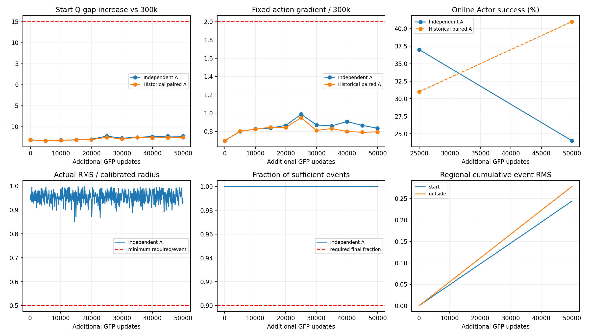

# 独立 A：参考 Actor 动作变化控制诊断

**裁决：MIXED_RESULT。** 持续更新达标，但没有同时通过较强收益标准。按混合结果保留，不能把未触发崩塌自动称为修复成功。

实验卡 GFP-INDEPENDENT-A-CONTROL-V1 于2026-10-16冻结，执行跨至2026-10-17。只有 Seed 3 全局350k这个分叉状态、一个50k续训分支。没有启动 B，没有加载密度模型，也没有增加任务、种子或搜索参数。

## 核心验收

| 项目 | 实测 | 预定标准 |
|---|---|---|
| 足额参考更新 | 500/500（100.0%） | 至少450/500 |
| 实际全局RMS / 标定半径，均值 | 0.9542 | 单事件至少0.5 |
| 幅度比最小 / 中位 / 最大 | 0.8514 / 0.9558 / 0.9980 | 起点与非起点均非零 |
| 零幅度事件 / 不同参考参数哈希 | 0 / 500 | 不把哈希变化代替幅度标准 |
| 最长连续联合异常 | 0个探针点 | 连续2点才判异常 |
| +50k行为崩塌 | False | 成功≤5%且起点滞留≥90% |
| +50k较强收益 | False | 成功≥25%、起点滞留≤30%、无连续联合异常 |

旧配对A平均实际半径比例为0.6815，本轮为0.9542。这排除了本轮依赖B额外压低共同步长的情况；A仍保留自己的动作变化上界，不能说所有减速都不重要。

参考更新每100次GFP更新执行一次。校准rho0=0.0005490051116794348，与前轮相同；保持独立起点/非起点幅度上界和跟随损失检验。A采用自己的可行候选，不再取A/B共同半径；初始候选/最多8次减半/6次区间细化均保留。删除的额外匹配阶段只用于前轮A/B配对。有限搜索不保证理论最大可行步长。

## 在线 Actor 评价

每点100回合，只部署原在线Actor，参考Actor不部署。

| 检查点 | 成功率 | 平均Return | 终点在起点区域 |
|---|---:|---:|---:|
| +25k | 37% | -1798.85 | 18% |
| +50k | 24% | -1856.27 | 34% |

旧配对A的25k/50k成功率为31%/41%，50k起点滞留14%；旧B为39%/41%、18%。历史L0原EMA为3%/0%、50k滞留100%；历史L1a固定TD Actor最终36%、滞留17%。这些是只读历史对照，没有重复训练；不能宣称逐位重放或当作多个独立训练重复。

本轮与历史A/B的初始观测100/100逐回合匹配，策略随机序列协议一致。下面区间只是固定模型间的配对回合bootstrap，不包含训练随机性，不能据此证明跨种子优势或算法等价。

| 比较 | 本轮减历史成功率（百分点） | 配对回合95%区间 |
|---|---:|---|
| +25k / 历史A | +6.0 | [-8.0, 20.0] |
| +25k / 历史B | -2.0 | [-15.0, 11.0] |
| +50k / 历史A | -17.0 | [-29.0, -5.0] |
| +50k / 历史B | -17.0 | [-30.0, -4.0] |

25k到50k的成功率下降13个百分点；同批初始条件中，29个回合由成功变失败，16个由失败变成功，8个均成功。配对回合bootstrap区间为[-26, 0]个百分点，仅描述这两个冻结模型，不能代替独立训练重复。50k相对历史配对A低17个百分点，配对回合区间[-29, -5]；仍不是跨训练种子的差异证明。

24%与25%的操作门槛只差一个回合，未达预设标准必须如实报告，但不等于已经证明方法无效。起点滞留34%也未达≤30%要求。综合判为混合结果：更新幅度恢复后没有重现原定义崩塌，但能力保留不足。此前较小步幅可能有帮助，目前不能把该历史差异归因于密度信息。

## 完整探针与动作变化

历史诊断锚点保持原300k，未改为350k。联合条件是起点相对全局Q差增量≥15且固定历史动作处梯度范数比≥2。方向相似度只作辅助，不是异常判据。

| 续训 | Q差增量 | 梯度范数比 | 梯度方向cos | 单点联合条件 |
|---|---:|---:|---:|---|
| 0k | -13.150 | 0.697 | 0.168 | 否 |
| 5k | -13.358 | 0.800 | 0.146 | 否 |
| 10k | -13.232 | 0.825 | 0.153 | 否 |
| 15k | -13.147 | 0.837 | 0.169 | 否 |
| 20k | -13.011 | 0.865 | 0.167 | 否 |
| 25k | -12.262 | 0.987 | 0.183 | 否 |
| 30k | -12.761 | 0.871 | 0.181 | 否 |
| 35k | -12.538 | 0.859 | 0.172 | 否 |
| 40k | -12.379 | 0.908 | 0.168 | 否 |
| 45k | -12.245 | 0.865 | 0.195 | 否 |
| 50k | -12.278 | 0.835 | 0.203 | 否 |

固定4032状态及两份固定噪声的纯前向审计提供另一种动作变化测量；下表路径是相邻5k检查点的RMS之和，不能等同连续参数路径。每100更新的独立拟合/检验批次路径另见regional_paths.csv。没有使用密度评分决定更新或验收。

| split / 区域 | 独立A粗路径 | 旧配对A粗路径 | 独立A最终净RMS | 旧配对A最终净RMS |
|---|---:|---:|---:|---:|
| val / start | 0.02731 | 0.02094 | 0.00731 | 0.00572 |
| val / outside | 0.03358 | 0.02521 | 0.00875 | 0.00723 |
| train / start | 0.02774 | 0.02108 | 0.00762 | 0.00592 |
| train / outside | 0.03196 | 0.02404 | 0.00838 | 0.00685 |

## 正确性与成本

- 同一350k源检查点SHA256：ffba11e943f7e192134b86093f4b2dc49efbe239cf2d32e3e884406358de1cca。源文件结束后未变，完整检查点索引见checkpoint_index.json。
- 零更新TD完全一致，总损失及梯度对照最大差0；首四次真实更新计入50k，在线网络确实变化而参考无隐藏EMA；模型、Adam计数、Agent/NumPy/Python RNG保存恢复通过。首500更新5/5事件足额，准入通过。
- 首事件与历史A输入身份一致；实际RMS差1.68e-07，不声称浮点计算逐位重现。GPU共享及编译差异属于历史比较限制。
- GFP更新总计50000，参考事件500；训练无环境交互，密度模型训练与加载均为0。评价200回合，参数更新0。
- 评价外部步365573，包含构造/reset的控制调用374373，物理子步1871865，均在400000 / 416666 / 2083330预算内。
- 训练含准入墙钟798.38秒、CPU 642.86秒，最大单训练进程RSS 6.93 GiB。评价进程及worker成本逐项见costs.json。GPU为共享使用，设备总利用率不能当作本作业独占利用率；未作独占算力效率比较。
- 训练、两点评价真实退出码均0；无重试、无额外训练、无参数调整；两点评价worker全部退出。轻量文件归档，权重、输入及完整日志留服务器。

## 证据边界与下一步

持续更新达标，但没有同时通过较强收益标准。按混合结果保留，不能把未触发崩塌自动称为修复成功。

这只回答一个已知异常中途窗口，不能证明长期训练、从头训练、其他种子或Task4有效；也不能据此否定数据支持信息在其他条件下的作用。收益不能被解释为已证明原始崩塌的唯一根因。下一步最值得区分的是：为何25k到50k的成功率下降、起点滞留增加，却没有触发预定义价值异常？可先只读定位受损回合与参考动作变化的关系，再决定是否需要新的干预；当前不据此升级密度模型，也不追加训练。

分支：[codex/gfp-independent-a-control-v1-20261016](https://github.com/rollinpioneer/graph/tree/codex/gfp-independent-a-control-v1-20261016)。提交与远端核验见receipts/git_verified.json。
