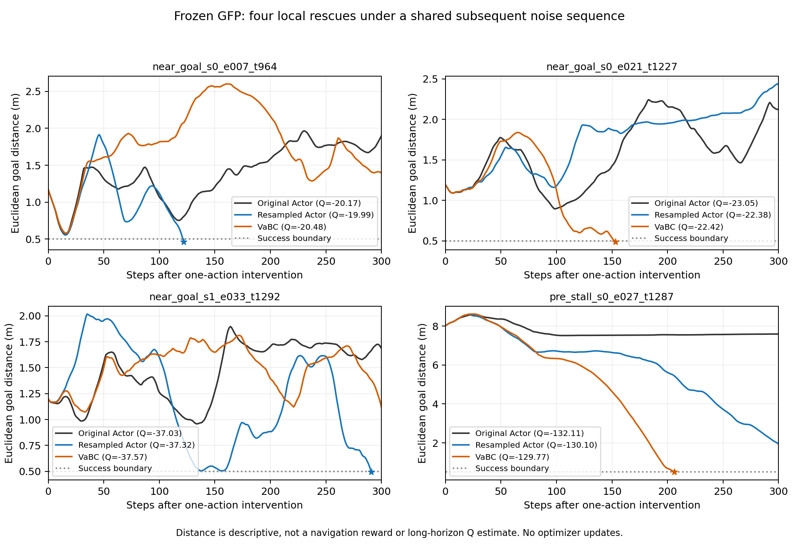

# 本轮结论：机制分支诊断与公开条件筛查

两部分均已执行，新增训练为0。停止在诊断与条件筛查，不启动模块实现或下一轮实验。

## 1. 同状态机制诊断

- 12个状态、36条分支，实际9,481环境步，低于10,800步上限。
- 12条原动作分支逐步精确重现旧轨迹，模型和checkpoint身份前后未变，退出码0。
- 8个失败状态中，4个仅改变首动作就在300步内成功：Actor重采样2个、VaBC2个。近目标3/4、停滞前1/4；这是选择性样本的局部计数，不是总体成功率。
- 两个局部救回状态中，在线/Target Critic均值最高的候选没有成功。但只有单次共同后续噪声和短窗口，且评分差小/ensemble有分歧，不能确证长期价值排序错误。
- 没有得到“统一是Critic坏了”“Actor不会生成好动作”或“必须加记忆/规划”的证据。后续最有价值的是检验这些局部现象是否跨后续动作随机序列重复；本轮不追加。

[完整机制报告](MECHANISM_REPORT.md) · [全部分支指标](branch_results.json) · [状态汇总](state_summary.csv)

## 2. 三张条件卡

| 条件 | 本轮证据 | 当前决定 |
|---|---|---|
| 延迟/历史 | Pipeline源码已有25步动作和流量历史；官方验证集20,000转移已校验，支持代码的20槽位队列语义 | 不以缺历史立项；保留完整输入利用问题，先处理论文/代码描述差异 |
| 安全约束 | DSRL有独立reward/cost接口；EpiFlow/SafeFQL覆盖直接相关机制 | 暂不选新模块方向；数据访问和信息/目标公平性尚待解决 |
| 移动与末段修正 | 现有权重和精确状态干预提供局部提案敏感性证据 | 保留诊断方向；尚未证明时间组织缺口 |

[条件A：历史](CONDITION_A_HISTORY.md) · [条件B：安全](CONDITION_B_SAFETY.md) · [条件C：修正](CONDITION_C_CORRECTION.md)

三者均不是已成立的论文贡献。新任务的GFP Baseline未训练，不能拿HumanoidMaze权重或默认配置充当其在新领域的最好水平。没有删去必要输入、改变物理规则、训练新模型或执行后续建议中的对照矩阵。

## 3. 差异、可信度与交接

- 旧轨迹raw_actions实际上经过官方采样接口clip，本轮已纠正解释，旧文件不改。
- Pipeline README的index字段在实读验证集不存在；done/truncated可准确还原20条边界。论文25步延迟/20条轨迹等描述与源码及train/validation区分需登记，未静默统一。
- DSRL固定源码映射已确认；服务器访问官方HF文件失败，数据与模拟器运行准入均未完成。
- 新分支初次归档因稀疏索引未初始化误记录继承文件删除，随后普通恢复提交已修复；旧分支/实验文件不变。最终归档必须校验对父提交仅新增本轮目录，不强推、不合并。
- 程序计时段80.523秒，完整进程墙钟上界84.119秒，CPU83.816秒，RSS峰值约1.29GiB。GPU0用于只读推理，显存峰值和精确GPU驻留时间未采样，不补造GPU成本。
- 完整数值分支留服务器 branches/，轻量指标含对应SHA；公开数据留sources/，不进入Git。sources/code_evidence_manifest.json固定11份官方源码证据；paper_evidence.json固定论文版本。

服务器根目录：/home/xushijie3/work/gfp_mechanism_and_condition_screen_v1_20261015

分支：[codex/gfp-mechanism-and-condition-screen-v1-20261015](https://github.com/rollinpioneer/graph/tree/codex/gfp-mechanism-and-condition-screen-v1-20261015)。本轮到此停止，后续重复回放、调参或训练另行决定。
