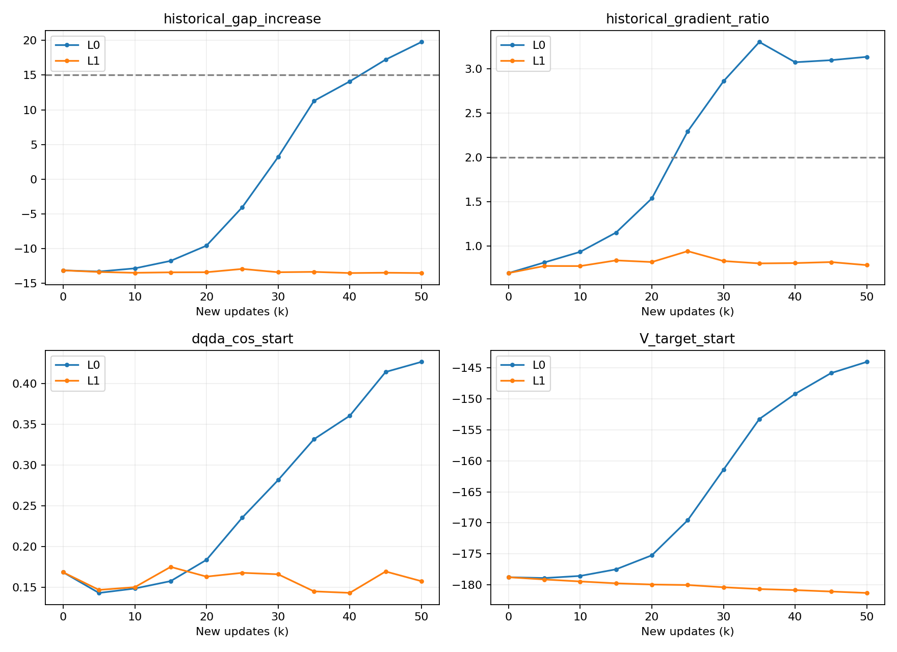

# 异常形成途中固定 TD 动作来源：配对结果

**符合情况 A：L0 重现崩塌，L1 未出现预定联合异常或行为退化。** 在本窗口，持续变化的 TD 动作来源对后续异常仍然重要；已有 Critic 状态没有使崩塌不可避免。

| 分支 | 新增更新 | 成功率 | 回合末在起点 | Return |
|---|---:|---:|---:|---:|
| L0 | 25k | 3% | 91% | -1979.27 |
| L0 | 50k | 0% | 100% | -2000.00 |
| L1 | 25k | 34% | 15% | -1779.34 |
| L1 | 50k | 44% | 15% | -1803.82 |

两臂各 50k，源全局 350k、终点 400k，每点评价 100 回合。仅部署在线 Actor。来源旧评价 26% 为历史记录，本轮未重复评价来源检查点。

## 曲线

| 最终指标 | L0 | L1 |
|---|---:|---:|
| 起点减全体价值差的历史增量 | 19.774 | -13.539 |
| 固定历史动作处梯度范数比 | 3.137 | 0.787 |
| 当前 Actor 动作的起点在线 Q | -143.586 | -181.325 |
| 非起点在线 Q | -151.570 | -151.385 |
| 相对原300k梯度方向余弦 | 0.427 | 0.157 |
| 相对350k梯度方向余弦 | 0.146 | 0.786 |

L0 在 +45k、+50k 连续满足联合阈值；L1 无满足点。L0 在 +25k 已出现行为退化，因此该数值阈值不是保证提前预警的指标。L1 最终相对原300k的梯度余弦仍仅0.157，未恢复为原健康方向，但阻止了后续局部价值抬升。

## 证据与推测的边界

前次分解显示目标漂移主要体现为 Target Critic 重新评分；本轮显示停止 TD 动作生成器的参数变化能改变后续结果。两者不矛盾：前者定位变化出现的位置，后者干预学习反馈。不能据此认定 Critic 无问题或某一个动作生成器是唯一根因。

这是一个被选择过的训练状态和50k窗口。L1 同时固定参考 Actor 与 TD VaBC，只支持联合干预；不能证明跨种子、从头训练、长期或 task4 的效果。100评价回合不是100个独立训练重复。

**下一问：收益主要来自固定慢参考 Actor，还是固定 TD VaBC？** 若以后获批，先区分两个因素；本轮不新增实验、不设计模块。

## 必要核验

- 源checkpoint完整恢复，模型、Adam、Agent/NumPy/Python随机状态齐全；源哈希前后不变。
- 分叉时TD目标完全相同；总损失和梯度在3e-5容差内一致。两臂真实fused4及保存恢复PASS，首4更新计入预算。
- L1每个保存点的参考Actor及TD VaBC参数哈希不变，在线Actor/VaBC/Critic/Target Critic更新正常。Guidance和Actor蒸馏未切换至固定副本。冻结参数不等于固定抽样动作。
- 每5k完整恢复PASS；最终Adam count=400000、TrainState.step=400001。两臂所有保存点Agent RNG一致。训练与四组评价真实退出码均0，无重试。
- 四组初始观测哈希逐回合一致。最终44个场景仅L1成功，56个两者均失败。
- L0复现崩塌但非逐位重演旧曲线：最终起点Q比旧R3多2.574，梯度范数多0.091。保留差异，不将固定RNG冒充跨编译/设备确定性。

## 成本与产物

新增更新100,000，评价400回合。外部步 756,324；含构造/reset控制调用 773,924/833,332；物理子步 3,869,620。
训练进程实测墙钟L0 372.68s、L1 394.44s，含加载/编译/探针/保存。合计 0.2131 GPU分配进程小时；不是精确GPU忙碌积分。
评价已计时合计 226.84s，排除恢复和环境启动。训练加已计评价共 0.2761 小时，是分配进程时长下界，不冒充完整GPU驻留成本。整轮派发至收尾 559.13s（9.32分钟）。
训练CPU合计 853.51s；评价子进程CPU未完整采集。训练最大RSS分别 6.118/6.126GiB。每条GPU进程曾采样11,000MiB，不声明严格显存峰值。

服务器：`/home/xushijie3/work/gfp_midwindow_td_freeze_v1_20261016`。完整权重、路径、日志保留服务器；轻量结果 results.json、paired_curves.png、每5k checkpoint身份JSON归档。
分支：https://github.com/rollinpioneer/graph/tree/codex/gfp-midwindow-td-freeze-v1-20261016
