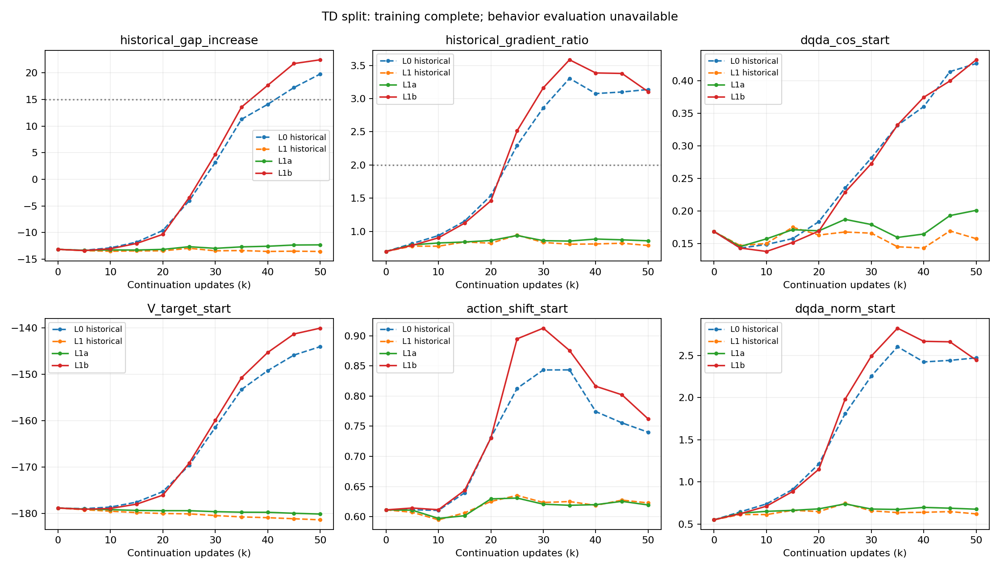

> 历史阶段快照：评价已获用户批准补做并全部完成。最终结论见 REPORT_ZH.md。

# GFP-MIDWINDOW-TD-SPLIT-V1：阶段结果与评价故障

**状态：两臂训练完成，评价失败暂停；尚不能裁决 H1/H2 的行为收益。**

| 分支 | 新增更新 | 最终价值差增量 | 最终梯度/300k | 连续联合异常 | +25k/+50k 成功率 |
|---|---:|---:|---:|---|---|
| L0（历史） | 50,000 | 19.774 | 3.137 | True，最长 2 点 | 3.0%/0.0% |
| L1（历史） | 50,000 | -13.539 | 0.787 | False，最长 0 点 | 34.0%/44.0% |
| L1a | 50,000 | -12.299 | 0.858 | False，最长 0 点 | 未取得/未取得 |
| L1b | 50,000 | 22.450 | 3.104 | True，最长 3 点 | 未取得/未取得 |

L1a 全程未触发联合异常，最终曲线接近历史联合冻结 L1。L1b +25k 时梯度比已达 2.51，但价值差增量仍为 −3.43；+40k、+45k、+50k 连续满足两项门槛，联合异常起始为 +40k、确认于 +45k。判据仍以原 300k 模型为锚点。

这支持“只固定参考 Actor 与数值稳定有关”的窗口内证据；缺少行为评价，不能宣称保留 L1 收益、不能判定 L1b 行为崩塌，也不能证明 Actor 是唯一根因。只有一个来源状态、一次配对续训；历史 L0/L1 未重跑，不声称逐位重放。

## 正确性与资产
来源 SHA256、模型/Adam/RNG 恢复、零更新 TD/损失/梯度对照、首四次真实更新及每5k完整恢复均通过；首四更新计入预算。指定冻结参数哈希不变，L1b 未冻结参考 Actor 正常变化。所有保存检查点再次核验文件 SHA256。总新增100,000更新，两训练退出码均0；原来源与历史对照轻量文件未改变。

## 评价故障与已采取操作
两条 +25k 评价均未完成环境初始化；L1a 三个、L1b 十个子进程 SIGSEGV（原生状态139）。分别读取一个属于本账号的 core：L1a 栈在 mjr_makeContext，L1b 栈在 mjr_readPixels，均进入 NVIDIA libnvidia-eglcore.so.610.57.04。故障发生于 OGBench 构造时的渲染；尚不能认定底层原因就是并发。
父进程等待全部 ready 消息，未发出任何评价策略动作。保存现场后，仅终止已核对身份的本卡挂起评价进程，父进程退出−15（人工清理，不能混同子进程 SIGSEGV）。两条 +50k 尚未启动；未重试训练或评价。完整 core 留服务器 diagnostics/，不入 Git。

## 成本
两训练内部墙钟353.04秒、375.52秒，CPU合计767.61秒；峰值RSS各约6.16GiB。GPU采样占用见 partial_results.json，不能解释为独占GPU耗时。
完成新评价0回合、策略环境步0。失败构造的精确计数随子进程丢失；依据20个构造、每个至多40次稳定动作，保守上界800控制调用、4000物理子步，不能冒充精确实测。评价CPU总量未完整保存。若四组评价各执行一次，含本次失败构造上界为818400控制调用、4092000物理子步，仍低于原预算；不得另加未登记测试回合。

## 待授权修复方案
evaluate_repair_pending.py 已准备，仅语法检查，未运行：串行化环境构造，保留 spawn、10评价环境和全部原种子；关闭父进程不用的管道端并保存启动阶段计数；首次发出策略动作前核对历史初始观测哈希。串行构造只是待验证缓解措施，不能宣称已修复 EGL。
需要明确批准后，失败的两组 +25k 各重做一次，再执行原计划两组 +50k；仍为400回合、0参数更新。失败目录保留，补做目录独立。若再次失败则停止，不自动重试。

分支：https://github.com/rollinpioneer/graph/tree/codex/gfp-midwindow-td-split-v1-20261016
完整权重与日志：/home/xushijie3/work/gfp_midwindow_td_split_v1_20261016
