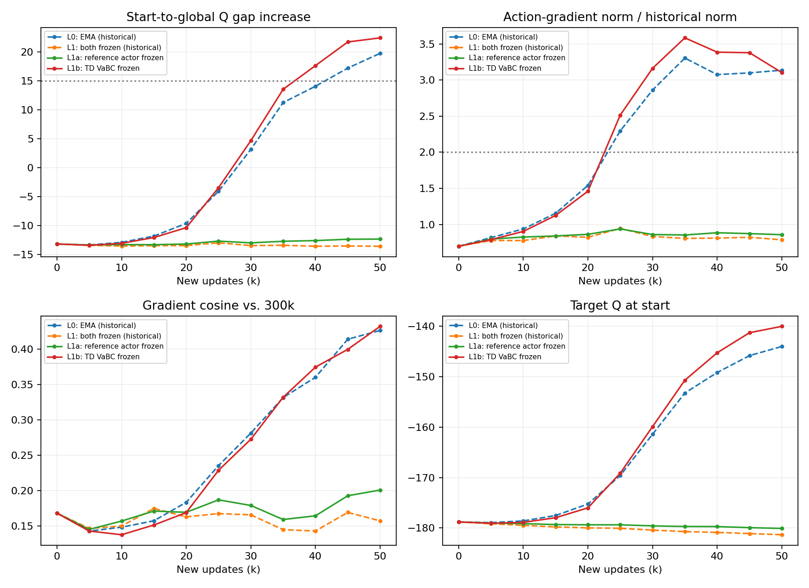
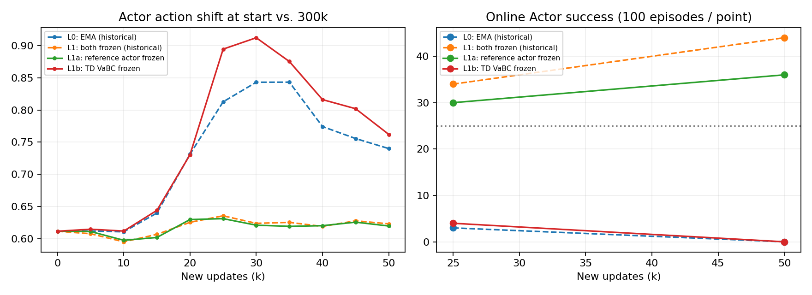

# GFP-MIDWINDOW-TD-SPLIT-V1：拆分实验报告

**支持H1/H2：本窗口单独固定TD参考Actor保留较强收益，而单独固定TD VaBC仍出现联合异常与行为崩塌。**

## 结果

来源为Seed3最慢EMA R3的全局350k完整状态。两新臂各续训50k至400k；历史L0/L1仅复用。各点评价100回合，只部署在线Actor。

| 分支 | 数据身份 | +25k成功率 | +50k成功率 | +50k起点终点占比 | +50k Return |
|---|---|---:|---:|---:|---:|
| L0：原EMA继续 | 历史复用 | 3% | 0% | 100% | -2000.00 |
| L1：Actor与VaBC均固定 | 历史复用 | 34% | 44% | 15% | -1803.82 |
| L1a：只固定TD参考Actor | 本轮新增 | 30% | 36% | 17% | -1812.89 |
| L1b：只固定TD VaBC | 本轮新增 | 4% | 0% | 100% | -2000.00 |

| 分支 | 联合价值异常 | 行为崩塌 | 较强收益保留 | 首次连续异常起点 |
|---|---|---|---|---|
| L0 | 是 | 是 | 否 | 45k |
| L1 | 否 | 否 | 是 | 无 |
| L1a | 否 | 否 | 是 | 无 |
| L1b | 是 | 是 | 否 | 40k |

较强收益要求成功率>=25%、起点终点占比<=30%、无连续联合异常；行为崩塌要求成功率<=5%且起点终点占比>=90%。未崩塌本身不等于有效。

## 完整曲线与终点指标

| 最终指标 | L0历史 | L1历史 | L1a新增 | L1b新增 |
|---|---:|---:|---:|---:|
| 起点减全体Q差相对300k增量 | 19.774 | -13.539 | -12.299 | 22.450 |
| 固定历史动作处梯度范数比 | 3.137 | 0.787 | 0.858 | 3.104 |
| 起点动作梯度范数 | 2.472 | 0.620 | 0.676 | 2.446 |
| 相对300k梯度方向余弦 | 0.427 | 0.157 | 0.201 | 0.432 |
| 起点在线Q | -143.586 | -181.325 | -179.952 | -140.406 |
| 非起点在线Q | -151.570 | -151.385 | -151.424 | -151.436 |
| 起点Actor动作相对300k位移范数 | 0.740 | 0.623 | 0.620 | 0.762 |

主锚始终为原300k模型及其固定动作；350k锚只作补充。价值Q在当前Actor动作处计算，梯度在固定历史动作处计算，二者不是同一种测量。联合异常是连续两个5k点同时达到Q差增量15和梯度范数2倍，不触发提前结束。

## 可信度与解释边界

- 源SHA-256：`ffba11e943f7e192134b86093f4b2dc49efbe239cf2d32e3e884406358de1cca`；源检查点和历史对照文件前后不变。OGBench1.1.0，原环境和固定源码核验一致。
- 分叉时两新臂与原L0/L1的TD目标一致；损失/梯度按3e-5容差通过。首4真实更新计入预算，在线网络学习、冻结哈希、更新计数与完整恢复均PASS。
- 每5k完整保存恢复；新臂Agent RNG逐点匹配历史L0，最终Adam count=400000、TrainState.step=400001。L1a只停止参考Actor EMA；L1b只固定TD VaBC，参考Actor继续原EMA。Guidance和蒸馏不变。
- 四个新评价及四个历史评价的初始观测哈希一致：True。严格配对解释允许：True。逐回合长度、成功、Return、区域和路径均保留。
- 两条训练及最终四组评价退出码均0；评价更新0。最初两组+25k评价因EGL原生崩溃失败，保留失败目录；用户明确批准后各补做一次。+50k为原计划首跑，无训练重跑、补种子或延长。
- 评价修复仅串行构造环境、指定EGL设备、关闭闲置管道及加入初始观测哈希检查；原spawn/10环境/物理规则/动作种子不变。修复后成功不能区分串行构造与指定设备各自贡献。
- 这是一个训练状态的一次拆分，历史对照未同期重跑。固定随机数不保证跨JIT编译/设备逐位重放，续训非确定性仍是限制；评价回合不是独立训练种子。
- 若支持Actor连接，仅说明本窗口单独固定它足以达到预设收益标准；不能宣称VaBC无作用、Actor是普遍唯一根因，或已证明从头训练/长期/Task4有效。不能直接返回BFC V1限幅方案。

## 新增成本

新增更新100,000，评价400回合；外部步762,203，成功评价的含构造/reset控制调用779,803，物理子步3,899,015。另计失败构造控制调用上界800、物理子步上界4000；合计保守上界780,603/833,332及3,903,015/4,166,660，失败项不是精确测量。
派发至全部收尾墙钟1680.27s（28.00分钟）。GPU放置进程的内部计时时长合计0.2847小时，派发至退出轮询口径0.2916小时；后者含最多一个轮询周期的尾部误差，均不是GPU忙碌积分，且不含失败评价的进程计时成本；失败父进程的派发与停止时间另存回执。
训练、成功评价主进程与已回收子进程的已测CPU合计1445.81s。失败评价CPU成本缺失，不能把已测合计当全部成本。各作业最大RSS、GPU采样峰值及首次至末次采样驻留跨度见cost.json。采样峰值不是严格全程峰值。

## 交付与停止

服务器根目录：`/home/xushijie3/work/gfp_midwindow_td_split_v1_20261016`。每5k完整权重、原始路径和日志留服务器；配置、代码差异、逐回合轻量评价、曲线、恢复回执和成本均归档。
分支：https://github.com/rollinpioneer/graph/tree/codex/gfp-midwindow-td-split-v1-20261016
本轮已停止，不启动新模块、额外损失、更长训练或Task4扩展。
