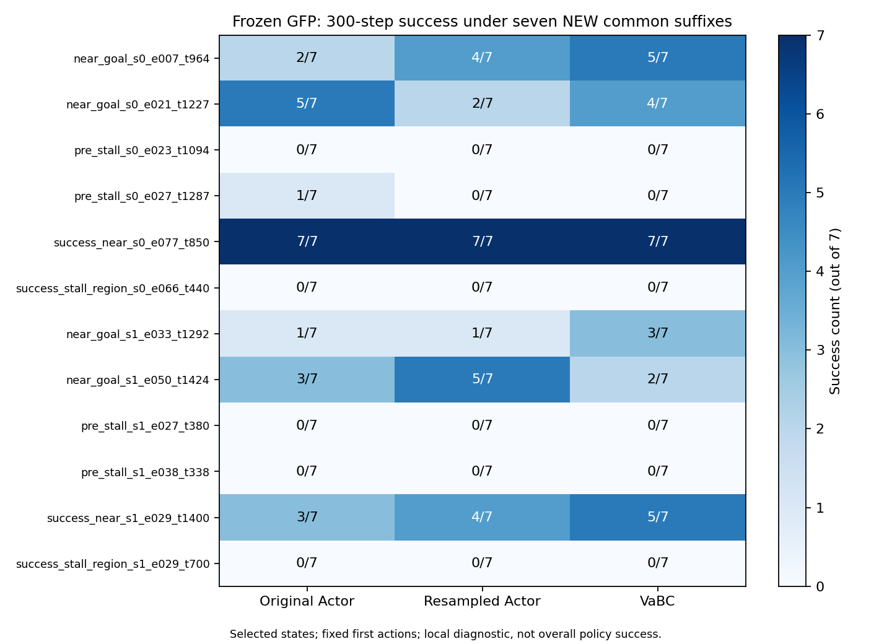

# GFP 首动作替代的稳健性验证

结论：存在局部正向线索，但本轮没有建立“稳定生成有效替代动作却未执行”的普遍机制。此前四个获救配对均未达到预先冻结的重复获益门槛（0/4）；按卡停止扩展，不增加模块、不调参、不训练。此结论不是证明替代动作永远无效。

完成12状态 × 3个旧首动作 × 7条新共同后续随机序列，共252条新分支、62,041个环境步，参数更新0。原来的36条分支只读取，不重跑。以下主结果完全排除旧序列。

## 四个预先指定的复验对象

配对胜：替代动作成功而原动作失败；负为反向；其余为平。全部是在相同后续随机序列下比较。

|状态|替代动作|原动作成功/7|替代成功/7|胜/负/平|
|---|---|---:|---:|---|
|near_goal_s0_e007_t964|Actor 重采样|2|4|2/0/5|
|near_goal_s0_e021_t1227|VaBC|5|4|1/2/4|
|near_goal_s1_e033_t1292|Actor 重采样|1|1|1/1/5|
|pre_stall_s0_e027_t1287|VaBC|1|0|0/1/6|

运行前冻结的操作性门槛：同一配对至少4胜、至多1负；至少2/4个旧获救配对达到门槛才继续该窄假设。本轮0/4通过。门槛是小样本研究决策规则，不是显著性检验，也不是对所有可能收益的否定。

## 所有状态：新7条与旧1条分开

每格顺序为 原 Actor / Actor 重采样 / VaBC。旧序列已经参与候选线索发现，合并8条只能作为辅助记录。

|状态|新7条成功数|旧1条成功数|合并8条成功数|
|---|---|---|---|
|near_goal_s0_e007_t964|2 / 4 / 5|0 / 1 / 0|2 / 5 / 5|
|near_goal_s0_e021_t1227|5 / 2 / 4|0 / 0 / 1|5 / 2 / 5|
|pre_stall_s0_e023_t1094|0 / 0 / 0|0 / 0 / 0|0 / 0 / 0|
|pre_stall_s0_e027_t1287|1 / 0 / 0|0 / 0 / 1|1 / 0 / 1|
|success_near_s0_e077_t850|7 / 7 / 7|1 / 1 / 1|8 / 8 / 8|
|success_stall_region_s0_e066_t440|0 / 0 / 0|0 / 0 / 0|0 / 0 / 0|
|near_goal_s1_e033_t1292|1 / 1 / 3|0 / 1 / 0|1 / 2 / 3|
|near_goal_s1_e050_t1424|3 / 5 / 2|0 / 0 / 0|3 / 5 / 2|
|pre_stall_s1_e027_t380|0 / 0 / 0|0 / 0 / 0|0 / 0 / 0|
|pre_stall_s1_e038_t338|0 / 0 / 0|0 / 0 / 0|0 / 0 / 0|
|success_near_s1_e029_t1400|3 / 4 / 5|0 / 0 / 0|3 / 4 / 5|
|success_stall_region_s1_e029_t700|0 / 0 / 0|0 / 0 / 0|0 / 0 / 0|

## 正反证据与研究解释

- s0 e007 仍有正向线索：Actor 重采样比原动作2胜0负；VaBC 为3胜0负，成功数5/7。但这些不足以建立跨状态稳定缺陷。
- s0 e021 的原动作在新序列下成功5/7，旧获救 VaBC 为4/7，配对1胜2负。旧的单次获救不能预测此次相对优势。
- s1 e033 的旧获救 Actor 重采样与原动作均1/7，配对1胜1负。另一个固定 VaBC 动作成功3/7，是应保留的探索性线索，不能事后替代预先指定的复验对象。
- s0 e027 停滞前状态的旧获救 VaBC 成功0/7，原动作1/7。首动作效果依赖后续随机序列。
- s1 e050 的 Actor 重采样成功5/7，原动作3/7，但配对4胜2负，存在收益也存在损失。VaBC 2/7，不能据此宣称 VaBC 普遍优于普通 Actor 重采样。

本轮只检验固定候选动作在不同后续随机序列下的效果，没有测试在线多采样选择器。能由事后观察挑出某个成功分支，不等于策略知道如何选择。不同状态的后续随机种子共用，两个成功对照还来自同一原始回合，不能把所有分支当作独立同分布样本做总体推断。

## 停滞前状态：不能只看300步内成功

以下为7条新序列平均值，距离进展为初始减最终距离，正值表示末端更接近目标；碰墙为有墙接触的步骤占比。停滞为所有完整100步窗口中，离窗口起点最远距离仍小于0.5m的比例。

|状态|首动作|末端距离进展(m)|墙接触比例|停滞窗口比例|
|---|---|---:|---:|---:|
|pre_stall_s0_e023_t1094|原 Actor|-0.159|0.153|0.058|
|pre_stall_s0_e023_t1094|Actor 重采样|1.247|0.296|0.156|
|pre_stall_s0_e023_t1094|VaBC|0.633|0.207|0.112|
|pre_stall_s0_e027_t1287|原 Actor|4.022|0.051|0.008|
|pre_stall_s0_e027_t1287|Actor 重采样|1.470|0.094|0.026|
|pre_stall_s0_e027_t1287|VaBC|1.659|0.100|0.000|
|pre_stall_s1_e027_t380|原 Actor|-0.768|0.256|0.088|
|pre_stall_s1_e027_t380|Actor 重采样|0.113|0.123|0.065|
|pre_stall_s1_e027_t380|VaBC|-1.431|0.180|0.061|
|pre_stall_s1_e038_t338|原 Actor|7.639|0.055|0.000|
|pre_stall_s1_e038_t338|Actor 重采样|8.154|0.085|0.000|
|pre_stall_s1_e038_t338|VaBC|8.493|0.067|0.014|

停滞前4个状态中，原动作总共1次300步内成功，两个替代来源均0次。这不是说没有短期位置变化：例如 s1 e038 三者平均末端距离进展约7.64/8.15/8.49m，均未成功，说明短窗口成功指标受起点距离限制；s0 e023 重采样末端进展改善，但墙接触与停滞比例同时升高。位置进展不等于路线正确，低头也不等于跌倒原因。完整次级指标和每序列配对差保存在 summary.json 与 new_branch_metrics.csv。

## 可信度、身份和成本

原始 GFP commit：`1abbd5f0e287caf9bda70e7bc655d0a499ac8401`；仅用 seeds 0/1 的1M冻结权重。任务 HumanoidMaze-medium task1；OGBench1.1.0、MuJoCo3.3.5、JAX0.6.2。完整模型/优化器/Agent RNG 和 checkpoint 哈希前后不变；全部252次初始恢复及首步状态、奖励、终止检查通过，最大首步误差0。六条分支的数值指标另作粗粒度复算，252个文件哈希核验通过。没有调用参数更新入口。

实际进程退出码0；墙钟220.81秒，CPU 193.54秒，进程峰值RSS 1338.5 MiB。GPU4共享运行，5秒采样的本进程显存峰值680 MiB；进程墙钟折合0.06134 GPU驻留小时上界，非独占整卡算力消耗。正显存采样跨度205.45秒；采样不能给出精确GPU忙碌积分。代码准备、归档时间未算训练或推理吞吐。

## 停止点与交付

此次窄问题已完成，停止新增环境交互。只保留“特定状态下候选动作有局部收益且依赖后续随机性”的观察，不升级为 Critic 排序错误、动作时间组织缺陷或新模块依据。样本量小，未排除小幅真实收益；但当前证据不足以支持继续包装为稳定复杂控制机制问题。

分支：[codex/gfp-proposal-robustness-v1-20261015](https://github.com/rollinpioneer/graph/tree/codex/gfp-proposal-robustness-v1-20261015)。冻结协议提交594fc91eacd16280f08efae0cf6dc7eb1e886bcd，执行代码提交94428fa117e12d54e3cdebed2fde0e1e6a11ec73，均在新增交互之前推送验证。

服务器根目录：`/home/xushijie3/work/gfp_proposal_robustness_v1_20261015`。完整252条数值轨迹在 branches/，身份索引 reports/branch_index.json；代码、卡、配置、原始轻量指标与回执入新分支，旧文件与旧结果不变。最终归档提交见 receipts/final_archive.json。
