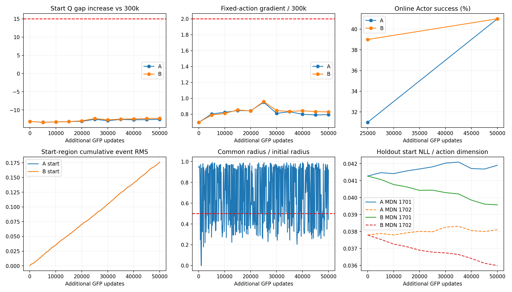

# A/B 数据支持约束对照结果

**结论：本轮未建立数据支持约束的额外收益；完整方法准入为 INCONCLUSIVE / DIAGNOSE。** 两臂都避免了本窗口的价值异常和行为崩塌，最终成功率相同。但持续更新幅度门槛未通过，不能升级为“数据支持提供额外保护”，也不能宣称两种算法等价。没有追加训练或重跑评价。

## 已完成的实验

从 seed3 全局350k的同一完整检查点出发，A、B各新增50,000次离线GFP更新，总100,000次；首4次和500次准入已计入。每100次更新同步参考网络，共1,000次参考更新尝试。两臂+25k、+50k各100回合，共400回合。密度模型更新0、在线训练0。

A为普通动作变化约束；B在相同拟合方向上增加模型1701的两区域密度非恶化约束。1702只审计。两臂共享实际动作半径；A方向不读取密度，但A的共同半径可以被B可行性压低。**A因此是配对实验控制，尚不是独立部署方案；也不是历史参数EMA实验的重复。**

## 行为与完整曲线

| 臂 | 新增更新 | 成功率 | Return | 终点仍在起点区域 |
|---|---:|---:|---:|---:|
| A：普通变化约束 | 25k | 31% | -1826.12 | 20% |
| B：数据支持约束 | 25k | 39% | -1770.82 | 19% |
| A：普通变化约束 | 50k | 41% | -1812.69 | 14% |
| B：数据支持约束 | 50k | 41% | -1783.98 | 18% |

25k时B−A为+8个百分点，配对回合bootstrap 95%区间[-5,21]；50k为0个百分点，区间[-14,13]。区间只描述本评价集合中两个冻结策略的差异，不代表训练种子间不确定性，不能用来证明算法等价。

每5k的11个探针点中，两臂均没有联合价值异常。50k时，相对原300k锚的起点减全局价值差增量为A -12.558、B -12.280，未达到+15阈值；固定历史动作处梯度范数比为A 0.794、B 0.829，未达到2倍阈值。两臂均满足本卡较强收益保留标准，均不满足行为崩塌标准。

## 最关键的限制：完整持续更新门槛未通过

零更新检查与首500次真实更新准入均通过：TD目标一致、梯度最大绝对差0，前5次参考更新全部满足匹配和持续更新要求。**这不代表后续500个事件都通过。**

- 总体动作匹配498/500（99.6%）；分区匹配499/500；两项同时通过498/500。
- 每个5k窗口的分区累计事件路径差均低于10%；留出集粗粒度路径差为起点2.42%、非起点3.67%，B略大，未发现B的整体动作路径比A更小。
- 但只有326/500（65.2%）事件的共同半径达到初始半径一半，低于预定90%门槛。174次低幅度事件从+700更新就开始出现，不仅发生在训练末期。
- 这174次中，B的最大已验证可行半径都小于A，匹配器随之同时缩小两臂更新。平均共同半径为初始半径的68.1%，中位数75.7%；2次共同半径为0。
- 因此不能说参考网络永久冻结；但也不能把“参数非零变化”当作已经满足本卡的持续跟进要求。当前结果无法排除共同减速解释。

两臂的幅度**彼此接近**与两臂**都达到足够的更新幅度**是不同的要求。本轮前者基本成立，后者不成立。按冻结规则，准入后单纯匹配偏离只记录、不调参，因此两臂仍完成了50k预算；没有为改善结果放宽门槛。

## 支持模型有没有提供不同信息？

B在77.6%的事件中触发至少一个投影约束。50k留出起点上的NLL/动作维：模型1701为A 0.04191、B 0.03957；未参与约束的1702为A 0.03810、B 0.03600。1702低支持尾部比例为A 1.458%、B 1.354%。两个模型都认为B的支持评分略好，不能解释为只利用了1701的偏差。

但评分改善幅度小，也没有转化为本轮最终成功率优势。两个模型共享训练数据和架构，不是独立行为真值；已有稀有完整绕行正例的留出轨迹数量有限，限制继续保留。更高密度也可能偏好模式中心，不能直接当作更有效的动作。

## 可信性、成本与实现差异

- 来源检查点、两个行为模型哈希未改变。0/4/500及每5k检查点均核对完整恢复、Adam与更新计数；两臂训练RNG保持相同。内部reference EMA关闭；在线Actor、VaBC、Critic和Target Critic仍学习。
- 四组评价均正常退出0，在线Actor部署、随机协议与历史修复版一致，400回合初始观测哈希按对应回合全部匹配。评价参数更新0，检查点前后哈希不变。
- 新增外部环境步719,513；含构造/reset的控制调用737,113；物理子步3,685,565，均低于800,000 / 833,332 / 4,166,660上限。训练和审计不构造环境。
- 准入及正式续训共679.7秒墙钟、826.8秒CPU，训练进程峰值RSS约7.17 GiB；使用GPU0。评价使用GPU6/7和5/4，四个评价进程墙钟分别约54.4、56.5、74.8、51.3秒，其中有并行。墙钟含编译、保存和同步，不能当作纯GPU计算时间。
- 参考方向与候选搜索的事件时长保留，但未把反向、JVP、回溯及同步等待逐项独立计时；不提供无法重建的子项精确GPU成本。
- 初次零更新准备因JAX采样shape接口写错退出1，修正为tuple后继续，额外48.5秒墙钟已保留，旧日志未覆盖。该次GFP/参考更新和环境步均为0，没有重跑训练。首次准备的CPU/峰值显存未完整计量，不补造。
- 汇总时仅修正NumPy布尔值的JSON写入；未重跑训练或评价。实际训练源码与损失、奖励、数据、目标时序保持原样；本卡新增部分仅为参考更新与其匹配/审计。

## 决策

| 问题 | 本轮判断 |
|---|---|
| B比A更能防止崩塌吗？ | 未建立；两臂都未崩塌。 |
| B最终任务表现更好吗？ | 未建立；都是41%，配对区间较宽。 |
| 参考Actor是否完全不动？ | 否；存在持续参数与动作变化，但幅度门槛仅65.2%通过。 |
| 数据支持模型是否改变更新？ | 是；经常触发投影并限制共同半径，但这不是独立保护效果的证明。 |
| 能否直接升级数据支持方案？ | 不应；降低其优先级，保留本次负/不可裁决证据。 |

下一步最值得验证的一个问题是：**不使用密度模型决定步长时，普通动作变化约束能否在保持足够持续更新的情况下保留当前稳定性？** 这是排除本轮“B同时拖慢A”的必要问题，尚未运行，也不由本卡授权追加训练。当前不开发新模块、不转入新种子或Task4。

本结论仅针对一个350k暖启动分叉、一个50k窗口。所有细节见同目录逐回合表、匹配表、成本、检查点索引；完整权重、候选记录和日志保留服务器。
