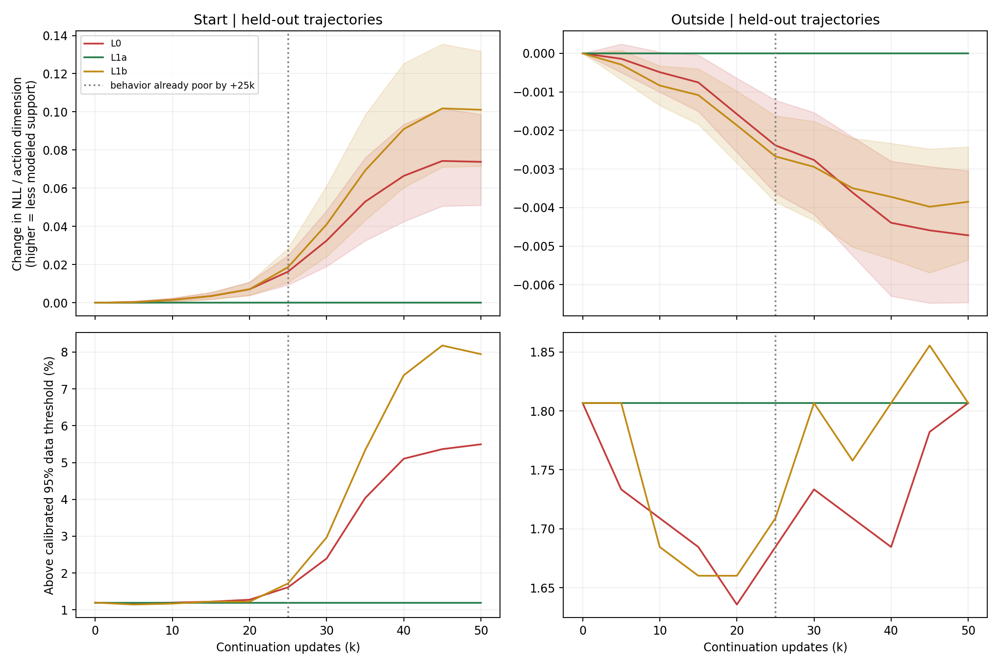
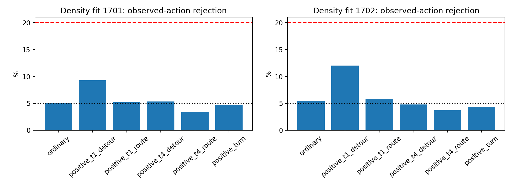

# 参考 Actor 的离线行为支持检查

**结论：DIAGNOSE。存在可重复的、集中于起点区域的支持度下降；尚不能认定崩塌由严重脱离离线数据支持引起。**

L0 和 L1b 的参考动作在独立行为密度模型下逐渐变得不那么常见，L1a 的评分保持不变。这一变化在训练数据和留出数据、两次独立密度拟合、两组固定动作噪声下方向一致。可是，行为已明显恶化时，低支持尾部比例仍很小；后期大部分参考动作也没有越过真实数据校准的阈值。因此，“数据支持约束值得保留为候选”与“已经找到应当实施的数据约束机制”是两种不同结论，本轮只支持前者。

## 完成范围

读取 L0、L1a、L1b 各 11 个完整检查点，覆盖全局 350k–400k，每 5k 一个点。使用固定 4,032 个真实数据状态及两组配对高斯输入，共生成 266,112 个参考动作。状态均可作为 TD 下一状态，保留对应的真实数据动作。train 各 1,024 起点/非起点状态；独立 test 为 960 起点、1,024 非起点。每条轨迹每区域最多 32 个状态，统计区间按轨迹聚类，不把相邻状态视为独立实验。

独立评估器为 8 分量条件高斯混合模型，输入完整 69 维观测，输出 21 维动作密度。两层 256 隐层，每个拟合种子 15k 监督更新，共 30k；只用原始未加权行为数据，不读取 Critic、Q、Guidance 或 VaBC 评分。原 GFP 更新 **0**，环境构造、reset 和 step 均 **0**。

原始 train 1000 条轨迹用于拟合，官方 validation 的 100 条轨迹按完整轨迹分成 50 条校准、50 条测试。用校准 NLL 选择模型，独立测试只用于检验。原始数据与宿主实际训练缓存抽查 1,000 个对应状态动作，最大误差均为 0。

## 观察结果

下表为留出起点区域的低支持尾部比例：行为模型 NLL 超过同区域校准真实动作的 95% 分位阈值。数字平均了两个密度拟合与两组噪声，**不是四次独立训练实验，也不是失败概率**。

| 分支 | 0k | +20k | +25k | +50k | 历史 +50k 成功率 |
|---|---:|---:|---:|---:|---:|
| L0：参考 Actor 正常 EMA | 1.20% | 1.28% | 1.61% | 5.49% | 0% |
| L1a：固定参考 Actor | 1.20% | 1.20% | 1.20% | 1.20% | 36% |
| L1b：只固定 TD VaBC | 1.20% | 1.22% | 1.72% | 7.94% | 0% |

同一组留出起点状态的**真实数据动作**，平均尾部比例为 **5.94%**。因此，不能把 L0 后期 5.49% 描述为整体已严重失去支持；L1b 的 7.94% 也只是温和超过这个对照。两臂后期平均 NLL 仍低于真实数据动作，意味着按这个模型，它们的平均密度仍较高。密度模型也可能偏爱保守或接近某个模式中心的动作，高密度不保证动作有效。

连续评分比阈值更早显示变化。起点区域每动作维度 NLL 相对 0k 的增量为：

| 分支 | +10k | +20k | +50k |
|---|---:|---:|---:|
| L0 | +0.00150 | +0.00703 | +0.07382 |
| L1a | 0 | 0 | 0 |
| L1b | +0.00142 | +0.00704 | +0.10110 |

两密度模型和两噪声下，+10k、+20k 的轨迹聚类区间下界均大于 0，支持小幅但一致的相对变化；这是条件于本次冻结模型与状态的逐点区间，没有多重比较校正，不是跨训练种子的显著性结论。+20k 尾部比例的变化区间仍包含 0。L0/L1b 到 +25k 的历史成功率已经只有 3%/4%，所以后期尾部增长不能当作领先于行为恶化的预警证据。早于 +25k 的精确行为退化时间没有评价记录，不能重建。

变化具有空间集中性。非起点留出区域 +50k 的 NLL 变化分别为 −0.00472、−0.00385，尾部比例都保持约 1.81%；训练集也呈现“起点变差、其他区域不变差”的模式。L1a 的参考参数冻结、状态和噪声固定，因此评分完全不变是应有的实现检查，不能算独立支持 H1 的证据。

图的两列纵轴刻度不同；非起点的绝对变化远小于起点，不应按线条斜率直接比较。

## 评估器能信到什么程度

| 检验 | 两次拟合结果 | 含义 |
|---|---|---|
| 真实动作 vs 跨状态置换动作 AUC | 0.9969 / 0.9972 | 学到了明显的状态—动作关联 |
| 真实动作 vs 均匀随机动作 AUC | 0.99977 / 0.99981 | 能识别粗粒度偏离 |
| 普通留出真实动作误拒率 | 5.07% / 5.51% | 与 5% 校准水平接近 |
| 实际转弯片段误拒率，50 轨迹 | 4.74% / 4.39% | 没有普遍排斥转弯片段 |
| Task1 绕行进展片段，16 轨迹 | 9.30% / 12.02% | 比普通动作更易被误拒，需保留偏差 |
| Task4 绕行进展片段，24 轨迹 | 5.37% / 4.79% | 通过预设粗粒度筛查 |

Task1 和 Task4 完整路线片段在独立测试中各只有一条轨迹，**无法验证对完整稀有正确路线的普遍可靠性**。转弯/绕行标签来自实际观测到的位置序列和 BFS 进展，不是单步动作最优性标签。置换/均匀动作也不全是已知错误动作，AUC 不证明能可靠识别“很接近数据但有害”的动作。

本次得到的是行为密度代理，不是真实支持集合。只评估真实数据状态上的参考动作，没有覆盖闭环部署产生的异常姿态。数据采集包含变化目标和历史控制因素，单状态条件模型可能不能表示全部行为多模态。两拟合种子只检验评估器重复性；GFP 仍只有一个分叉训练状态。

## 决策

| 命题 | 本轮判断 |
|---|---|
| 两个崩塌分支的参考动作在起点区域相对越来越少见 | 支持，跨数据 split、拟合和噪声重复一致 |
| 在行为明显恶化前已出现显著低支持尾部扩张 | 未支持；连续评分先小幅变化，尾部早期基本不变 |
| 大部分参考动作已脱离可靠数据支持 | 未支持 |
| 支持度下降是崩塌根因，数据约束必然能修复 | 未检验，仍需因果干预 |
| 数据支持约束应立即成为唯一主线 | 不支持；保留候选，暂不开发新模块 |

**下一步最值得验证的一个问题：在参考 Actor 更新速度和动作变化幅度匹配时，数据支持约束是否比不看数据的普通变化约束，多产生保护作用？** 这个对照才能区分“约束了缺乏支持的变化”与“只是让参考 Actor 更少变化”。当前不启动该训练。若没有额外作用，应降低方案 1 优先级，转向 Critic 对受支持动作变化的学习响应。

## 身份、成本与局限

33 个原检查点均与其 SHA 清单一致，读取前后哈希不变；三个分支 0k 参考动作逐位一致，L1a 全程一致。全部计算正常退出。开始时由于留出起点状态不足 1024，第一次准备在拟合前退出；保留每轨迹上限，改为实际 960，失败日志和 10.17 秒成本保留。

主流水线 94.18 秒：准备 8.19 秒，两次监督拟合进程 23.86/23.05 秒，冻结推理进程 39.08 秒；汇总 2.28 秒。主流水线累计 CPU 162.54 秒。共享 A100 40GB GPU0，GPU 计算进程墙钟合计约 86 秒，**不是独占 GPU 使用时长**；峰值进程 RSS 约 1.95 GiB。未测到进程级显存峰值或积分 GPU 利用率，不能补造 GPU 成本。资产读取、身份复查和制表的额外墙钟未逐项计量。预检一次未限定设备的 pickle 读取触发 CUDA1 初始化显存不足警告，随后限定 GPU0 和关闭预分配；未更新 GFP 或中断其他作业。

服务器：`/home/xushijie3/work/gfp_reference_support_diagnostic_v1_20261016`。

代码、冻结卡、完整轻量曲线和校验回执归档在 [本轮分支](https://github.com/rollinpioneer/graph/tree/codex/gfp-reference-support-diagnostic-v1-20261016)。模型、完整数值数组留服务器 `models/`、`arrays/`；未新增 GFP 权重或环境轨迹。
