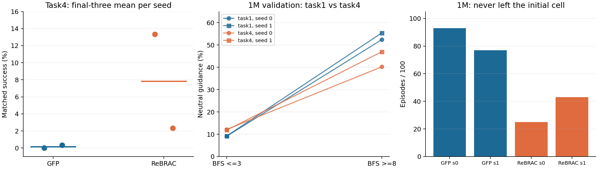

# GFP task4 Baseline 与 Guidance 联合诊断报告

日期：2026-10-15。实验卡：GFP-TASK4-BASELINE-PILOT-V1。**训练、统一评价和只读 Z2 已完成。总体裁决：DIAGNOSE；目前不支持进入动态温度或新 Guidance 模块训练。**

## 1. 完成情况与主要结果

task4 的低成功现象已在本地重现，但“远距离权重中性化造成失败”的因果链未建立。GFP 两条新训练各完成 1M 更新、exit=0；ReBRAC 两条复用指定 seeds 0/1 的已完成原版资产，通过配置、原版损失/梯度和模型身份核验，没有重复训练。合计逻辑范围为 4M，新增正式更新为 2M，在线更新为 0。

主要结果来自 800k、900k、1M，每点 100 回合的统一评价；每个训练种子取最后三点算术平均。共 1,200 回合，100 个 episode 的初始观测哈希在四模型、三个检查点之间完全一致。

| 方法 | 种子 | 800k | 900k | 1M | 三点平均成功率 | 三点平均 Return |
|---|---|---|---|---|---|---|
| GFP | 0 | 0.00% | 0.00% | 0.00% | 0.00% | -2000.00 |
| GFP | 1 | 0.00% | 0.00% | 1.00% | 0.33% | -1995.85 |
| ReBRAC | 0 | 19.00% | 17.00% | 4.00% | 13.33% | -1921.14 |
| ReBRAC | 1 | 1.00% | 6.00% | 0.00% | 2.33% | -1986.64 |

GFP 两种子均值 **0.17%**，ReBRAC **7.83%**。两种子三点均值的描述性总体标准差分别为 0.17、5.50 个百分点（若使用样本标准差则为 0.24、7.78）；这些不是置信区间。ReBRAC seed0 从 19% 降至 4%，seed1 从 1% 到 6% 再到 0%，不能挑最高点。此小样本不足以证明稳定的跨种子优势。

Native Actor 成绩另列，保持作者聚合方式：

| 方法 | 种子 | 800k | 900k | 1M | 三点平均 |
|---|---|---|---|---|---|
| GFP | 0 | 0.00% | 0.00% | 0.00% | 0.00% |
| GFP | 1 | 0.00% | 0.00% | 0.00% | 0.00% |
| ReBRAC | 0 | 14.71% | 12.87% | 4.00% | 10.53% |
| ReBRAC | 1 | 0.00% | 9.00% | 0.00% | 3.00% |

Native GFP VaBC 在最后三点：seed0 为 0/0/0%，seed1 为 0/1/2%，三点均值 0/1%。Native 的向量环境完成回合数可能略超过 100，保留实际统计；ReBRAC 的历史 spawn 未显式继承全局 NumPy/Python RNG，与本卡 GFP 不同，因此主比较采用 matched。逐检查点 Return、native 全曲线和逐回合回执见附属 JSON/CSV。

此前 Z0 核验的作者八种子 task4 汇总为 GFP 3.00±6.62%、ReBRAC 19.50±17.46%（种子标准差）；本轮只能说重现了困难现象，不能声称精确复现该八种子均值。task1/task4 均使用 navigate、discount=.995；未混入 stitch 的 .999。task3 绕行比更高却表现较好，仍是单调“绕行难→失败”解释的反例。

## 2. Guidance 的证据链

Z2 固定模型为 task4 GFP 两种子的 200k/600k/1M，沿用 task1 原始采样索引：两 split 各 100 批×256，主状态 307,200；额外两个 RNG 重复各 10 批，敏感性 61,440；合计 **368,640 次状态推理**。Z2 参数更新、环境创建/步进均为 0。整批在线 Actor Q 的归一化保持原训练语义，之后才按目标 BFS 分组。目标奖励和距离均使用各自 task，未用 task1 Critic 评价 task4。

下表为独立验证集 1M。近距离 BFS≤3，远距离 BFS≥8；中性区为 0.4≤g≤0.6。控制项包括欧氏距离及平方、姿态、速度和轨迹固定效应，区间以数据轨迹为簇 bootstrap 200 次。

| 模型目标 | 种子 | 近处中性比例 | 远处中性比例 | 远处代理 AUC | 调整后 BFS 系数 [95%区间] |
|---|---|---|---|---|---|
| task1 | 0 | 9.13% | 52.43% | 0.518 | 0.0614 [0.0521, 0.0703] |
| task1 | 1 | 9.27% | 55.43% | 0.512 | 0.0731 [0.0637, 0.0816] |
| task4 | 0 | 12.19% | 40.21% | 0.486 | -0.0006 [-0.0075, 0.0063] |
| task4 | 1 | 11.89% | 46.99% | 0.510 | 0.0270 [0.0203, 0.0347] |

1. **H1a：描述性趋势存在，独立距离效应不稳健。** task4 远处中性比例为 40.21/46.99%，高于近处的 12.19/11.89%，两种子三个检查点的未调整远近差均为正。但表现较好的 task1 远处中性化更强，为 52.43/55.43%；task4 seed0 控制其他变量后 1M 的 BFS 系数接近零且区间跨零，seed1 为正。不能复述为“两个 task4 种子都存在相同独立距离效应”。
2. **H1b：有害动作筛选未证实。** task4 1M 远处代理 AUC 为 .486/.510；两种子有用/无用代理组的权重差区间均跨零。未来 100 步 BFS 进展来自不断变换采集目标的数据，不能当作当前 task4 的真实动作优势。AUC 是描述值，未把相关状态当独立样本检验。
3. **Critic 分歧未显示特异性的远处恶化。** task4 1M 远处两成员排序一致率为 74.37/73.88%，近处约 70.16/69.38%；task1 远处约 72.74/73.37%。一致不等于准确，两成员可能共同出错，因此这只能削弱“远处分歧特别大”的解释，不能排除共同价值偏差。
4. **隔墙分组是相关证据。** task4 直线穿墙状态的中性比例约 29.46/30.67%，直线无遮挡约 16.27/15.35%；两组 BFS 和欧氏分布不同，不能据此归因拓扑。相关明细、轨迹区间和两个 split 全部保留。
5. 随机参考动作会改变单点权重：1M 验证重复的平均 |Δg| 约 .175–.179，跨越 .5 的比例约 26.9–28.9%；远近总体趋势仍保留。这是随机性敏感性，不是新的策略效果结论。

## 3. 失败区域、数据与 Guidance 是否重合

使用已获准 matched 数值轨迹做后处理，没有补录新回合。1M 时 GFP seed0 100 个失败全部结束于起点格 (6,5)；seed1 的 99 个失败中 97 个结束于该格。进一步检查完整过程：两种子分别 **93/100、77/100 回合从未离开初始网格**；逐回合等权的起点格时间占比分别 99.87%、96.73%。这是网格停留现象，不等于完全静止、跌倒、碰撞或已找到首因。

相同起点格在原始训练数据中有 **37,929 个转移、177 条轨迹**，向可通行邻格 (6,6) 的有向跨格记录 **183 次**，邻格中有 **294 次直角转向记录**。因此不是几何上完全无数据；这仍不能证明失败时的具体姿态、速度及目标条件充分覆盖。

该格验证数据的 Guidance 中性比例为 **20.72/29.36%**，低于 task4 远处总体；成员排序一致率约 **72.10/74.39%**。失败集中区并非中性比例最高区，尚无“失败与最大中性化重合”的证据。**这里关联的是同一网格内的离线数据状态，不是对失败 rollout 状态重新调用模型**，不能当同状态因果诊断。

ReBRAC 1M 从未离开起点格的回合数为 25/100、43/100，也存在起点停留，只是频率不同。GFP 1M 仅一条成功，无法从本轮建立稳定的 GFP 成功/失败区域对照。完整分布见 initial_cell_escape.json 与 failure_guidance_coverage_overlap.json；各回合等权，未将长失败轨迹的全部帧当独立样本。

## 4. 可信度、身份与成本

- 原 GFP/ReBRAC 来源：Simple-Robotics/guided-flow-policy，完整 SHA `1abbd5f0e287caf9bda70e7bc655d0a499ac8401`。新 GFP 的 Agent/loss/network 与固定源码一致，仅保存/日志/执行监测和已有 spawn 修复。
- OGBench **1.1.0**；Python 3.12.14、JAX/jaxlib 0.6.2、Flax 0.10.7、Optax 0.2.5、NumPy 1.26.4、MuJoCo 3.3.5、Gymnasium 1.1.1；float32，x64=false，matmul_precision=None。实际环境、数据 SHA、逐项配置、完整命令分别见 receipts/environments.json、data_identity.json、configs 与运行回执。
- GFP 首次官方 fused4 更新计入 1M，完整状态保存恢复通过；两条实际退出 0。ReBRAC 指定原版资产的损失/梯度差异为 0，五个要求检查点通过恢复、计数与有限性检查，原任务 exit0。
- 此轮再次验证 **30 份 checkpoint 文件 SHA**（GFP 每种子 10 份、ReBRAC 每种子 5 份）。200k/600k/1M 的 Z2 与 800k/900k/1M matched 覆盖全部要求的恢复检查；模型/Adam/RNG 和文件哈希未改变。索引含完整服务器路径、SHA 和状态身份。
- 已记录训练指标全部有限，最终更新计数正确；这不等于逐更新完整数值证明。复用 ReBRAC 缺历史连续健康回执、全局 RNG sidecar 及同格式原生逐回合记录，不能用于宣称精确续训恢复。matched 原始逐回合数值记录完整。
- Matched 控制 NumPy/Python/reset=20261015+episode、policy=420000+episode；GFP temperature=0 仍有 Gaussian 动作输入，不宣称确定性。只读评价未改 checkpoint；策略随机接口不同的限制保留。

| 作业 | 来源 | 训练驻留 h | CPU h | 峰值 RSS GiB | 主训练 PID 显存 MiB | matched 驻留 h |
|---|---|---|---|---|---|---|
| GFP_seed0 | 本卡新训练 | 1.906 | 2.092 | 7.29 | 3144.0 | 0.308 |
| GFP_seed1 | 本卡新训练 | 1.936 | 2.093 | 7.29 | 3068.0 | 0.317 |
| ReBRAC_seed0 | 复用 | 0.801 | 1.008 | 6.68 | 未记录 | 0.392 |
| ReBRAC_seed1 | 复用 | 0.951 | 1.154 | 6.70 | 未记录 | 0.417 |

本卡新训练驻留合计 3.842 GPU·h；复用训练原成本 1.753 GPU·h；本卡 matched 1.433 GPU·h；Z2 GPU 分配流水线 68.55s，其中纯 probe（含初始化）约 46.61s。从两条新训练启动到全部 matched 完成，墙钟约 **2.261 h**。CPU-only 汇总/拓扑分析不计入 GPU 训练。

驻留按每任务单卡的进程墙钟统计，含原生评价和共享负载等待，不能当独占 GPU 计算时间或算法纯训练速度。GFP 主 PID 显存峰值不含原生评价子进程；ReBRAC 历史显存峰值缺失。前置资产准入/配置核验未保存完整 GPU 计时，不计入上述可核验训练/评价合计，不能声称覆盖所有准备成本。

## 5. 决策表

| 决策 | 当前证据 | 本轮裁决 |
|---|---|---|
| GO：针对性 Guidance 改进 | 需独立证明有用动作被错误筛除，且关联 task4 失败 | **未满足** |
| DIAGNOSE：重新解释失败 | task4 困难复现；起点格停留突出；中性化强度无法区分强 task1 与弱 task4 | **采用** |
| NO-GO：按现证据启动动态温度/新模块 | 有害筛选及因果关系均未建立，控制后距离效应跨种子不一致 | **当前不放行**；不是证明所有 Guidance 假设均错误 |

下一步最有信息量的是从已有 task4 起点区域失败状态形成可反驳的价值排序/动作可执行性假设，并先核查姿态、速度和目标方向的数据覆盖；若需要模拟器干预或训练，应另卡批准。当前不增加种子、不改温度、不训练模块，也不为保留 H1 继续自动追加实验。

轻量结果归档分支：[codex/gfp-task4-baseline-pilot-v1-20261015](https://github.com/rollinpioneer/graph/tree/codex/gfp-task4-baseline-pilot-v1-20261015)。权重、原始数值轨迹、数据及完整日志保留服务器；最终提交 SHA 见推送回执。本报告中的统计来源均为本卡冻结结果及既有 task1 Z01，无新环境干预。
