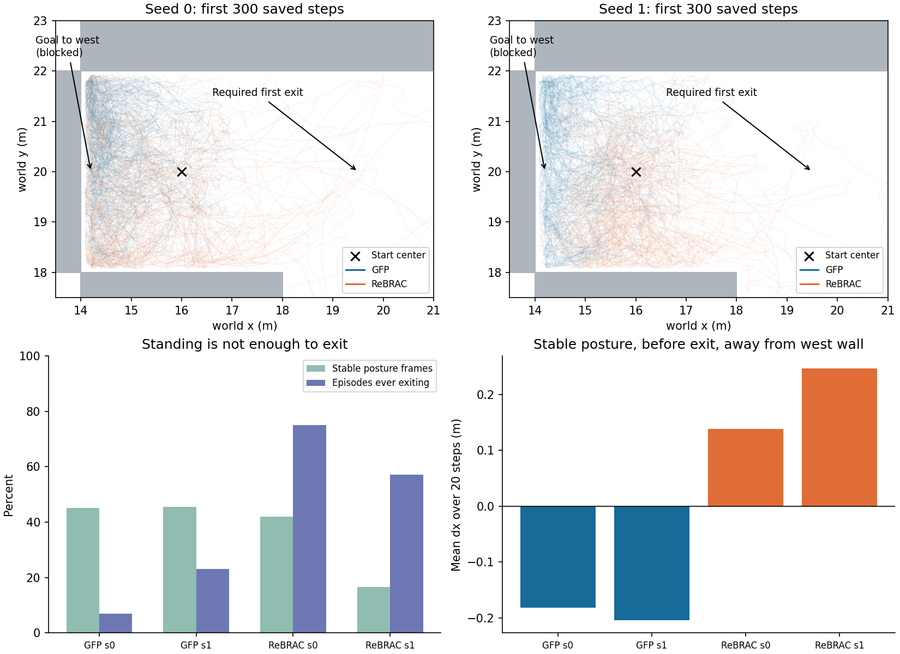

# task4 起点失败诊断：控制、方向与数据利用

2026-10-16（Asia/Taipei）。沿用 GFP-TASK4-BASELINE-PILOT-V1 分支，对已有资产追加只读诊断。未修改模型、超参数或任务；**新增训练 0，环境交互 0，模型调用 0**。Q/Guidance 全部复用此前已完成的 Z2 输出。

## 结论先行

最明确的失败模式是：**GFP 通常能恢复站立，却偏向朝目标直线方向移动，进入西侧封闭边界附近；没有稳定利用先向东离开起点的通路。** 这比“完全站不起来”更符合观察，但还不能证明网络内部采用了直线规划，也不能把控制问题完全排除。

训练数据中确实存在向东离开和绕行样例。价值评分的局部空间关系也与这个错误运动方向相符；不过，**现有证据还不足以将首因锁定为 Critic、VaBC 或 Actor，更不支持单独归因 Guidance 权重筛选。**

## 三个问题的裁决

| 问题 | 证据 | 当前判断 |
|---|---|---|
| 因姿态/控制问题无法离开？ | 1M 的 200 个 GFP 回合均出现连续站立；站立比例不低于 ReBRAC；站立且离墙时仍向西移动 | 不支持“主要因为无法站立”；动作控制、恢复和贴墙失衡仍可能放大失败 |
| 向目标直线移动，没有先反向绕行？ | 起点唯一出口向东，而目标在西；97/100、94/100 回合先发生明显西移；站立片段仍有西移偏向 | **行为层面支持，是目前最清楚的定位**；无法从动作扭矩直接推断内部意图 |
| 数据有绕行但价值/行为学习没利用？ | 183 次向东离开；9 条训练轨迹从起点区域随后到达 task4 成功半径；模型却大多滞留 | 有可利用样例，策略未稳定复现；完整路线覆盖仍少，尚不能区分价值与行为学习责任 |

## 1. 数据、方法与几何约束

读取全部现有 matched：GFP/ReBRAC、seeds0/1、800k/900k/1M，共 **1,200 条完整轨迹**，逐文件 SHA 与旧评价回执一致。主要表格使用 1M 每模型 100 回合，其余检查点用于粗粒度复验；没有挑选少量视频代表整体。

OGBench1.1.0 源码确认观测索引：xy=0:2、头高=23、躯干竖直分量=38、质心速度=39:42。初始化姿态本来随机，早期低姿态不能自动算失败。描述性站立门槛为头高≥1.2m 且 torso_zz≥0.7，连续20帧用于首次站立时刻；另检查头高1.0/1.4、torso_zz0.5。这不是官方成功/终止标准。

起点格 (6,5) 中心 (16,20)，目标中心 (0,20)。西侧 x=14 是墙，东侧 x=18 通往唯一可行邻格 (6,6)。因而初始正确绕行需要 **+x**，直线靠近目标是 **−x**。x≤14.75 仅定义“西墙附近”，保存轨迹没有接触力信息，不能把它直接写成碰撞。

## 2. 身体能否恢复，恢复后朝哪里移动？

| 方法 | 种子 | 曾连续站立 | 曾离开起点格 | 站立帧比例 | 前100步净Δx(m) | 离墙且站立的20步Δx(m) |
|---|---|---|---|---|---|---|
| GFP | 0 | 100/100 | 7/100 | 45.2% | -1.28 | -0.182 |
| GFP | 1 | 100/100 | 23/100 | 45.4% | -1.24 | -0.204 |
| ReBRAC | 0 | 100/100 | 75/100 | 42.0% | -0.26 | 0.138 |
| ReBRAC | 1 | 97/100 | 57/100 | 16.5% | -0.17 | 0.247 |

最后一列：首次离开起点前，每20步取不重叠片段，要求整段满足姿态门槛，且片段起点 x>14.75；先在每回合内平均，再按回合等权平均。GFP seed0/1 有95/98个回合符合条件，ReBRAC为95/83个；它是条件描述比较，不是随机干预。

- GFP 首次连续站立时刻的中位数为 **48、42.5 步**。两种子站立帧比例 **45.2%、45.4%**，并非一直倒地；ReBRAC为42.0%、16.5%。在全部六种姿态阈值组合下，GFP站立占比也没有更低。
- GFP 两种子各 **99/100** 回合出现从初始位置向西≥0.75m；**97/100、94/100** 回合先西移，再东移或始终未明显东移。
- 从首次站立开始再观察50步，GFP平均 Δx 为 **−0.432、−0.542m**；ReBRAC为 **+0.055、+0.747m**。该50步窗口不要求全程站立；上表的严格站立片段进一步支持方向差异。
- GFP 在西墙附近的逐回合平均时间占比为 **67.9%、62.8%**；对站立时刻单独计算，仍为 **78.5%、69.7%**。这削弱“只是跌倒后被动留在原地”的单一解释。
- 800k/900k/1M 的六组 GFP 结果均出现前100步向西约1.24–1.43m，且所有回合都曾连续站立；该方向模式不是只见于最后一个检查点。

姿态与路线仍可能相互作用：部分回合在站立前已西移，贴墙又可能增加失衡。因此本轮确定的是可重复的错误运动偏向，不能声称已经排除低层控制的因果作用。

## 3. 绕行数据是否真的存在？

训练数据起点格有 **37,929个有效状态转移、177条轨迹**，实际离开该格的183次记录全部进入东侧可行邻格；验证集为4,859个转移、24条轨迹、26次向东离开。训练数据起点区的站立比例41.6%，不是只有理想直立姿态。

进一步按原始轨迹边界检查：训练集有 **9条不同轨迹** 曾进入起点格，之后在同一条轨迹内进入 task4 目标0.5m半径；验证集有 **1条**。因此不仅存在单次向右动作，也存在完整绕行到目标的记录。数量不多，不能据此宣布目标相关数据覆盖充分，也不能用网格占据代替姿态/速度/历史的覆盖验证。

这些轨迹由变化的采集目标产生。未来100步向东进展只用于筛查关联，**不是对当前单个数据动作的真实长期优势标注**；数据动作与模型候选动作没有在相同完整模拟器状态下作回放比较。

## 4. 价值学习还是行为学习？证据到哪一步

复用 Z2 的原分布256样本批次及原归一化，提取起点格数据，不重新计算分组归一化。对1M验证样本，未来100步向东>0.75m的388个样本，其平均 Guidance 为 **0.419/0.441**；向西<-0.75m的97个样本为 **0.457/0.442**。原始差在一个种子存在、另一个几乎没有。

控制xy、头高、躯干竖直、vx/vy/速度，并做轨迹固定效应及200次轨迹簇 bootstrap 后，东向相对西向的 Guidance 系数：

| 种子 | 验证集系数 | 95%轨迹簇区间 |
|---|---:|---:|
| 0 | −0.0557 | [−0.1657, +0.0433] |
| 1 | −0.0058 | [−0.0918, +0.0684] |

训练集两种子区间也跨零。**不能据此认定 Guidance 稳定压制了有效绕行动作。** 小样本、采集目标和剩余状态混杂意味着这也不是“证明没有问题”。

更值得留意的是局部价值地形：在起点格，控制上述姿态/速度、y和轨迹因素后，数据动作的 target Q 随x增大而降低。验证集两种子的 x 系数为 **−1.67、−1.40 Q/m**，区间分别约 [−1.91,−1.27]、[−1.62,−1.09]；训练集也均为负。这与“向西接近目标但走向墙”的运动偏向同向，提示**拓扑绕行与局部价值评分之间可能不一致**。

但这是自然数据上的条件关联，**不是固定身体状态/固定动作的 Q 偏导，不是同状态动作排序错误的证明**。数据动作、采集目标和身体状态仍有未控制差异；Critic 也可能只是在反映当前容易失败的策略。Actor失败导致价值偏低与价值误导Actor，目前无法定向区分。

同一批向东进展数据，Actor 与 VaBC 相对数据动作的平均L2约为1.65与1.63–1.64，不能据此判定VaBC掌握了有效动作而Actor蒸馏失败：21维动作尺度、随机多模态及策略改进目标都妨碍这种解释。没有新增VaBC执行评价，不将动作相似度当动作有效性。

## 5. 下一步与边界

目前最窄、证据最强的问题是：**在起点恢复站立后，为什么策略继续向西侧封闭边界运动，而不能稳定选择向东的起始绕行？** 首要候选是价值拓扑/动作选择与行为学习的耦合，而非直接加记忆、规划或温度模块。

要区分 Critic 排序错误与 Actor/VaBC 不生成有效动作，下一项最有价值的检查是同完整状态下比较候选动作及其受控后续结果。**本轮不执行这项干预。** 当前 task4 matched 文件仅保存69维观测、动作、奖励与成功标记，没有完整 MuJoCo 状态和接触/求解器状态；不能从这些观测声称精确恢复模拟器。后续若获批准，需要先验证完整状态捕获/恢复，并保持首动作之后的策略与随机序列一致。

本轮已完成三项原因筛查，停止于可支持的证据边界。所有分析CPU执行，0新模型调用、0新GPU实验、0参数更新、0环境步；未改旧权重、原评价、冻结配置或任务规则。原始1,200条轨迹SHA全部复核。完整摘要、逐回合数据、阈值、条件回归及代码与本报告同目录归档。

分支：[codex/gfp-task4-baseline-pilot-v1-20261015](https://github.com/rollinpioneer/graph/tree/codex/gfp-task4-baseline-pilot-v1-20261015)。本轮为已有实验卡的分析续篇；提交身份见推送回执。
