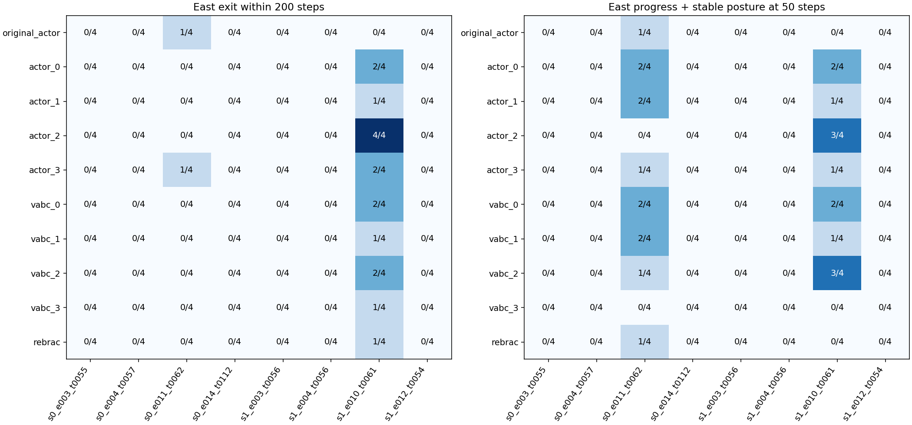
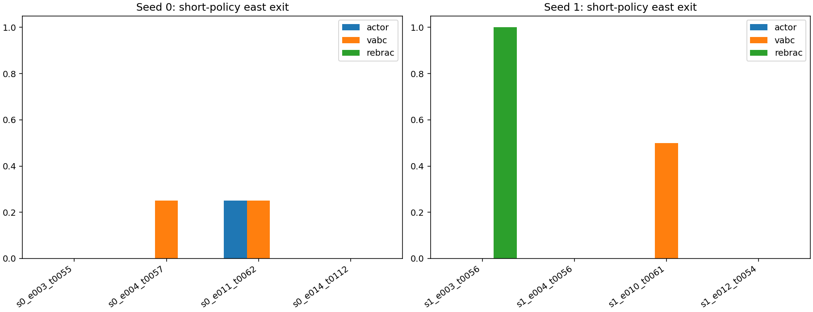

# task4 同状态动作生成与价值评分诊断

2026-10-16（Asia/Taipei）。**结论：DIAGNOSE。已确认一个状态存在可重复的替代首动作收益，但不支持把起点失败统一归因于 Critic 低估有效动作，也不足以宣称普遍的动作生成缺陷。**

## 执行与可信度

- 原 GFP、原 ReBRAC，task4、seeds0/1、1M 冻结权重，OGBench1.1.0，原配置与float32不变。
- 干预前提交协议与状态名单：`033d4cd10afec8e777a0de6871d1538085440d2e`。按回合编号选前4个合格回合/种子，不参考候选效果或最终成功。200回合中48个符合资格，选定8个状态，时刻54–112步；它们不是所有失败状态的随机样本。
- 资格：连续20帧头高≥1.2m、躯干竖直≥0.7；当前x∈[15,17.5]、y∈[18.5,21.5]；此前未离开起点格、未进入西墙邻域x≤14.75。
- **8/8完整状态恢复通过**：保存完整MuJoCo MjData、积分状态、目标、包装器与随机状态；从序列化状态恢复后100步的观测、qpos、qvel、动作最大差均为0，奖励/终止/截断一致。还核对了原始评价轨迹和动作，未用69维观测代替模拟器状态。
- 共**384条分支**：320条仅替换首动作，64条短时策略替换。各最多200步，均完成。所有候选、4条共同随机序列预先固定，没有根据结果增补。
- **参数更新0**。两工作进程真实退出码均为0，模型/优化器/Agent随机状态摘要与旧checkpoint哈希前后不变；384份分支文件哈希已核验。

## 一、只换首动作：重复收益集中在一个状态

每状态候选：原Actor动作1个、额外Actor4个、VaBC4个、ReBRAC1个。第二步起全部由原GFP接续，同状态内共用4条后续随机序列。

下表数字为4条配对序列中，200步内**曾向东跨出起点格**的次数。Actor/VaBC列给出预先生成的4个候选中的最大次数，是**候选集事后上界**，不是已经实现的选动作策略或总体成功率。完整10候选结果见图和JSON。

| 状态 | 原Actor | Actor候选最高 | VaBC候选最高 | ReBRAC首动作 |
|---|---:|---:|---:|---:|
| s0_e003_t0055 | 0/4 | 0/4 | 0/4 | 0/4 |
| s0_e004_t0057 | 0/4 | 0/4 | 0/4 | 0/4 |
| s0_e011_t0062 | 1/4 | 1/4 | 0/4 | 0/4 |
| s0_e014_t0112 | 0/4 | 0/4 | 0/4 | 0/4 |
| s1_e003_t0056 | 0/4 | 0/4 | 0/4 | 0/4 |
| s1_e004_t0056 | 0/4 | 0/4 | 0/4 | 0/4 |
| **s1_e010_t0061** | **0/4** | **4/4** | **2/4** | **1/4** |
| s1_e012_t0054 | 0/4 | 0/4 | 0/4 | 0/4 |

预定“至少3/4序列获益、原动作至多1/4”的描述性门槛只在 **1/8状态** 达到：

- `actor_2`：4/4曾离开；50步内向东≥0.5m且站立比例≥0.5为3/4，原动作为0/4。
- `vabc_2`：上述50步进展指标3/4，曾离开2/4，原动作为0/4。
- 必须保留持续性限制：`actor_2`虽然4/4曾跨出，但到200步末只有2/4仍在起点格外；首次离开为54、80、82、186步，其中3/4分支曾在站立状态下离开。其余2条发生退回。这里不是4/4完成绕行或任务成功。
- 对退出持续性的补充统计是事后描述，未替换原冻结的“曾离开”主指标。全部分支均未完成整个task4任务；200步局部诊断本来不以任务成功为唯一标准。

这支持“某个冻结状态下已有可执行的有用首动作未被原采样执行”，**尚不支持这种现象在多数起点失败状态中稳定存在**。其余状态的有限候选失败，也不能证明整个动作分布没有好动作；后续原GFP控制还可能消除首动作收益。

## 二、Critic：关键有效候选没有被打成更低分，但排序仍不理想

在唯一达到重复收益门槛的 `s1_e010_t0061`：

| 候选 | 在线Q均值 | 相对原动作ΔQ | 200步曾离开 |
|---|---:|---:|---:|
| 原Actor | −181.88399 | 0 | 0/4 |
| Actor actor_2 | −181.83803 | +0.04596 | 4/4 |
| VaBC vabc_2 | −181.81349 | +0.07050 | 2/4 |
| 全候选最高Q：vabc_3 | −181.75214 | +0.13184 | 1/4 |

`actor_2`在线两个Critic成员相对原动作均更高（+0.07187、+0.02005），`vabc_2`也均更高（+0.09064、+0.05035）。Target Q的差也为正（分别+0.05992、+0.08599）。因此，**本次最明确的有效候选并未遭到Critic一致低估至原动作之下**。

但不能由此说Critic已经正确：最高Q的`vabc_3`只有1/4离开；只在四个Actor候选中按Q挑选也会选`actor_0`（2/4），而非`actor_2`（4/4）。两者的差距都很小，且这里检验的是200步局部运动，不是长期Q真值。现有证据只能说**局部运动效果与评分排序不完全一致**，不能确认长期价值排序错误。

原GFP执行时只从已学Actor采样一次，不会在线生成多个动作再按Q择优。因此“好候选存在而未执行”不是代码漏调了一个择优函数；它可能涉及学习后分布、随机采样与价值/模仿约束之间的关系。本轮没有证明哪种训练机制导致了它，也没有验证best-of-N能改善完整任务。

## 三、连续更换策略：与首动作干预分开解释

下表是从相同完整状态连续由VaBC或ReBRAC控制200步。GFP列复用原Actor首动作加GFP后续的对照，不重复运行。

| 状态 | GFP原对照 | VaBC连续控制 | ReBRAC连续控制 |
|---|---:|---:|---:|
| s0_e003_t0055 | 0/4 | 0/4 | 0/4 |
| s0_e004_t0057 | 0/4 | 1/4 | 0/4 |
| s0_e011_t0062 | 1/4 | 1/4 | 0/4 |
| s0_e014_t0112 | 0/4 | 0/4 | 0/4 |
| s1_e003_t0056 | 0/4 | 0/4 | 4/4 |
| s1_e004_t0056 | 0/4 | 0/4 | 0/4 |
| s1_e010_t0061 | 0/4 | 2/4 | 0/4 |
| s1_e012_t0054 | 0/4 | 0/4 | 0/4 |

ReBRAC在`seed1/episode3`能离开，而它的单个首动作接GFP后续为0/4：该状态存在可行的多步控制过程，收益不能归于其首动作。**ReBRAC temperature=0为确定性控制，四条重复为相同轨迹，只提供一个确定性可行过程，不是四份独立随机证据。** GFP虽传temperature=0仍采样噪声，不能把它也视为确定性。

在4个状态（s0_e003、s0_e014、s1_e004、s1_e012），所有本轮首动作与短时策略分支均未离开。这只支持保留身体动量、姿态细节、局部控制和覆盖不足等解释，不证明物理上不可离开。头高/躯干达到门槛不等于完整身体状态已相同或容易控制。

## 四、对四种机制判断的裁决

| 候选解释 | 本轮证据 | 裁决 |
|---|---|---|
| Actor/VaBC没有生成有效东向动作 | 仅1个状态有重复首动作优势；另外1个状态ReBRAC连续控制可行，但其单首动作无效 | 不能由有限候选宣判整个分布缺动作；保留多步控制/行为学习解释 |
| 有效候选被Critic低估，导致失败 | 关键有效候选均高于原动作；更高Q候选却不一定有更好局部效果 | 不支持单一“低估有效动作”解释；排序可靠性仍未证实 |
| 候选有效且评分高，但原执行未利用 | 在s1_e010_t0061有直接配对证据 | **局部支持，限1个状态、1个训练种子；未升级为普遍缺陷** |
| 身体状态/局部控制/数据覆盖限制 | 4状态所有已测分支无出口，部分连续控制恢复差；另有状态可被替换策略带出 | 保留，不能仅凭站立阈值排除 |

下一步仍应停留在生成、选择与多步控制的区分上。当前不支持直接进入动态Guidance、新Critic或其他模块训练；不自动扩大状态、随机种子或回放数量。若继续，需对唯一有重复收益的状态做独立候选复验，避免把本轮候选集事后最好当作可部署策略。

## 工程回执与成本

- 初次预检因目标坐标为tuple而快照代码调用`.copy()`退出，两真实退出码1；修正为保存其数组副本，未改变环境目标、模型、状态名单、容差或候选。旧代码与失败回执保留于`attempts/goal_tuple_error`，诊断修正记录见`IMPLEMENTATION_CORRECTION.md`。
- 首次失败消耗191步计入总预算。总物理环境步 **79,424 / 90,000**，其中对外step调用79,024，reset内部400；包括回放、恢复验证和全部分支，无隐瞒重算。
- 修正后两进程各约209、214秒（含等待准入门禁），CPU用户+系统合计约207秒；两次失败进程墙钟另共44.7秒。模型推理进程驻留合计约0.13小时，仅作为含等待的成本记录，**不是独占GPU忙时**。运行在GPU1/7，采样显存各约0.7GB，非连续峰值测量；RSS峰值各约1.36GiB。
- 完整状态8份、分支轨迹384份及完整日志留服务器；Git只归档代码、协议、配置、指标、图、身份/退出/恢复/成本回执及哈希索引。没有停止其他任务。
- 根目录：`/home/xushijie3/work/gfp_task4_same_state_v1_20261016`。
- 分支：[codex/gfp-task4-same-state-v1-20261016](https://github.com/rollinpioneer/graph/tree/codex/gfp-task4-same-state-v1-20261016)。最终提交身份见`receipts/latest_push.json`。
