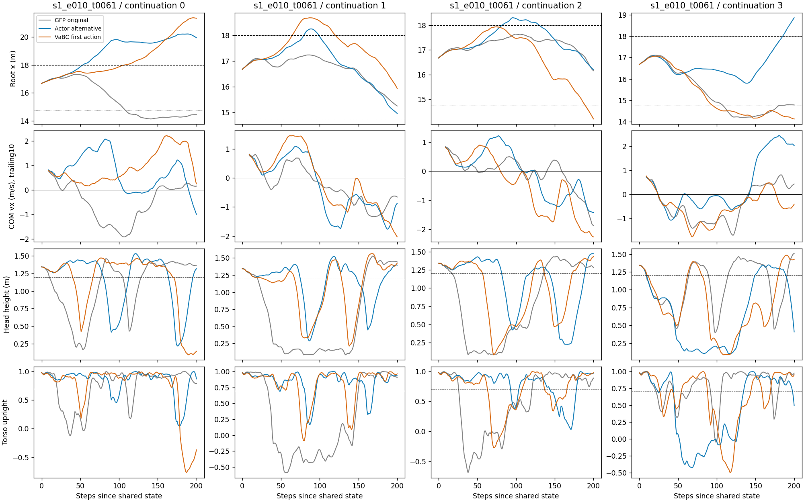
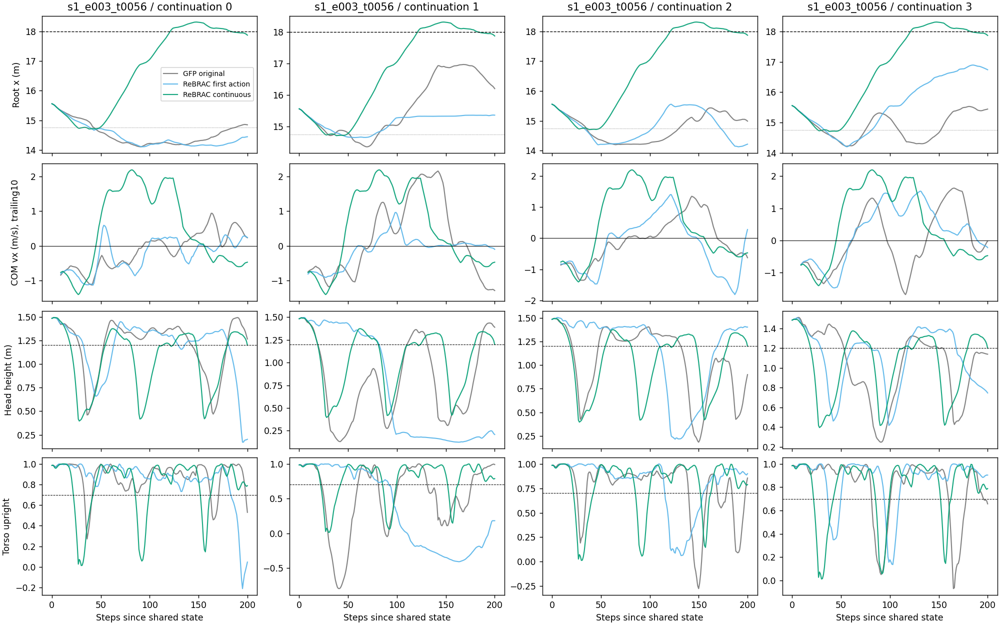

# task4：有利首动作之后，控制能否维持进展？

2026-10-16。**结论：值得继续区分后续控制，但尚未建立“动作时间组织有缺陷”的解释。两例都说明“曾离开”明显弱于“持续在外”；ReBRAC 连续控制的那条轨迹也在第183步退回。**

本轮只读取已有384条分支中、两个指定状态对应的全部96条，重点比较28条时间序列。没有生成新动作、加载模型或调用模拟器；新增环境步、参数更新均为0。来源提交为 `0fad5452a634a602b6c2fe7510ec5d612fb5ddfe`，96份轨迹的SHA-256与原索引一致。

## 口径

- 下文 `h` 从已保存的完整状态算起：`h=0`；动作 `a[h]` 产生下一帧。每步0.025秒，200步只覆盖5秒。原回合时刻分别为 `61+h`、`56+h`。
- 离开/退回按根节点是否在起点格判断；这几条实际穿越的是东侧 `x=18m`。跨线不表示全身已经通过、完成绕行或任务成功。
- “持续西移”指COM水平速度低于−0.1m/s连续至少10帧；“低姿态”指头高<0.6m或躯干竖直分量<0.3，连续至少10帧。站立描述仍用头高≥1.2m且竖直分量≥0.7。这些是本轮事后描述性阈值，不是跌倒的因果判定。
- 配对分支使用同一保存初态与后续策略随机序列。只换首动作的分支从第二个动作起均由原GFP控制；状态开始分歧后，后续动作不同不表示又更换了策略。

## 1. s1_e010_t0061：初始东移可重复，持续性并不稳定

固定候选 `actor_2` 相比原动作的优势得到保留：原动作四条均未离开，替代首动作四条均曾离开。但事件顺序不同：

| 后续序列 | 首次离开h | 离开后低姿态区间 | 离开后持续西移起点h | 首次退回h | 200步末 |
|---|---:|---|---:|---:|---|
| 0 | 54 | 88–101；172–187 | 103 | 未观察到 | x=19.955，在外 |
| 1 | 80 | 83–95 | 95 | 99 | x=14.965，在内 |
| 2 | 82 | 91–102；154–177 | 124 | 131 | x=16.202，在内 |
| 3 | 186 | 离开后无连续10帧低姿态 | 未观察到 | 未观察到 | x=18.866，在外 |

序列1、2分别只在外维持约 **0.475秒、1.225秒**。两条都先出现低姿态，再转入持续西移；但不能据此把低姿态认定为根因：序列0也有低姿态和西移，却因已深入东侧而没有退回。序列3曾在45–134步持续处于低姿态，后来恢复东移，在186步才跨线，跨线后只观察了 **0.35秒**。因此，末尾在外的2/4也不能解释成2/4已稳定维持方向。

退回并非仅仅记录了倒地后的被动位移：序列1在109–147步恢复站立阈值时仍持续西移；序列2在118–143步满足站立阈值，其中124步起持续西移，131步退回。序列1转向前后没有墙接触；序列2退回前20步约29%的帧有墙接触。因此，“再次西移”是共同现象，但墙碰撞不是两条共同的必要条件。

相对配对原动作，替代分支首次持续20帧保持至少0.5m的东侧位置优势，分别从 **49、63、79、70步** 开始。后续关节动作差异更早出现：按每关节RMS差≥0.2持续20动作的描述阈值，起点为 **5、6、5、20步**。这是同一GFP对已分歧状态的响应，不能据此宣布动作抖动或蒸馏失败。

动作变化也没有支持一个简单的“离开后突然更抖”解释。序列1、2离开前/后20步的相邻动作变化RMS均值分别为 **0.447→0.327、0.565→0.367**，同期头高均值却分别从 **1.261→0.514m、1.353→0.682m** 降低。这里的动作指标只描述关节控制变化，不把动作向量正负当作地图方向。

VaBC首动作 `vabc_2` 提供一致的辅助现象：序列1在65步离开、75步起出现持续低姿态、97步开始持续西移、121步退回；另一个离开分支在107步离开且末尾仍在外。它没有消除“后续能否保持进展”的问题。

## 2. s1_e003_t0056：差异来自后续过程，但连续ReBRAC也没有持续留在外面

只用ReBRAC首动作后交回GFP：四条均没有离开。连续ReBRAC：四份保存结果完全相同，包括观测、动作、qpos和qvel；因此只算 **一条确定性轨迹**，不是四次独立成功。

连续控制与“只换ReBRAC首动作”的首动作和第一步后观测逐元素一致。后续控制过程才发生变化：

| 阶段 | 连续ReBRAC的实测过程 | 含义 |
|---|---|---|
| 0–38步 | COM持续西移；26–41步有低姿态 | 它也不是从起点立即向东、始终站稳 |
| 39–143步 | COM持续向东；55–80步恢复站立阈值 | 形成一段较长的东向运动 |
| 50–100步 | 根节点向东2.273m，平均COM vx=+1.738m/s | 同序列0原GFP西移0.377m，平均vx=−0.315m/s |
| 122步 | x=18.044，首次跨出起点格 | 离开前20步平均vx=+1.852m/s |
| 156步起 | 开始持续西移；170–200步再次持续西移 | 连续ReBRAC自身也未保持东向运动 |
| 183步 | x=17.997，退回；头高1.320m、竖直0.996 | 退回时身体已满足站立阈值 |
| 200步 | x=17.871，在起点格内 | 在外仅约1.525秒；全程没有墙接触 |

相对原GFP，持续东侧位置优势最早在 **51–57步** 出现（≥0.5m并维持20帧）。更严格地与“相同ReBRAC首动作、随后GFP”配对，东侧位置优势出现在 **47–60步**，东向速度优势出现在 **35–48步**（≥0.5m/s并维持10帧）。所以差异主要在离开前约40–60步已形成，不是在122步跨线时才出现。

连续ReBRAC在50–100、100–150步的相邻动作变化RMS均值约 **0.290、0.300**；同序列0原GFP为 **0.469、0.449**。但两种策略的随机性、动作质量与所处状态都不同，较平滑只是伴随现象，不能归因于平滑机制或时间建模。此处没有识别出哪个关节动作或哪一小段控制是必要原因。

## 3. 研究裁决与下一步边界

| 判断 | 本轮裁决 |
|---|---|
| 一次有利首动作足以保证持续离开 | 不支持；既有4/4曾离开仅2/4末尾在外，且一条跨线后观察很短 |
| 后续控制过程值得检查 | 支持；同一ReBRAC首动作后，后续策略不同会形成明显不同的运动过程 |
| ReBRAC持续控制已经解决方向保持 | 不支持；同一确定性分支在183步退回 |
| 起点问题只是无法站稳 | 不足以解释；部分西移/退回发生在满足站立阈值期间，姿态仍是竞争解释 |
| 动作分块、时间建模不足已获证明 | 不支持；尚未排除策略动作质量、状态依赖和随机性等解释 |
| 是否值得批准极小接管长度实验 | 值得，用来区分需要持续提供控制还是只需短暂改变状态；现有只读数据不能确定必要时长 |

**当前状态：DIAGNOSE。** 若另行批准，可在这两个固定状态比较接管1/10/50/100步后全部交回GFP，继续配对既定后续随机序列。必须同时报告首次离开、200步末是否仍在外、离开后停留时间及姿态；原有连续200步ReBRAC作为已有对照。长度增加带来收益也不能自动解释为时间建模机制，可能只是更久使用了更好的动作。本轮没有新建或运行这些分支。

本轮局限：两个事后指定状态均来自训练seed1；四条共同随机序列不是四个训练种子。没有全任务新成功率、显著性推断或长期Q真值结论。全部既有分支的全任务成功仍为0。本报告是对原报告“曾离开”的持续性补充，不改写既有评价结果。

## 交付与回执

- 主分析：约3.86秒墙钟、8.68秒CPU、114MiB峰值RSS；另有轻量只读检查与分段整理，分段成本见 `phase_receipt.json`。GPU计算0，模型推理0，环境交互0，参数更新0。
- `branch_events.json`：96分支事件与窗口指标；`paired_divergence.json`：配对差异时刻；`phase_intervals.json`：连续运动/姿态区间；`same_first_action_comparison.json`：相同首动作验证；`focal_timeseries.csv`：28条重点时间序列。
- `receipt.json`保留96份源文件路径、大小与SHA-256；原始完整轨迹留服务器，不写入Git。
- 服务器结果：`/home/xushijie3/work/gfp_task4_same_state_v1_20261016/reports/continuation`。
- 沿用分支：[codex/gfp-task4-same-state-v1-20261016](https://github.com/rollinpioneer/graph/tree/codex/gfp-task4-same-state-v1-20261016)。
