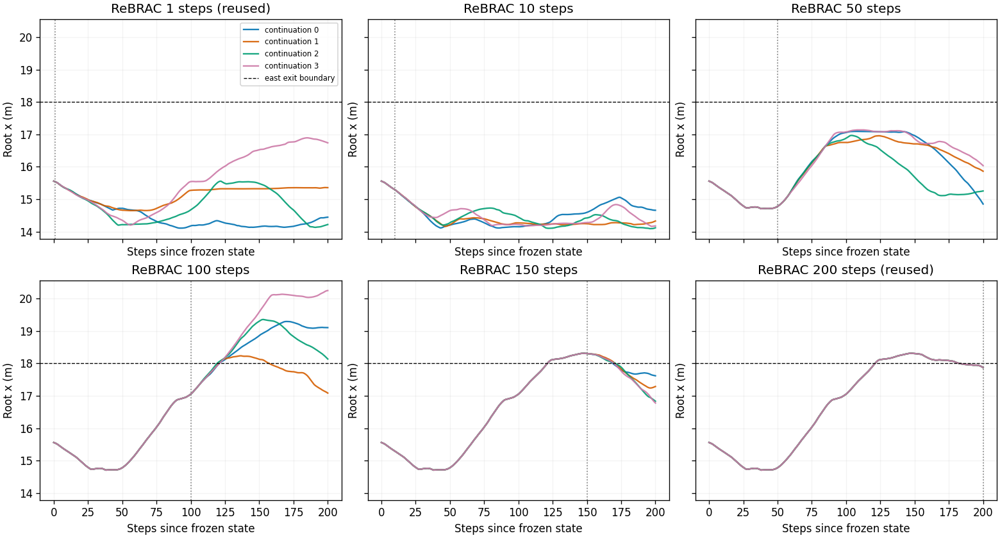
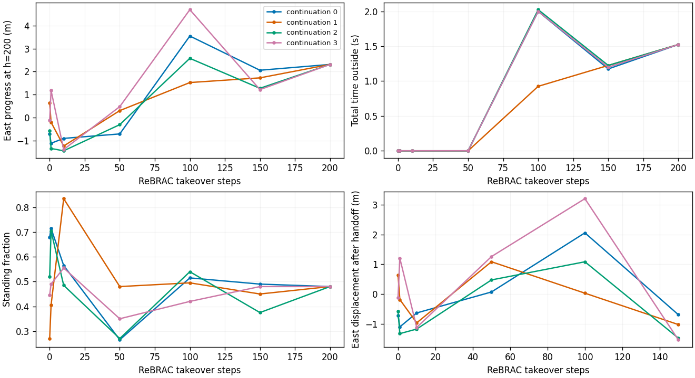

# GFP task4：接管长度诊断

2026-10-16。**完成16条新增分支。100步接管在这个固定状态上有明确局部收益，但150步与200步更差，结果不支持“接管越久越好”。结束本轮个例实验；没有启动训练或追加状态。**

## 结果

状态 `s1_e003_t0056`；原GFP/ReBRAC seed1、task4、1M冻结模型。每条从相同完整状态开始，总长200步（5秒）。仅新增L=10/50/100/150各4条；L=1及200、原GFP对照直接复用。GFP的后续随机键按全局h对齐，没有从交接时重新起算。

| ReBRAC接管长度 | 曾离开起点格 | 200步末仍在外 | 首次离开h | 首次退回h |
|---|---:|---:|---|---|
| 0，原GFP（复用） | 0/4 | 0/4 | — | — |
| 1（复用） | 0/4 | 0/4 | — | — |
| 10 | 0/4 | 0/4 | — | — |
| 50 | 0/4 | 0/4 | — | — |
| **100** | **4/4** | **3/4** | 121、121、120、121 | 未观察到、158、未观察到、未观察到 |
| 150 | 4/4 | 0/4 | 均122 | 169、171、171、170 |
| 200（复用） | 1条唯一轨迹曾离开 | 0/1 | 122 | 183 |

200步ReBRAC的四份存档逐元素相同，只算一条确定性轨迹。150步组的首次离开发生在交回GFP之前，四条共享相同ReBRAC前缀，不能把它写成四次独立的GFP成功。100步组则都在交回GFP约20–21步后离开。

## 100步的收益有多持久？

起点x=15.558m，东侧出口x=18m。以下全部是局部位移，非完整任务成绩。

| 后续随机序列 | 第200步x | 相对初态东移 | 交回后东移 | 首次离开后在外时长 | 交回后站立比例 |
|---|---:|---:|---:|---:|---:|
| 0 | 19.106m | +3.547m | +2.054m | 至少1.975秒 | 59% |
| 1 | 17.084m | +1.526m | +0.033m | 0.925秒，随后退回 | 55% |
| 2 | 18.136m | +2.578m | +1.085m | 至少2.000秒 | 64% |
| 3 | 20.250m | +4.692m | +3.198m | 至少1.975秒 | 40% |

“至少”表示观察在200步截止，未延长追踪。序列2末尾只超出边界约0.136m；序列3交回后的站立比例低于一半，末尾头高1.104m，也未达到站立阈值。**因此3/4末尾在外，不等于3/4稳定站立完成绕行。** 同时满足“末尾在外、交回后净东移非负、站立比例≥50%”的为2/4。

冻结卡的分项描述门槛为末尾在外≥3/4，且交回后净东移非负并站立比例≥50%的分支≥3/4。L=100达到这个分项门槛；两组分支的交集只有2条，报告同时保留这一更严格的联合指标，不用分项门槛掩盖姿态限制。

L=150在交回后19–21步全部退回；交回后的净东移分别为 **−0.688、−1.019、−1.473、−1.529m**，站立比例46%、30%、0%、42%。首次在外时长只有1.175–1.225秒。持续ReBRAC至200步也在183步退回，在外1.525秒。

`branch_metrics.csv/json`完整保留全部28份新旧轨迹的10/20/50/100/150/200步位移、首次离开/退回、总在外时间、姿态、墙接触、成功和Return。所有分支完整任务成功均为0，不构造新的总体成功率。

## 为什么不能解释成“时间建模缺陷”？

接管长度同时改变了交回GFP时的身体状态、位置与动量：

| 交回时刻 | x | COM向东速度 | COM南北速度 | 头高 | 躯干竖直分量 |
|---|---:|---:|---:|---:|---:|
| 10 | 15.288 | −0.784m/s | −0.916m/s | 1.440m | 0.998 |
| 50 | 14.779 | +1.672m/s | +0.022m/s | 0.993m | 0.993 |
| 100 | 17.052 | +1.114m/s | +0.461m/s | 0.766m | 0.754 |
| 150 | 18.306 | +0.040m/s | +1.756m/s | 1.032m | 0.845 |

100步交回时仍有明显东向速度；150步时已越过边界，但东向速度接近0，运动主要沿另一轴。这提供了“交接状态/运动阶段影响后续效果”的候选解释，**不是已确认的原因**。50步交回时也有较高东向速度却全部未离开，说明不能只用一个速度量解释结果；100步状态头高反而更低，也不能简化为“站得更高就更好”。

原GFP在同一初态的四条都未离开；只换一次ReBRAC动作也都未离开。100步组在配对随机序列下确实改善了本状态的局部进展。与此同时，150/200步的结果反驳了简单的“持续ReBRAC越久越好”叙事；也不支持“交回GFP必然抹掉所有成果”，因为100步组三条到截断时仍在外。

## 本轮裁决

| 问题 | 裁决 |
|---|---|
| 持续使用一段ReBRAC是否比只用首动作有帮助？ | **本状态局部支持**：100步的4/4曾离开、3/4末尾在外，相比1步均为0/4 |
| 接管长度越长是否越有效？ | **不支持**：150与200步均未维持末尾在外 |
| 已证明GFP普遍缺少持续控制或时间建模能力？ | **没有**：一个事后选择的状态、一个训练种子、四条固定后续序列 |
| 是否继续追加这两个个例的随机分支？ | **停止当前局部诊断链**：此次预算已完成，不自动补状态或随机数 |
| 下一研究方向 | 转向task4整体数据支持、价值拓扑与行为学习之间的关系；先建立跨状态可预测且可反驳的假设，另行确定范围 |

局部事实的保留与研究路线的暂停并不矛盾：本轮得到一个非单调、依赖交接状态的局部改善，但没有定位模块级原因，不据此实现action chunking、自适应时间尺度或新Flow结构。

## 必要验证与成本

- 冻结协议提交：`939b1b9eaddcbd067c108eec2d9ef3178549b252`；在新增环境交互前推送并核验远端SHA。
- 20步恢复核验：观测、qpos、qvel、动作最大误差均0；奖励/终止/截断一致。16条新增分支的全部ReBRAC前缀与旧完整控制轨迹最大差均0。
- 旧模型/优化器/Agent RNG摘要及权重、完整状态、旧对照文件哈希前后不变；没有更新参数或优化器。原GFP/ReBRAC配置、OGBench1.1.0、MuJoCo3.3.5、JAX0.6.2及精度不变。
- **新增分支3,200步 + 恢复验证20步 + 初始化/reset内部80步 = 3,300个物理控制步**，对应16,500个MuJoCo积分帧，未把3,200冒充全部物理成本。
- 16/16正常结束，实际进程退出码0，无非有限值、恢复或哈希异常。没有重试或额外模拟分支。
- GPU1（A100）；工作进程总驻留约29.37秒，约0.00816 GPU进程小时，包含导入/编译/初始化/退出，**不是独占GPU忙时**。内部工作阶段21.85秒；CPU用户+系统约20.90秒；RSS峰值约1.30GiB；采样显存峰值680MiB，非连续峰值计量。只读分析和归档耗时另计，不计为训练。
- 原始16条数值轨迹：`/home/xushijie3/work/gfp_task4_takeover_length_v1_20261016/branches`。报告、指标、输入/输出哈希与资源/退出回执留在同根目录；重资产不进Git。
- 分支：[codex/gfp-task4-takeover-length-v1-20261016](https://github.com/rollinpioneer/graph/tree/codex/gfp-task4-takeover-length-v1-20261016)。
