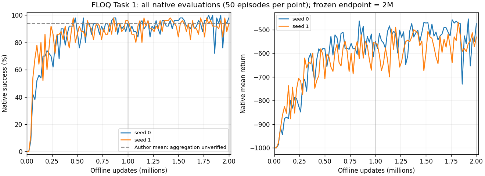

# FLOQ 性能与复现判定

**B — FUNCTIONAL_REPRODUCED**。两条完整训练产生有效策略；目前不能标 A，也没有按事后阈值标 C。

按看到结果前冻结的协议：主结果只用 2M 时点原生 50 回合。

| Seed | Updates | 成功回合 | Success | Return | Mean length |
|---|---:|---:|---:|---:|---:|
| 0 | 2M | 49/50 | 98.0% | -475.22 | 476.20 |
| 1 | 2M | 47/50 | 94.0% | -531.44 | 532.38 |

Success 等权均值 **96.0%**；总体标准差（ddof=0）**2.00 个百分点**；样本标准差（ddof=1）**2.83 个百分点**。Return 均值 -503.33，ddof0 28.11、ddof1 39.75。不是置信区间，也不足以证明跨种子稳健性。

预先固定作者参考为 arXiv 2509.06863v2 Table 2 Task1 的 floq-default 94±4%，3 seeds。[论文固定版本](https://arxiv.org/html/2509.06863v2)。作者检查点聚合窗口仍未核实，因此不能把本轮 96% 与其 94% 的差额称为提升、复现偏差检验或 Critic 效果。没有用五任务均值替代 Task1。

每条保留全部 101 点原生曲线、1M/2M 模型。`final/primary_results.csv` 是主表；`final/primary_episodes.csv` 保留两种子共 100 个 2M 回合的轻量记录；全 10,100 回合留服务器并建散列索引。训练中最高分和最后三个检查点平均均未替代本卡的 2M 主结果。

## 与 FQL 的描述性关系

旧 FQL 已完成每种子 1M，原生评价和所有十个 Matched 检查点均完整。FLOQ 每种子 2M；旧 FQL 主表聚合最后三检查点，本卡只用 2M；FQL 原生每 100k、本卡每 20k；旧环境/依赖与新卡作者环境存在差异。原始 NPZ 字节由只读链接复用，不能据此推断运行环境及评价 RNG 相同。

只读核验旧 FQL 实际参数：α10、batch256、lr3e-4、γ.99、τ.005、4×512 MLP、BC flow10、actor layer norm=false、critic layer norm=true；这些与本卡相应 Actor 配方一致。FQL 使用标量 TD Critic、Q=min，本卡增加 Flow/Target Flow/Scalar 蒸馏并使用 Q=mean；更新预算、聚合、评价 RNG、依赖仍是混杂因素。不能把分数差异单独归因于 Critic。

本 FLOQ 卡没有新增 Matched Evaluation；原生场景与旧 FQL/GFP 未对齐。旧卡的成绩和损失未复制到本卡 Git 分支，也未启动新的 FQL、GFP、Q-Flow 或模块替换训练。
