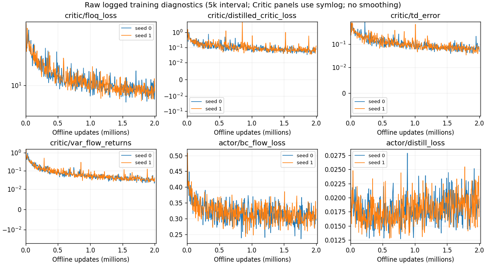

# FLOQ Baseline 研究准入

| 判断 | 本轮结论 |
|---|---|
| 工程运行成功 | 通过：两条 2M、exit0、有限损失、101×50 原生评价、1M/2M文件身份核验；P1恢复测试通过 |
| 论文成绩复现 H1 | 未确认：只执行两个种子、作者聚合窗口未核实，保持 B 标签 |
| 模块拆分 H2 | 通过静态接口及P1探针准入；未执行替换训练 |
| 新算法论文潜力 | 未验证；高分不能证明贡献、受控改动的有效性或新颖性 |

建议把 floq 作为研究 Flow Critic 的**有条件 Baseline**。适合保留已验证的 FQL 风格 Actor，把 Flow Critic + Target Flow Critic + Distilled Scalar Critic 及其损失/状态作为整体受控替换单元。是否比 FQL/GFP 更适合长期研究，仍取决于要检验的机制，不按本次分数自动推荐。

模块输入/输出、计算图和梯度关系详见 [CRITIC_INTERFACES.md](CRITIC_INTERFACES.md)。接口须保留 observation `[B,29]`、action `[B,8]`、Flow velocity `[2,B,1]`、Scalar Q `[2,B]` 和 Scalar Q 对 action 的导数；当前 encoder=None，不把低维验证泛化到视觉 encoder。

Flow 值的蒸馏目标固定，Actor Q loss 只经 action 回传，TD backup 不回传到 Actor/Target Flow。8 个 noise 的 Floq loss 先求和，不能换成全维均值；Target Flow 的 Polyak 读取更新前在线参数，保留原版一拍延迟。共同 ModuleDict/Adam 的参数树、优化器状态、bootstrap、噪声范围、ensemble聚合与 RNG 消费必须一并定义。单换 online Flow 而保留旧 target/读出会破坏状态一致性。

后续容易受控验证的失败假设：Flow return 噪声方差及 Scalar 蒸馏误差，使 Actor 的 Q 梯度偏离 Flow 价值。当前只保留 `var_flow_returns`、蒸馏 loss、TD error、Actor loss 的观察，没有直接比较 dQ/da、做干预或验证因果；不能声称该假设已证实。

已有 FLOQ 论文/代码已经包含 Flow Critic、Scalar 蒸馏、FQL BC/one-step Actor 组合，以及 t=0、Flow steps、noise coverage、time/return embedding、ResNet 等对照。直接复制这些改动不能作为原创贡献。与 Value Flows、GFP 或 FAN 的具体组合是否已有相同贡献，本卡没有完成文献差异核验，必须在下一研究决策中先核查，不能预先声称新颖。

未新增第二任务、种子、时长、超参搜索、Matched评价或模块替换训练；Q-Flow 仍 PAPER_REPRODUCTION_BLOCKED。全部已登记训练/评价结束后暂停监控；不自动扩大实验。
